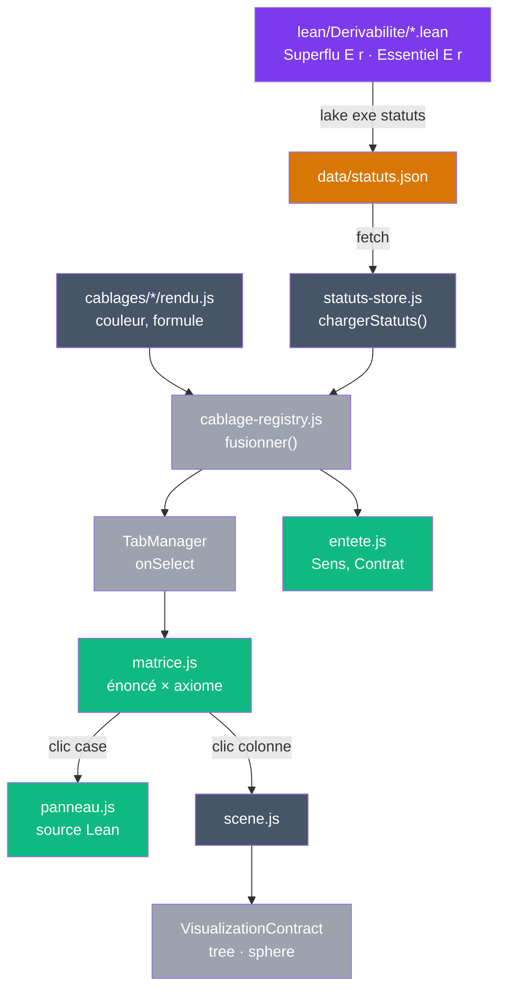

# V10 — Statuts de dérivabilité issus de Lean

> [Retour à l'index](../README.md) | [Proposition](../proposals/v10-statuts.md) | [Lean](../../lean/README.md)

`pythagore.html` + `style.css` + `data/statuts.json` + `js/`

- **Sens** — pour chaque câblage de Pythagore, ce que chaque axiome apporte vraiment : essentiel (contre-modèle), superflu (preuve qui s'en passe) ou non testé
- **Contrat** — `data/statuts.json`, produit par `lake exe statuts` ; chaque statut est un théorème Lean vérifié par le noyau
- **Ports** — onglets des câblages, clic sur une colonne (énoncé affiché dans le canvas), clic sur une case (panneau : source Lean), curseurs a et b (application numérique) ; sortie : matrice HTML + canvas

## Lancer

```bash
cd app && python3 -m http.server 8765
# ouvrir http://localhost:8765/10_statuts/pythagore.html
```

Régénérer les statuts après un changement Lean :

```bash
cd lean && lake build && lake exe statuts ../app/10_statuts/data/statuts.json
```

Vérifier :

```bash
cd app/10_statuts/tests && npm install && node verifier.mjs   # --lean : relance aussi l'export
```

## Circuit



## Ce qui change depuis V9

| V9 | V10 |
|----|-----|
| `cablages/*/axiomes.js` : axiomes et poids écrits à la main | axiomes, statuts, notes lus dans `data/statuts.json` |
| panneau gauche en canvas, tronqué | matrice HTML, défilante, lisible sur mobile |
| taille des cercles ∝ poids | style des nœuds et des arcs selon le statut |
| « trois axiomatiques » en dur | Sens et Contrat lus dans le JSON, nombre de câblages calculé |
| aucun lien vers une preuve | panneau : théorème, fichier, lignes, source, définitions et lemmes locaux |
