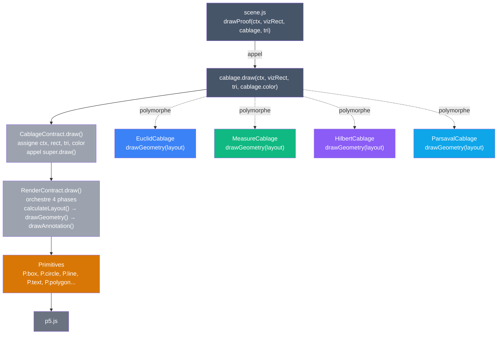
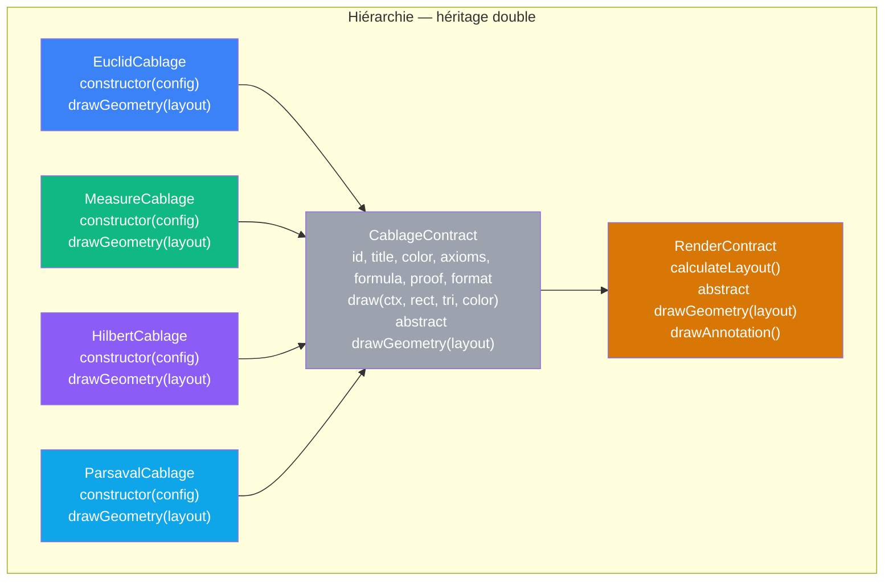
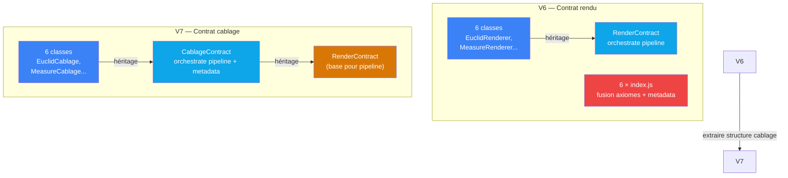

# V7 — Contrat de cablage explicite

> [Retour a l'index](../README.md)

`pythagore.html` + `js/cablage-contract.js` + `js/cablages/<nom>/rendu.js`

- **Sens** -- meme application que V6, mais la structure repetee des 6 cablages (axiomes + rendu + fusion) est extraite dans une classe abstraite `CablageContract`
- **Contrat** -- les 6 cablages heritent de `CablageContract` qui orchestre metadata + axiomes + rendu via orchestration uniforme. Seul `drawGeometry()` varie ; metadata et structure sont partagees
- **Ports** -- `CablageContract(config)` encapsule axioms, formula, proof, format, id, title, color ; chaque cablage spécialise `drawGeometry(layout)` pour sa geometrie

## Circuit complet



## Cablages — hiérarchie des classes



## Blocs (modules)

| Module | Sens | Contrat | Ports |
|--------|------|---------|-------|
| cablage-contract.js | **formalise la structure cablage** — metadata + axiomes + orchestration 4-phases commune | constructor(config), hérité de RenderContract | id, title, color, axioms, formula, proof, format (entrees) ; draw() (sortie) |
| cablages/euclid/rendu.js | classe `EuclidCablage` — specialize axiomes et geometrie euclidienne | `extends CablageContract` ; `drawGeometry(layout)` dessine carres | herite de CablageContract |
| cablages/measure/rendu.js | classe `MeasureCablage` — specialize axiomes et barres de mesure | `extends CablageContract` ; `drawGeometry(layout)` dessine barres | herite de CablageContract |
| cablages/hilbert/rendu.js | classe `HilbertCablage` — specialize axiomes et vecteurs | `extends CablageContract` ; `drawGeometry(layout)` dessine grille + fleches | herite de CablageContract |
| cablages/parseval/rendu.js | classe `ParsavalCablage` — specialize axiomes et diagramme commutatif | `extends CablageContract` ; `drawGeometry(layout)` dessine noeuds + fleches | herite de CablageContract |
| classifier.js, structure.js, primitives.js | inchanges | idem V6 | idem V6 |

## Comment ca marche

Comme V6, les 6 cablages heritent d'une classe abstraite `CablageContract` qui encapsule la structure commune. La difference : CablageContract orchestre non seulement le pipeline de rendu (herite de RenderContract) mais aussi la metadata (id, title, color, axioms, formula, proof, format).

Avant V7 (V6), chaque cablage avait 3 fichiers :
```
cablages/euclid/
  ├── axiomes.js       (export axioms, formula, proof, format)
  ├── rendu.js         (export draw function)
  └── index.js         (fusion des deux + metadata)
```

En V7, structure devient explicite dans la classe :

```js
class EuclidCablage extends CablageContract {
  constructor() {
    super({
      id: 'euclid',
      title: 'Preuve 1 — Geometrie euclidienne',
      color: '#3B82F6',
      axioms: axioms,
      formula: formula,
      proof: proof,
      format: format,
    });
  }

  drawGeometry(layout) {
    // Geometrie euclidienne specialisee
  }
}

export default new EuclidCablage();
```

Chaque cablage surcharge :
- Metadata dans constructor (via super())
- `drawGeometry(layout)` — la geometrie specifique

### Le saut : CablageContract IS le contrat des cablages

En V6, la structure etait *implicite* : "les 6 cablages exportent {id, title, color, axioms, formula, proof, format, draw}".

En V7, la structure est *explicite* : la classe `CablageContract` EST le contrat des cablages. Son constructor et ses methodes definissent exactement ce qui est commun vs. ce qui est specifique.

## Analyse sens / contrat / cablage

| Dimension | V6 | V7 |
|-----------|-----|--------|
| **Sens** | axiomes + rendu → cablage (structure implicite x6) | **axiomes + rendu → cablage via CablageContract** |
| **Contrat** | Chaque cablage exporte objet {id, title, color, axioms, formula, proof, format, draw} | **CablageContract formalise ce contrat via classe abstraite** |
| **Cablage** | 6 fichiers index.js identiques, convention implicite | **6 classes heritant CablageContract, orchestration explicite** |

### Benefices par rapport a V6

| Contrainte V6 | Solution V7 |
|---|---|
| `index.js` duplique x6 (fusion axiomes + rendu + metadata) | **centralise dans CablageContract constructor** |
| Pas visible que les 6 cablages font la meme chose | **héritage rend la structure explicite** |
| Ajouter un cablage = creer 3 fichiers + apprendre convention | **ajouter 1 classe + hériter CablageContract** |
| Metadata + axiomes + rendu couples sans interface claire | **CablageContract = interface uniforme** |

## Fichiers

```
app/7_cablages/
  pythagore.html                       (copie V6)
  ../proposals/v7-cablages.md          (lire avant : V7 design)
  js/
    cablage-contract.js                ← NOUVEAU (classe abstraite)
    render-contract.js                 (copie V6)
    primitives.js                      (copie V6)
    classifier.js                      (copie V6)
    structure.js                       (copie V6)
    scene.js                           (modifie : import rendu.js au lieu d'index.js, 4 cablages)
    main.js                            (copie V6)
    cablages/
      euclid/
        axiomes.js                     (copie V6)
        rendu.js                       ← Refactorise (classe EuclidCablage extends CablageContract)
      measure/
        axiomes.js                     (copie V6)
        rendu.js                       ← Refactorise (classe MeasureCablage extends CablageContract)
      hilbert/
        axiomes.js                     (copie V6)
        rendu.js                       ← Refactorise (classe HilbertCablage extends CablageContract)
      parseval/
        axiomes.js                     (copie V6)
        rendu.js                       ← Refactorise (classe ParsavalCablage extends CablageContract)
```

**Note** : Tous les `cablages/*/index.js` sont SUPPRIMES. Cablages algebre + algebre-inversion retires (V7 = 4 axiomatiques).

## Comparaison V6 → V7



| Métrique | V6 | V7 |
|----------|----|----|
| Fichiers JS | 18 | **18** (cablage-contract.js remplace 6×index.js) |
| Couches | 4 | **4** (identique, mais orchestration explicite) |
| index.js | 6 (dupliques) | **0** |
| Cablages testables isolément | 6 | **6** (mêmes, mais avec CablageContract injectable) |
| Structure cablage | implicite (convention) | **explicite (classe abstraite)** |

## Chiffres

| Métrique | V6 | V7 |
|----------|----|----|
| Fichiers cablage | 18 (3×6) | **12** (2×6) |
| Lignes cablage-contract.js | 0 | **50** |
| Lignes totales cablages/ | ~1650 | **~1350** |
| Duplication | 6×index.js identiques | **0** |

**Bilan** : +50 lignes (cablage-contract), -350 lignes (supprimer index.js) = **-300 lignes totales**.

## Verification

### Verification structurelle

1. ✓ CablageContract herite de RenderContract (done via super())
2. ✓ Chaque cablage herite CablageContract
3. ✓ Chaque cablage surcharge drawGeometry() seulement
4. ✓ scene.js importe `cablages/*/rendu.js` (pas index.js)
5. ✓ Aucun index.js ne reste dans cablages/

### Verification fonctionnelle

1. Tous les onglets cablages s'affichent (euclid, measure, hilbert, parseval, algebre, algebre-inversion)
2. Axiomes s'affichent correctement (cercle, arbre)
3. Redimensionnement fonctionne
4. Sliders a, b mettent a jour les animations
5. 3 vues (animation, arbre, cercle) fonctionnent

### Signature cablage

En V6, scene.js importe :
```js
import euclid from './cablages/euclid/index.js';
// index.js retourne {id, title, color, axioms, formula, proof, format, draw}
```

En V7, scene.js importe :
```js
import euclid from './cablages/euclid/rendu.js';
// rendu.js retourne instance de class EuclidCablage extends CablageContract
// Meme interface publique : .id, .title, .color, .axioms, .formula, .proof, .format, .draw()
```

## Triple distinction de V7

| Dimension | Contenu |
|-----------|---------|
| **Sens** | Axiomes assembles avec leur rendu forment un cablage complet |
| **Contrat** | `CablageContract` orchestre axiomes + metadata + rendu via interface uniforme (constructor config) |
| **Cablage** | `CablageContract` herite `RenderContract` (pipeline 4-phases) et centralise l'assemblage (constructor) |

## Mouvement unifie V1 → V7

```
V1 (Modules)     : tous les modules dans draw-layout
         ↓ "extraire contrats"
V2 (Contrats)    : ctx/rect/tri explicites, 3 couches
         ↓ "structures repetees = fichiers"
V3 (Contraintes) : 1 cablage = 1 fichier calcul
         ↓ "formes emergentes"
V4 (Sens)        : 1 cablage = 1 dossier, sens commun
         ↓ "primitives graphiques"
V5 (Abstraites)  : p5.js encapsule, 3 couches stables
         ↓ "pipeline implicite"
V6 (Contrats)    : RenderContract = classe abstraite (4 phases)
         ↓ "structure cablage repetee"
V7 (Cablages)    : CablageContract = classe abstraite (metadata + rendu)
```

**Logique** : Chaque version rend explicite ce que la precedente laisse implicite. V7 = derniere etape avant que la structure soit totalement formalisee.

---

[← V6 Contrat rendu](../6_contrats/) | [Index](../README.md)
