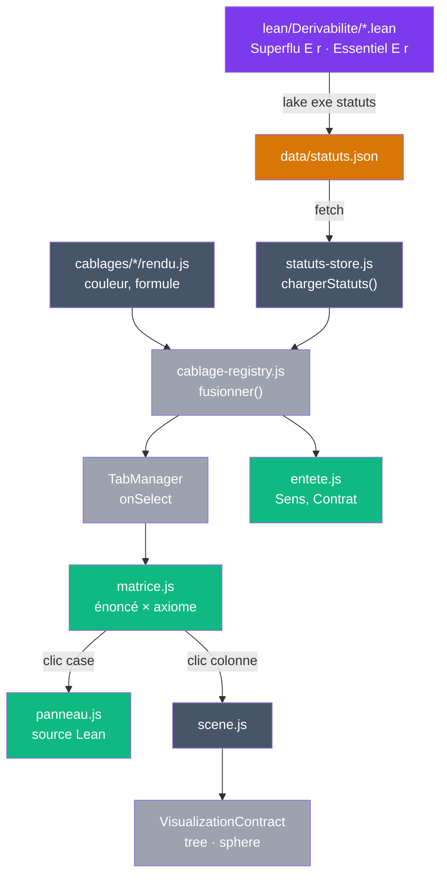

# Visualiseur V10 — statuts de dérivabilité issus de Lean : plan d'implémentation

> **For agentic workers:** REQUIRED SUB-SKILL: Use superpowers:subagent-driven-development (recommended) or superpowers:executing-plans to implement this plan task-by-task. Steps use checkbox (`- [ ]`) syntax for tracking.

**Goal:** Afficher dans une nouvelle version du visualiseur (`app/10_statuts/`) la matrice énoncé × axiome des cinq câblages de Pythagore, chaque statut (essentiel, superflu, non testé) venant d'un théorème Lean vérifié par le noyau.

**Architecture:** En Lean, `Derivabilite/Cadre.lean` fixe une forme canonique : un statut est un théorème de type `Superflu E r` ou `Essentiel E r`. Les cinq câblages sont réécrits dans cette forme. Un exécutable `lake exe statuts` charge les `.olean` à l'exécution, lit l'environnement, vérifie la cohérence et écrit `app/10_statuts/data/statuts.json`. V10, copiée de V9, lit ce JSON : matrice et panneau en HTML, arbre et cercle en canvas p5.

**Tech Stack:** Lean 4.35.0-rc4 + mathlib v4.35.0-rc4 (Lake), métaprogrammation Lean (`MetaM`, `Json`), JavaScript ES modules sans bundler, p5.js 1.9.0 (CDN), Node 26 + puppeteer-core 23.11.1 pour les tests navigateur.

**Spec:** `docs/superpowers/specs/2026-10-11-visualiseur-statuts-design.md`

Tout le code Lean de ce plan a été compilé avant l'écriture du plan (fichiers d'essai, depuis supprimés) : les cinq câblages, l'exporteur, l'exécutable et les tests passent, et l'export produit 31 statuts (18 essentiels, 13 superflus) et 2 cases non testées, conformes à `attendu.json`. Le code JavaScript a été vérifié en syntaxe (`node --check`) ; l'oracle et la couverture des docs ont été validés contre l'export réel. Les tests navigateur des tâches 8 et 9 n'ont pas encore tourné.

## Global Constraints

- Toolchain `leanprover/lean4:v4.35.0-rc4` et mathlib `v4.35.0-rc4` : ne pas modifier `lean-toolchain` ni la révision mathlib.
- Avant toute commande `lake` : `export PATH=$HOME/.elan/bin:$PATH`, depuis `lean/`.
- `Derivabilite/Cadre.lean` et `Derivabilite/Export.lean` n'importent pas mathlib (Cadre n'importe rien, Export importe `Lean`) : l'exécutable ne doit compiler en natif que ces modules.
- Aucun statut, axiome ou titre de câblage n'est écrit à la main côté appli : tout vient de `data/statuts.json`, régénéré seulement par `lake exe statuts`.
- Ne pas modifier `app/9_onglets/` ni `docs/theoreme/pythagore/cablages/*.md`.
- Prose (docs, commentaires, messages d'erreur, commits) en français ; identifiants Lean et JS tels que dans ce plan.
- Tests navigateur : Chrome à `/Applications/Google Chrome.app/Contents/MacOS/Google Chrome` (ou `CHROME_PATH`) ; p5.js vient du CDN, donc les tests navigateur demandent le réseau.
- **Commits** : l'utilisateur n'a pas demandé de commit. Chaque étape « Commit » ne s'exécute qu'après son accord explicite ; sinon, la sauter et le signaler. Le dépôt contient d'autres modifications non commitées : n'ajouter que les fichiers de la tâche, jamais `git add -A`.

## Review Focus

- Page ouverte par double-clic (`file://`) : un bandeau explique comment servir `app/`, pas une page blanche. Test : `tests/erreurs.mjs` (tâche 8).
- Source Lean longue dans le panneau, à 390 px : la page ne défile pas horizontalement. Test : `tests/navigateur.mjs` (tâche 9).
- Utilisateur au clavier : Entrée sur une case ouvre le panneau, Échap le ferme et rend le focus à la case. Test : `tests/navigateur.mjs` (tâche 9).
- Changement de câblage avec le panneau ouvert : le panneau se ferme, aucune preuve d'un autre câblage ne reste affichée. Test : `tests/navigateur.mjs` (tâche 9).
- Fenêtre redimensionnée du format bureau au format mobile : le canvas suit son conteneur, sans débordement. Test : `tests/vues.mjs` (tâche 8).

## Structure des fichiers

| Fichier | Rôle |
|---|---|
| `lean/Derivabilite/Cadre.lean` (nouveau) | Forme canonique : `Nature`, `Motif`, `Theoreme`, `Note`, `Cablage`, `Axiome`, `Enonce`, `tient`, `Enonce.sans`, `Superflu`, `Essentiel`, `pas_les_deux`, tactique `deplier` |
| `lean/Derivabilite/Pythagore.lean` (nouveau) | Constante `Derivabilite.pythagore : Theoreme` |
| `lean/Derivabilite/{Scalaire,Complexe,Trigonometrique,Cosinus,Groupes}.lean` (réécrits) | Fiche `cablage`, énoncés, statuts de chaque câblage |
| `lean/Derivabilite/Export.lean` (nouveau) | `Derivabilite.Export.exporterChamps` : lecture de l'environnement, vérifications, JSON |
| `lean/Statuts.lean` (nouveau) | `main` de `lake exe statuts` |
| `lean/Tests/Cadre.lean`, `lean/Tests/Export.lean` (nouveaux) | Tests Lean (`lake build Tests`) |
| `lean/lakefile.toml`, `lean/Derivabilite.lean`, `lean/README.md` (modifiés) | Cibles `Tests` et `statuts`, import de `Pythagore`, documentation |
| `app/10_statuts/` (nouveau, copié de V9) | Page V10 : `pythagore.html`, `style.css`, `data/statuts.json`, `js/` |
| `app/10_statuts/js/statut-style.js` | Mots, classes CSS, styles canvas des statuts ; `statutDe`, `cleRetrait` |
| `app/10_statuts/js/statuts-store.js` | `chargerStatuts()` |
| `app/10_statuts/js/cablage-registry.js` | `fusionner(statuts)` : rendus JS + fiches JSON |
| `app/10_statuts/js/entete.js` | En-tête : Sens, Contrat, application numérique |
| `app/10_statuts/js/matrice.js`, `panneau.js` | Matrice HTML, panneau de preuve |
| `app/10_statuts/js/scene.js`, `visualization-contract.js`, `visualizations/{tree,sphere}.js` | Vues canvas par statut |
| `app/10_statuts/tests/` | `verifier.mjs` et ses modules, `attendu.json` |
| `app/proposals/v10-statuts.md`, `app/10_statuts/README.md`, `app/README.md` | Documentation |

---

### Task 1 : forme canonique et théorème commun

**Files:**
- Create: `lean/Derivabilite/Cadre.lean`
- Create: `lean/Derivabilite/Pythagore.lean`
- Create: `lean/Tests/Cadre.lean`
- Modify: `lean/lakefile.toml` (cible `Tests`)
- Modify: `lean/Derivabilite.lean` (import de `Pythagore`)

**Interfaces:**
- Produces: espace de noms `Derivabilite` avec `Nature` (`structurel`, `numerique`), `Motif` (`definition`, `etape`, `amont`, `derivable`, `cache`, `horsPreuve`), `Theoreme` (`sens contrat : String`), `Note` (`code : String`, `nature`, `motif`, `texte : String`, `theoreme : Option String := none`), `Cablage` (`id titre espace : String`, `notes : List Note`), `Axiome (M : Type 1)` (`nom code : String`, `nature`, `libelle : String`, `prop : M → Prop`), `Enonce` (`cablage id sens contrat : String`, `Modele : Type 1`, `axiomes : List (Axiome Modele)`, `conclusion : Modele → Prop`), `Enonce.sans E r m`, `Superflu E r`, `Essentiel E r`, `pas_les_deux`, tactique `deplier [ids] (at loc)?` ; constante `Derivabilite.pythagore : Theoreme`.

- [ ] **Step 1 : écrire le test qui échoue**

Ajouter à la fin de `lean/lakefile.toml` :

```toml
[[lean_lib]]
name = "Tests"
globs = ["Tests.+"]
```

Créer `lean/Tests/Cadre.lean` :

```lean
import Derivabilite.Cadre

/-!
# Tests de la forme canonique

Un énoncé jouet à deux axiomes : `deplier` retire l'axiome nommé et garde l'autre ;
`pas_les_deux` interdit qu'un retrait soit à la fois superflu et essentiel.
-/

open Derivabilite

structure Jouet : Type 1 where
  p : Prop
  q : Prop

def jouet : Enonce where
  cablage := "jouet"
  id := "e"
  sens := "s"
  contrat := "c"
  Modele := Jouet
  axiomes := [⟨"a", "S1", .structurel, "p", fun m => m.p⟩, ⟨"b", "S2", .structurel, "q", fun m => m.q⟩]
  conclusion := fun m => m.p

/-- Sans `b`, il reste exactement l'hypothèse de `a`. -/
example : Superflu jouet ["b"] := by
  intro m h
  deplier [jouet] at h ⊢
  exact h

/-- Sans `a`, le modèle p = False, q = True satisfait `b` et contredit la conclusion. -/
example : Essentiel jouet ["a"] :=
  ⟨⟨False, True⟩, by deplier [jouet], by simp [jouet]⟩

example (h : Superflu jouet ["a"]) (h' : Essentiel jouet ["a"]) : False := pas_les_deux h h'
```

- [ ] **Step 2 : vérifier l'échec**

Run: `cd lean && export PATH=$HOME/.elan/bin:$PATH && lake build Tests`
Expected: FAIL, `unknown module prefix 'Derivabilite.Cadre'` ou `no such file or directory … Derivabilite/Cadre.lean`.

- [ ] **Step 3 : écrire `Cadre.lean` et `Pythagore.lean`**

Créer `lean/Derivabilite/Cadre.lean` :

```lean
/-!
# Forme canonique du test de dérivabilité

Un **énoncé** est un câblage vu sous un contrat : un type de modèles, une liste d'axiomes
sur ces modèles, une conclusion. Un **statut** est un théorème de type `Superflu E r` ou
`Essentiel E r` : le noyau vérifie qu'il établit bien ce statut. Un couple (énoncé, axiome)
sans théorème est **non testé**. Vocabulaire des docs : sens, contrat ; nature structurelle
ou numérique des axiomes.
-/

namespace Derivabilite

inductive Nature | structurel | numerique

/-- Pourquoi un code README n'est pas un axiome du modèle. -/
inductive Motif | definition | etape | amont | derivable | cache | horsPreuve

/-- Le théorème commun aux câblages (Pythagore). -/
structure Theoreme where
  sens : String
  contrat : String

/-- Code README qui n'est pas un axiome du modèle. Texte relu à la main, non vérifié. -/
structure Note where
  code : String
  nature : Nature
  motif : Motif
  texte : String
  /-- Pour `derivable` : nom complet du lemme Lean qui le démontre. -/
  theoreme : Option String := none

structure Cablage where
  id : String
  titre : String
  espace : String
  notes : List Note

structure Axiome (M : Type 1) where
  nom : String
  code : String
  nature : Nature
  libelle : String
  prop : M → Prop

/-- Une colonne de la matrice : un câblage vu sous un contrat. -/
structure Enonce where
  cablage : String
  id : String
  sens : String
  contrat : String
  Modele : Type 1
  axiomes : List (Axiome Modele)
  conclusion : Modele → Prop

/-- Tous les axiomes de la liste tiennent dans `m`, sauf ceux dont le nom est retiré. -/
def tient {M : Type 1} (retires : List String) (m : M) : List (Axiome M) → Prop
  | [] => True
  | a :: as => (a.nom ∈ retires ∨ a.prop m) ∧ tient retires m as

def Enonce.sans (E : Enonce) (retires : List String) (m : E.Modele) : Prop :=
  tient retires m E.axiomes

def Superflu (E : Enonce) (r : List String) : Prop := ∀ m, E.sans r m → E.conclusion m

def Essentiel (E : Enonce) (r : List String) : Prop := ∃ m, E.sans r m ∧ ¬ E.conclusion m

theorem pas_les_deux {E : Enonce} {r : List String} : Superflu E r → Essentiel E r → False :=
  fun hs ⟨m, hm, hc⟩ => hc (hs m hm)

/-- `deplier [E, axs] at h ⊢` : déplie `Enonce.sans` et la conclusion en hypothèses, une
par axiome conservé ; les axiomes retirés disparaissent. -/
syntax "deplier" " [" ident,* "]" (Lean.Parser.Tactic.location)? : tactic
macro_rules
  | `(tactic| deplier [$ids,*] $[$loc]?) => `(tactic| (
      simp only [Enonce.sans, $[$ids:ident],*, tient, List.mem_cons, List.mem_singleton,
        List.not_mem_nil, String.reduceEq, or_false, false_or, or_true, true_or, true_and,
        and_true] $[$loc]?))

end Derivabilite
```

`tient` est récursive plutôt qu'écrite `∀ a ∈ axiomes, …` : `simp` ne sait pas déplier un `∀ a ∈ [littéral]` quand le type des éléments dépend du champ `Modele` de l'énoncé.

Créer `lean/Derivabilite/Pythagore.lean` :

```lean
import Derivabilite.Cadre

namespace Derivabilite

/-- Sens et contrat communs aux cinq câblages (`docs/theoreme/pythagore/README.md`). -/
def pythagore : Theoreme where
  sens := "la longueur de l'hypoténuse d'un triangle rectangle se déduit des deux autres côtés"
  contrat := "(a, b) ∈ ℝ₊² → c ∈ ℝ₊"

end Derivabilite
```

Dans `lean/Derivabilite.lean`, ajouter en tête la ligne `import Derivabilite.Pythagore`.

- [ ] **Step 4 : vérifier le succès**

Run: `lake build Tests && lake build`
Expected: `Build completed successfully` deux fois, sans erreur (le graphe `#graphe` s'affiche pendant `lake build`).

- [ ] **Step 5 : commit (si l'utilisateur l'a accepté)**

```bash
git add lean/lakefile.toml lean/Derivabilite.lean lean/Derivabilite/Cadre.lean lean/Derivabilite/Pythagore.lean lean/Tests/Cadre.lean
git commit -m "Lean : forme canonique Superflu / Essentiel et théorème commun"
```

### Task 2 : exporteur

**Files:**
- Create: `lean/Derivabilite/Export.lean`
- Create: `lean/Tests/Export.lean`

**Interfaces:**
- Consumes: la forme canonique de la tâche 1 (noms complets `Derivabilite.Theoreme`, `Derivabilite.Cablage`, `Derivabilite.Enonce`, `Derivabilite.Superflu`, `Derivabilite.Essentiel`, constructeurs `….mk`).
- Produces: `Derivabilite.Export.exporterChamps (racine : System.FilePath) (prefixe : Name := .anonymous) : MetaM (List (String × Json))`, qui renvoie les champs `theoreme` et `cablages` du JSON (sans versions) ou lève une erreur dont le message commence par `statuts : `. Ne considère que les constantes dont le nom commence par `prefixe`. Ordre fixe : câblages et énoncés triés par id, axiomes et notes dans l'ordre de déclaration, statuts triés par axiomes retirés.

- [ ] **Step 1 : écrire les tests qui échouent**

Créer `lean/Tests/Export.lean`. Chaque espace de noms `Fixture.*` est un petit environnement ; `#guard_msgs` fige le JSON produit ou le message d'erreur.

```lean
import Derivabilite.Cadre
import Derivabilite.Export

/-!
# Tests de l'exporteur

Chaque espace de noms `Fixture.*` est un petit environnement, valide ou volontairement
cassé. `exporterChamps "." prefixe` ne regarde que les constantes sous `prefixe`.
`#guard_msgs` fige le JSON produit ou le message d'erreur.
-/

open Lean Meta Derivabilite Derivabilite.Export

/-- Lance l'exporteur sur un préfixe et affiche le JSON compact. -/
def essayer (prefixe : Name) : MetaM Unit := do
  let champs ← exporterChamps "." prefixe
  logInfo (Json.mkObj champs).compress

structure M : Type 1 where
  p : Prop
  q : Prop

namespace Fixture.Valide
def t : Theoreme := ⟨"sens commun", "contrat commun"⟩
def c : Cablage := ⟨"jouet", "Jouet", "P", [⟨"N1", .numerique, .etape, "calcul", none⟩]⟩
def e : Enonce := ⟨"jouet", "e", "s", "contrat commun", M,
  [⟨"a", "S1", .structurel, "p", fun m => m.p⟩, ⟨"b", "S2", .structurel, "q", fun m => m.q⟩],
  fun m => m.p⟩
theorem sans_b : Superflu e ["b"] := by
  intro m h
  simp only [Enonce.sans, e, tient, List.mem_cons, List.not_mem_nil,
    String.reduceEq, or_false, false_or, and_true] at h ⊢
  exact h.1
theorem sans_a : Essentiel e ["a"] :=
  ⟨⟨False, True⟩, by simp [Enonce.sans, e, tient], by simp [e]⟩
end Fixture.Valide

/-- info: {"cablages":[{"enonces":[{"axiomes":[{"code":"S1","lean":"m.p","libelle":"p","nature":"structurel","nom":"a"},{"code":"S2","lean":"m.q","libelle":"q","nature":"structurel","nom":"b"}],"contrat":"contrat commun","id":"e","nonTestes":[],"sens":"s","statuts":[{"definitions":[],"fichier":"","lignes":[0,0],"retires":["a"],"source":"","statut":"essentiel","theoreme":"Fixture.Valide.sans_a"},{"definitions":[],"fichier":"","lignes":[0,0],"retires":["b"],"source":"","statut":"superflu","theoreme":"Fixture.Valide.sans_b"}]}],"espace":"P","id":"jouet","notes":[{"code":"N1","motif":"etape","nature":"numerique","texte":"calcul","theoreme":null}],"titre":"Jouet"}],"theoreme":{"contrat":"contrat commun","sens":"sens commun"}} -/
#guard_msgs in
#eval essayer `Fixture.Valide

namespace Fixture.NomInconnu
def t : Theoreme := ⟨"s", "c"⟩
def c : Cablage := ⟨"jouet", "Jouet", "P", []⟩
def e : Enonce := ⟨"jouet", "e", "s", "c", M, [⟨"a", "S1", .structurel, "p", fun m => m.p⟩], fun m => m.p⟩
theorem faux : Superflu e ["z"] := fun _ h => by simp [Enonce.sans, e, tient] at h; exact h
end Fixture.NomInconnu

/-- error: statuts : Fixture.NomInconnu.faux : « z » n'est pas un axiome de jouet.e -/
#guard_msgs in
#eval essayer `Fixture.NomInconnu

namespace Fixture.SansCablage
def t : Theoreme := ⟨"s", "c"⟩
def e : Enonce := ⟨"absent", "e", "s", "c", M, [], fun m => m.p⟩
end Fixture.SansCablage

/-- error: statuts : énoncé Fixture.SansCablage.e : câblage « absent » inexistant -/
#guard_msgs in
#eval essayer `Fixture.SansCablage

namespace Fixture.DeuxTheoremes
def t1 : Theoreme := ⟨"s", "c"⟩
def t2 : Theoreme := ⟨"s", "c"⟩
end Fixture.DeuxTheoremes

/-- error: statuts : une constante Theoreme attendue, 2 trouvée(s) -/
#guard_msgs in
#eval essayer `Fixture.DeuxTheoremes

namespace Fixture.Nature
def t : Theoreme := ⟨"s", "c"⟩
def c : Cablage := ⟨"jouet", "Jouet", "P", [⟨"S1", .numerique, .etape, "calcul", none⟩]⟩
def e : Enonce := ⟨"jouet", "e", "s", "c", M, [⟨"a", "S1", .structurel, "p", fun m => m.p⟩], fun m => m.p⟩
end Fixture.Nature

/-- error: statuts : câblage jouet : code S1 à la fois structurel et numerique -/
#guard_msgs in
#eval essayer `Fixture.Nature

namespace Fixture.AxiomeIncoherent
def t : Theoreme := ⟨"s", "c"⟩
def c : Cablage := ⟨"jouet", "Jouet", "P", []⟩
def e1 : Enonce := ⟨"jouet", "e1", "s", "c", M, [⟨"a", "S1", .structurel, "p", fun m => m.p⟩], fun m => m.p⟩
def e2 : Enonce := ⟨"jouet", "e2", "s", "c", M, [⟨"a", "S1", .structurel, "autre", fun m => m.p⟩], fun m => m.p⟩
end Fixture.AxiomeIncoherent

/-- error: statuts : câblage jouet : axiome « a » décrit de deux façons -/
#guard_msgs in
#eval essayer `Fixture.AxiomeIncoherent

namespace Fixture.Derivable
def t : Theoreme := ⟨"s", "c"⟩
def c : Cablage := ⟨"jouet", "Jouet", "P", [⟨"N1", .numerique, .derivable, "lemme", some "Fixture.absent"⟩]⟩
end Fixture.Derivable

/-- error: statuts : note jouet.N1 : théorème Fixture.absent introuvable -/
#guard_msgs in
#eval essayer `Fixture.Derivable
```

- [ ] **Step 2 : vérifier l'échec**

Run: `lake build Tests`
Expected: FAIL sur `Tests.Export` : module `Derivabilite.Export` introuvable.

- [ ] **Step 3 : écrire l'exporteur**

Créer `lean/Derivabilite/Export.lean` :

```lean
import Lean

/-!
# Export des statuts de dérivabilité en JSON

`exporterChamps racine prefixe` parcourt l'environnement : la constante `Theoreme`, les
constantes `Cablage` et `Enonce`, et les théorèmes de type `Superflu E r` ou
`Essentiel E r`. Les valeurs sont lues par réduction (`whnfD`) : chaînes littérales,
listes littérales de `Axiome.mk` et de `Note.mk`. Seules les constantes dont le nom
commence par `prefixe` sont considérées (`.anonymous` : toutes). Toute incohérence lève
une erreur qui commence par « statuts : ».

Ce module n'importe que `Lean` : l'exécutable `statuts` charge les `.olean` de
`Derivabilite` à l'exécution, sans compiler mathlib en code natif.
-/

open Lean Meta

namespace Derivabilite.Export

def nTheoreme : Name := `Derivabilite.Theoreme
def nCablage : Name := `Derivabilite.Cablage
def nEnonce : Name := `Derivabilite.Enonce
def nSuperflu : Name := `Derivabilite.Superflu
def nEssentiel : Name := `Derivabilite.Essentiel

def erreur {α} (msg : String) : MetaM α := throwError s!"statuts : {msg}"

def chaine (e : Expr) : MetaM String := do
  match ← whnfD e with
  | .lit (.strVal s) => return s
  | e => erreur s!"chaîne littérale attendue, trouvé {← ppExpr e}"

partial def liste (e : Expr) : MetaM (List Expr) := do
  let e ← whnfD e
  match e.getAppFnArgs with
  | (``List.cons, #[_, x, xs]) => return x :: (← liste xs)
  | (``List.nil, #[_]) => return []
  | _ => erreur s!"liste littérale attendue, trouvé {← ppExpr e}"

/-- Arguments du constructeur `c`, après réduction de `e`. -/
def champs (c : Name) (e : Expr) : MetaM (Array Expr) := do
  let e ← whnfD e
  unless e.isAppOf c do erreur s!"{c} attendu, trouvé {← ppExpr e}"
  return e.getAppArgs

/-- Constructeur sans argument : `Nature.structurel` donne "structurel". -/
def etiquette (e : Expr) : MetaM String := do
  match ← whnfD e with
  | .const (.str _ s) _ => return s
  | e => erreur s!"constructeur attendu, trouvé {← ppExpr e}"

def optChaine (e : Expr) : MetaM (Option String) := do
  let e ← whnfD e
  if e.isAppOf ``Option.none then return none
  if e.isAppOfArity ``Option.some 2 then return some (← chaine e.appArg!)
  erreur s!"option attendue, trouvé {← ppExpr e}"

/-- Corps d'une proposition `fun m => …`, affiché par le délaborateur. -/
def ppProp (e : Expr) : MetaM String :=
  lambdaTelescope e fun _ b => return (← ppExpr b).pretty 100

structure AxiomeLu where
  nom : String
  code : String
  nature : String
  libelle : String
  lean : String

structure NoteLue where
  code : String
  nature : String
  motif : String
  texte : String
  theoreme : Option String

structure CablageLu where
  id : String
  titre : String
  espace : String
  notes : List NoteLue

structure EnonceLu where
  constante : Name
  cablage : String
  id : String
  sens : String
  contrat : String
  axiomes : List AxiomeLu

structure StatutLu where
  theoreme : Name
  enonce : Name
  retires : List String
  statut : String
  fichier : String
  lignes : Nat × Nat
  source : String
  definitions : List (Name × String)

def lireAxiome (e : Expr) : MetaM AxiomeLu := do
  let a ← champs `Derivabilite.Axiome.mk e
  return { nom := ← chaine a[1]!, code := ← chaine a[2]!, nature := ← etiquette a[3]!,
           libelle := ← chaine a[4]!, lean := ← ppProp a[5]! }

def lireNote (e : Expr) : MetaM NoteLue := do
  let a ← champs `Derivabilite.Note.mk e
  return { code := ← chaine a[0]!, nature := ← etiquette a[1]!, motif := ← etiquette a[2]!,
           texte := ← chaine a[3]!, theoreme := ← optChaine a[4]! }

def lireCablage (n : Name) : MetaM CablageLu := do
  let a ← champs `Derivabilite.Cablage.mk (mkConst n)
  return { id := ← chaine a[0]!, titre := ← chaine a[1]!, espace := ← chaine a[2]!,
           notes := ← (← liste a[3]!).mapM lireNote }

def lireEnonce (n : Name) : MetaM EnonceLu := do
  let a ← champs `Derivabilite.Enonce.mk (mkConst n)
  return { constante := n, cablage := ← chaine a[0]!, id := ← chaine a[1]!,
           sens := ← chaine a[2]!, contrat := ← chaine a[3]!,
           axiomes := ← (← liste a[5]!).mapM lireAxiome }

/-- Fichier source d'une constante importée, relatif à la racine du projet Lean. -/
def fichierDe (n : Name) : MetaM (Option String) := do
  let env ← getEnv
  let some i := env.getModuleIdxFor? n | return none
  let m := env.header.moduleNames[i.toNat]!
  return some (m.toString.replace "." "/" ++ ".lean")

def extrait (racine : System.FilePath) (fichier : String) (l₁ l₂ : Nat) : IO String := do
  let lignes ← IO.FS.lines (racine / fichier)
  return "\n".intercalate ((lignes.toList.drop (l₁ - 1)).take (l₂ - l₁ + 1))

/-- Fichier, lignes et texte source d'une déclaration ; vides pour une déclaration locale. -/
def sourceDe (racine : System.FilePath) (n : Name) : MetaM (String × (Nat × Nat) × String) := do
  let some f ← fichierDe n | return ("", (0, 0), "")
  let some r ← findDeclarationRanges? n | return (f, (0, 0), "")
  let (l₁, l₂) := (r.range.pos.line, r.range.endPos.line)
  return (f, (l₁, l₂), ← extrait racine f l₁ l₂)

/-- Définitions et lemmes des modules `Derivabilite.*` (hors `Cadre`) utilisés directement
par `ci` : contre-modèles, formes, lemmes communs. Les statuts eux-mêmes sont exclus. -/
def definitionsLocales (racine : System.FilePath) (ci : ConstantInfo) :
    MetaM (List (Name × String)) := do
  let env ← getEnv
  let utilisees := (ci.type.getUsedConstants ++ ((ci.value? (allowOpaque := true)).map (·.getUsedConstants)).getD #[])
  let mut vues : List Name := []
  for d in utilisees do
    if vues.contains d || d.isInternal || env.isProjectionFn d then continue
    -- le vocabulaire commun (`Derivabilite.*`, y compris ses lemmes d'équation) est exclu
    if (`Derivabilite).isPrefixOf d then continue
    let some dci := env.find? d | continue
    unless dci matches .defnInfo _ | .thmInfo _ do continue
    let tete := dci.type.getAppFn.constName
    if [nEnonce, nCablage, nTheoreme, nSuperflu, nEssentiel, ``List].contains tete then continue
    let some f ← fichierDe d | continue
    unless f.startsWith "Derivabilite/" do continue
    vues := vues ++ [d]
  vues.mapM fun d => return (d, (← sourceDe racine d).2.2)

def constantes (prefixe : Name) : MetaM (Array (Name × ConstantInfo)) := do
  let env ← getEnv
  let cs := env.constants.fold (init := #[]) fun acc n ci =>
    if prefixe.isPrefixOf n && !n.isInternal then acc.push (n, ci) else acc
  return cs.qsort (fun a b => a.1.toString < b.1.toString)

def lireStatut (racine : System.FilePath) (n : Name) (ci : ConstantInfo) :
    MetaM (Option StatutLu) := do
  let .thmInfo t := ci | return none
  let (f, #[.const e _, r]) := t.type.getAppFnArgs | return none
  unless f == nSuperflu || f == nEssentiel do return none
  let retires ← (← liste r).mapM chaine
  let (fichier, lignes, source) ← sourceDe racine n
  return some { theoreme := n, enonce := e, retires,
                statut := if f == nSuperflu then "superflu" else "essentiel",
                fichier, lignes, source, definitions := ← definitionsLocales racine ci }

/-! ## Vérifications -/

def verifier (cabs : List CablageLu) (ens : List EnonceLu) (sts : List StatutLu) : MetaM Unit := do
  let env ← getEnv
  for c in cabs do
    if (cabs.filter (·.id == c.id)).length > 1 then erreur s!"câblage « {c.id} » déclaré deux fois"
    for n in c.notes do
      if n.motif == "derivable" then
        match n.theoreme with
        | none => erreur s!"note {c.id}.{n.code} : motif derivable sans théorème"
        | some t => unless env.contains t.toName do
            erreur s!"note {c.id}.{n.code} : théorème {t} introuvable"
  for e in ens do
    unless cabs.any (·.id == e.cablage) do
      erreur s!"énoncé {e.constante} : câblage « {e.cablage} » inexistant"
    if (ens.filter (fun f => f.cablage == e.cablage && f.id == e.id)).length > 1 then
      erreur s!"énoncé {e.cablage}.{e.id} déclaré deux fois"
  for c in cabs do
    let axs := (ens.filter (·.cablage == c.id)).flatMap (·.axiomes)
    for a in axs do
      for b in axs do
        if a.nom == b.nom && (a.code != b.code || a.nature != b.nature || a.libelle != b.libelle) then
          erreur s!"câblage {c.id} : axiome « {a.nom} » décrit de deux façons"
    let codes := axs.map (fun a => (a.code, a.nature)) ++ c.notes.map (fun n => (n.code, n.nature))
    for (k, v) in codes do
      for (k', v') in codes do
        if k == k' && v != v' then erreur s!"câblage {c.id} : code {k} à la fois {v} et {v'}"
  for s in sts do
    let some e := ens.find? (·.constante == s.enonce)
      | erreur s!"{s.theoreme} : énoncé {s.enonce} inconnu"
    for r in s.retires do
      unless e.axiomes.any (·.nom == r) do
        erreur s!"{s.theoreme} : « {r} » n'est pas un axiome de {e.cablage}.{e.id}"

/-! ## JSON -/

def jAxiome (a : AxiomeLu) : Json :=
  Json.mkObj [("nom", a.nom), ("code", a.code), ("nature", a.nature),
              ("libelle", a.libelle), ("lean", a.lean)]

def jNote (n : NoteLue) : Json :=
  Json.mkObj [("code", n.code), ("nature", n.nature), ("motif", n.motif), ("texte", n.texte),
              ("theoreme", match n.theoreme with | some t => toJson t | none => Json.null)]

def jStatut (s : StatutLu) : Json :=
  Json.mkObj [("retires", toJson s.retires), ("statut", s.statut),
              ("theoreme", s.theoreme.toString), ("fichier", s.fichier),
              ("lignes", toJson [s.lignes.1, s.lignes.2]), ("source", s.source),
              ("definitions", Json.arr (s.definitions.map fun (d, src) =>
                 Json.mkObj [("nom", d.toString), ("source", src)]).toArray)]

def jEnonce (e : EnonceLu) (sts : List StatutLu) : Json :=
  let miens := (sts.filter (·.enonce == e.constante)).toArray.qsort
    (fun a b => toString a.retires < toString b.retires) |>.toList
  let testes := miens.filterMap fun s => match s.retires with | [r] => some r | _ => none
  let nonTestes := (e.axiomes.map (·.nom)).filter (!testes.contains ·)
  Json.mkObj [("id", e.id), ("sens", e.sens), ("contrat", e.contrat),
              ("axiomes", Json.arr (e.axiomes.map jAxiome).toArray),
              ("statuts", Json.arr (miens.map jStatut).toArray),
              ("nonTestes", toJson nonTestes)]

/-- Champs du JSON (sans versions). Ordre fixe : câblages et énoncés triés par id, axiomes
et notes dans l'ordre de déclaration, statuts triés par axiomes retirés. -/
def exporterChamps (racine : System.FilePath) (prefixe : Name := .anonymous) :
    MetaM (List (String × Json)) := do
  let cs ← constantes prefixe
  let thms := cs.filter fun (_, ci) => ci.type == mkConst nTheoreme
  unless thms.size == 1 do erreur s!"une constante Theoreme attendue, {thms.size} trouvée(s)"
  let t ← champs `Derivabilite.Theoreme.mk (mkConst thms[0]!.1)
  let cabs ← (cs.filter fun (_, ci) => ci.type == mkConst nCablage).toList.mapM (lireCablage ·.1)
  let ens ← (cs.filter fun (_, ci) => ci.type == mkConst nEnonce).toList.mapM (lireEnonce ·.1)
  let sts ← cs.toList.filterMapM fun (n, ci) => lireStatut racine n ci
  verifier cabs ens sts
  let cabsTries := cabs.toArray.qsort (fun a b => a.id < b.id) |>.toList
  let jCab (c : CablageLu) : Json :=
    let siens := (ens.filter (·.cablage == c.id)).toArray.qsort (fun a b => a.id < b.id) |>.toList
    Json.mkObj [("id", c.id), ("titre", c.titre), ("espace", c.espace),
                ("notes", Json.arr (c.notes.map jNote).toArray),
                ("enonces", Json.arr (siens.map (jEnonce · sts)).toArray)]
  return [("theoreme", Json.mkObj [("sens", ← chaine t[0]!), ("contrat", ← chaine t[1]!)]),
          ("cablages", Json.arr (cabsTries.map jCab).toArray)]

end Derivabilite.Export
```

Points à garder : `ci.value? (allowOpaque := true)` (sans ce paramètre, la valeur d'un théorème est absente et les contre-modèles n'apparaissent pas dans `definitions`) ; l'exclusion de l'espace `Derivabilite` (les lemmes d'équation `Derivabilite.tient.eq_2` sont créés dans le module qui les utilise).

- [ ] **Step 4 : vérifier le succès**

Run: `lake build Tests`
Expected: `Build completed successfully`, aucune différence signalée par `#guard_msgs`.

- [ ] **Step 5 : commit (si l'utilisateur l'a accepté)**

```bash
git add lean/Derivabilite/Export.lean lean/Tests/Export.lean
git commit -m "Lean : exporteur des statuts en JSON et ses tests"
```

### Task 3 : câblages scalaire et cosinus

**Files:**
- Modify: `lean/Derivabilite/Scalaire.lean` (réécriture complète)
- Modify: `lean/Derivabilite/Cosinus.lean` (réécriture complète)

**Interfaces:**
- Consumes: `Derivabilite.Cadre` (tâche 1).
- Produces: `Scalaire.lemme_carre` (remplace `Scalaire.carre_sans_pos_ni_homog`, utilisé par `Cosinus.via_scalaire`), `Scalaire.Bnonsym` (réutilisé par `Cosinus.sans_symm`), énoncés `Scalaire.carre`, `Scalaire.norme`, `Cosinus.orthogonal`, fiches `Scalaire.cablage`, `Cosinus.cablage`. Les deux fichiers changent ensemble : Cosinus dépend de Scalaire.

- [ ] **Step 1 : constater l'état de départ**

Run: `grep -cE "^theorem [A-Za-z0-9_]+ : (Superflu|Essentiel)" Derivabilite/Scalaire.lean Derivabilite/Cosinus.lean`
Expected: 0 pour chaque fichier (aucun statut en forme canonique).

- [ ] **Step 2 : réécrire**

Remplacer tout le contenu de `lean/Derivabilite/Scalaire.lean` par :

```lean
import Mathlib
import Derivabilite.Cadre

/-!
# Câblage scalaire : test de dérivabilité axiome par axiome

Forme abstraite `B : V → V → ℝ` sur un module réel `V`. L'axiome S1 du README
(bilinéarité) est découpé en `addL`, `addR` et `homog`.

Deux énoncés, deux contrats :
* `carre` : B(u+v, u+v) = B(u,u) + B(v,v), contrat `E × E → R` ;
* `norme` : ‖u+v‖² = ‖u‖² + ‖v‖² avec ‖x‖ = √B(x,x), contrat commun `(a, b) ∈ ℝ₊² → c ∈ ℝ₊`.

La positivité S3 est superflue pour le premier, essentielle pour le second : le statut
dépend du contrat.
-/

namespace Scalaire
open Derivabilite

def cablage : Cablage where
  id := "scalaire"
  titre := "Produit scalaire — ‖u+v‖² = a² + b²"
  espace := "E"
  notes := [
    ⟨"N1", .structurel, .definition, "‖x‖² = (x, x) : définition intégrée à l'énoncé `norme`", none⟩,
    ⟨"N3", .numerique, .etape, "développement bilinéaire : étape de calcul faite par la tactique", none⟩]

structure Modele : Type 1 where
  V : Type
  [grp : AddCommGroup V]
  [mod : Module ℝ V]
  B : V → V → ℝ
  u : V
  v : V

attribute [instance] Modele.grp Modele.mod

def axiomes : List (Axiome Modele) := [
  ⟨"addL", "S1", .structurel, "additivité à gauche",
    fun m => ∀ x y z : m.V, m.B (x + y) z = m.B x z + m.B y z⟩,
  ⟨"addR", "S1", .structurel, "additivité à droite",
    fun m => ∀ x y z : m.V, m.B x (y + z) = m.B x y + m.B x z⟩,
  ⟨"homog", "S1", .structurel, "homogénéité",
    fun m => ∀ (r : ℝ) (x y : m.V), m.B (r • x) y = r * m.B x y⟩,
  ⟨"symm", "S2", .structurel, "symétrie", fun m => ∀ x y : m.V, m.B x y = m.B y x⟩,
  ⟨"pos", "S3", .structurel, "positivité", fun m => ∀ x : m.V, 0 ≤ m.B x x⟩,
  ⟨"orth", "N2", .numerique, "orthogonalité de u et v", fun m => m.B m.u m.v = 0⟩]

def carre : Enonce where
  cablage := "scalaire"
  id := "carre"
  sens := "deux vecteurs orthogonaux : la forme de leur somme est la somme de leurs formes"
  contrat := "E × E → R"
  Modele := Modele
  axiomes := axiomes
  conclusion := fun m => m.B (m.u + m.v) (m.u + m.v) = m.B m.u m.u + m.B m.v m.v

def norme : Enonce where
  cablage := "scalaire"
  id := "norme"
  sens := "deux vecteurs orthogonaux : le carré de la longueur de leur somme est la somme des carrés des longueurs"
  contrat := "(a, b) ∈ ℝ₊² → c ∈ ℝ₊"
  Modele := Modele
  axiomes := axiomes
  conclusion := fun m =>
    √(m.B (m.u + m.v) (m.u + m.v)) ^ 2 = √(m.B m.u m.u) ^ 2 + √(m.B m.v m.v) ^ 2

/-- Lemme commun : additivité des deux côtés, symétrie et orthogonalité suffisent ; un
groupe abélien suffit, sans structure de module. Réutilisé par le câblage cosinus. -/
theorem lemme_carre {V : Type*} [AddCommGroup V] (B : V → V → ℝ)
    (addL : ∀ u v w, B (u + v) w = B u w + B v w)
    (addR : ∀ u v w, B u (v + w) = B u v + B u w)
    (symm : ∀ u v, B u v = B v u)
    (u v : V) (h : B u v = 0) : B (u + v) (u + v) = B u u + B v v := by
  grind

/-! ## Énoncé `carre` -/

theorem carre_sans_addL : Superflu carre ["addL"] := by
  intro m h
  deplier [carre, axiomes] at h ⊢
  obtain ⟨addR, homog, symm, pos, orth⟩ := h
  grind

theorem carre_sans_addR : Superflu carre ["addR"] := by
  intro m h
  deplier [carre, axiomes] at h ⊢
  obtain ⟨addL, homog, symm, pos, orth⟩ := h
  grind

theorem carre_sans_homog : Superflu carre ["homog"] := by
  intro (m : Modele) h
  deplier [carre, axiomes] at h ⊢
  obtain ⟨addL, addR, symm, pos, orth⟩ := h
  exact lemme_carre m.B addL addR symm m.u m.v orth

theorem carre_sans_pos : Superflu carre ["pos"] := by
  intro (m : Modele) h
  deplier [carre, axiomes] at h ⊢
  obtain ⟨addL, addR, homog, symm, orth⟩ := h
  exact lemme_carre m.B addL addR symm m.u m.v orth

/-- Forme bilinéaire de matrice [[1,0],[1,1]] : positive, pas symétrique. -/
def Bnonsym (u v : ℝ × ℝ) : ℝ := u.1 * v.1 + u.2 * v.1 + u.2 * v.2


theorem carre_sans_symm : Essentiel carre ["symm"] := by
  refine ⟨⟨ℝ × ℝ, Bnonsym, (1, 0), (0, 1)⟩, ?_, ?_⟩
  · deplier [carre, axiomes]
    refine ⟨?_, ?_, ?_, ?_, ?_⟩
    · intro x y z; simp only [Bnonsym, Prod.fst_add, Prod.snd_add]; ring
    · intro x y z; simp only [Bnonsym, Prod.fst_add, Prod.snd_add]; ring
    · intro r x y; simp only [Bnonsym, Prod.smul_fst, Prod.smul_snd, smul_eq_mul]; ring
    · intro x; simp only [Bnonsym]
      nlinarith [sq_nonneg (x.1 + x.2), sq_nonneg x.1, sq_nonneg x.2]
    · norm_num [Bnonsym]
  · simp only [carre]; norm_num [Bnonsym]

/-- Carré du produit scalaire usuel : symétrique et positif, ni additif ni homogène. -/
def Bcarre (u v : ℝ × ℝ) : ℝ := (u.1 * v.1 + u.2 * v.2) ^ 2

theorem carre_sans_addL_addR_homog : Essentiel carre ["addL", "addR", "homog"] := by
  refine ⟨⟨ℝ × ℝ, Bcarre, (1, 0), (0, 1)⟩, ?_, ?_⟩
  · deplier [carre, axiomes]
    refine ⟨?_, ?_, ?_⟩
    · intro x y; simp only [Bcarre]; ring
    · intro x; simp only [Bcarre]; positivity
    · norm_num [Bcarre]
  · simp only [carre]; norm_num [Bcarre]

/-! ## Énoncé `norme` -/

theorem norme_sans_addL : Superflu norme ["addL"] := by
  intro (m : Modele) h
  deplier [norme, axiomes] at h ⊢
  obtain ⟨addR, homog, symm, pos, orth⟩ := h
  have addL : ∀ x y z : m.V, m.B (x + y) z = m.B x z + m.B y z := fun x y z => by
    rw [symm, addR, symm z x, symm z y]
  rw [Real.sq_sqrt (pos _), Real.sq_sqrt (pos _), Real.sq_sqrt (pos _)]
  exact lemme_carre m.B addL addR symm m.u m.v orth

theorem norme_sans_addR : Superflu norme ["addR"] := by
  intro (m : Modele) h
  deplier [norme, axiomes] at h ⊢
  obtain ⟨addL, homog, symm, pos, orth⟩ := h
  have addR : ∀ x y z : m.V, m.B x (y + z) = m.B x y + m.B x z := fun x y z => by
    rw [symm, addL, symm y x, symm z x]
  rw [Real.sq_sqrt (pos _), Real.sq_sqrt (pos _), Real.sq_sqrt (pos _)]
  exact lemme_carre m.B addL addR symm m.u m.v orth

theorem norme_sans_homog : Superflu norme ["homog"] := by
  intro (m : Modele) h
  deplier [norme, axiomes] at h ⊢
  obtain ⟨addL, addR, symm, pos, orth⟩ := h
  rw [Real.sq_sqrt (pos _), Real.sq_sqrt (pos _), Real.sq_sqrt (pos _)]
  exact lemme_carre m.B addL addR symm m.u m.v orth

/-- Forme de Minkowski : bilinéaire et symétrique, pas positive. -/
def Bmink (u v : ℝ × ℝ) : ℝ := u.1 * v.1 - u.2 * v.2

theorem norme_sans_pos : Essentiel norme ["pos"] := by
  refine ⟨⟨ℝ × ℝ, Bmink, (1, 0), (0, 1)⟩, ?_, ?_⟩
  · deplier [norme, axiomes]
    refine ⟨?_, ?_, ?_, ?_, ?_⟩
    · intro x y z; simp only [Bmink, Prod.fst_add, Prod.snd_add]; ring
    · intro x y z; simp only [Bmink, Prod.fst_add, Prod.snd_add]; ring
    · intro r x y; simp only [Bmink, Prod.smul_fst, Prod.smul_snd, smul_eq_mul]; ring
    · intro x y; simp only [Bmink]; ring
    · norm_num [Bmink]
  · simp only [norme]; norm_num [Bmink, Real.sqrt_eq_zero']

theorem norme_sans_symm : Essentiel norme ["symm"] := by
  refine ⟨⟨ℝ × ℝ, Bnonsym, (1, 0), (0, 1)⟩, ?_, ?_⟩
  · deplier [norme, axiomes]
    refine ⟨?_, ?_, ?_, ?_, ?_⟩
    · intro x y z; simp only [Bnonsym, Prod.fst_add, Prod.snd_add]; ring
    · intro x y z; simp only [Bnonsym, Prod.fst_add, Prod.snd_add]; ring
    · intro r x y; simp only [Bnonsym, Prod.smul_fst, Prod.smul_snd, smul_eq_mul]; ring
    · intro x; simp only [Bnonsym]
      nlinarith [sq_nonneg (x.1 + x.2), sq_nonneg x.1, sq_nonneg x.2]
    · norm_num [Bnonsym]
  · simp only [norme]; norm_num [Bnonsym]

end Scalaire
```

Remplacer tout le contenu de `lean/Derivabilite/Cosinus.lean` par :

```lean
import Derivabilite.Scalaire

/-!
# Câblage cosinus : test de dérivabilité axiome par axiome

Énoncé : B(x − y, x − y) = B(x,x) + B(y,y). Les normes `nx`, `ny` et le cosinus `c` sont
des réels quelconques : ni θ ni π n'interviennent. N1 (loi des cosinus) est un lemme
dérivable (`loi_cos`), et `via_scalaire` montre que le câblage se ramène au scalaire.
-/

namespace Cosinus
open Derivabilite

def cablage : Cablage where
  id := "cosinus"
  titre := "Théorème du cosinus — cas orthogonal"
  espace := "E"
  notes := [
    ⟨"N1", .numerique, .derivable, "loi des cosinus : conséquence de S1, S2, S3", some "Cosinus.loi_cos"⟩,
    ⟨"N2", .numerique, .horsPreuve, "θ = π/2 : θ n'intervient pas, l'énoncé pose directement cos θ = 0", none⟩,
    ⟨"N4", .numerique, .etape, "identité remarquable : étape de calcul faite par la tactique", none⟩]

structure Modele : Type 1 where
  V : Type
  [grp : AddCommGroup V]
  B : V → V → ℝ
  x : V
  y : V
  nx : ℝ
  ny : ℝ
  c : ℝ

attribute [instance] Modele.grp

def axiomes : List (Axiome Modele) := [
  ⟨"angle", "S1", .structurel, "B(x, y) = ‖x‖ ‖y‖ cos θ", fun m => m.B m.x m.y = m.nx * m.ny * m.c⟩,
  ⟨"addL", "S2", .structurel, "additivité à gauche",
    fun m => ∀ u v w : m.V, m.B (u + v) w = m.B u w + m.B v w⟩,
  ⟨"addR", "S2", .structurel, "additivité à droite",
    fun m => ∀ u v w : m.V, m.B u (v + w) = m.B u v + m.B u w⟩,
  ⟨"symm", "S3", .structurel, "symétrie", fun m => ∀ u v : m.V, m.B u v = m.B v u⟩,
  ⟨"droit", "N3", .numerique, "cos(π/2) = 0", fun m => m.c = 0⟩]

def orthogonal : Enonce where
  cablage := "cosinus"
  id := "orthogonal"
  sens := "pour un angle droit, la loi des cosinus perd son terme croisé"
  contrat := "E × E → R"
  Modele := Modele
  axiomes := axiomes
  conclusion := fun m => m.B (m.x - m.y) (m.x - m.y) = m.B m.x m.x + m.B m.y m.y

variable {V : Type*} [AddCommGroup V]

/-- N1 : loi des cosinus, conséquence de S1, S2, S3. -/
theorem loi_cos (B : V → V → ℝ)
    (addL : ∀ u v w, B (u + v) w = B u w + B v w)
    (addR : ∀ u v w, B u (v + w) = B u v + B u w)
    (symm : ∀ u v, B u v = B v u)
    (x y : V) (nx ny c : ℝ) (S1 : B x y = nx * ny * c) :
    B (x - y) (x - y) = B x x + B y y - 2 * nx * ny * c := by
  have negL : ∀ u w, B (-u) w = -B u w := fun u w => by
    have h0 := addL 0 0 w; have h1 := addL u (-u) w; simp at h0 h1; linarith
  have negR : ∀ u w, B w (-u) = -B w u := fun u w => by rw [symm, negL, symm]
  rw [sub_eq_add_neg, addL, addR, addR, negL, negL, negR, negR, neg_neg, symm y x]
  linarith

/-- L'angle est un détour : S1 et N3 ne servent qu'à obtenir B(x,y) = 0, puis le
câblage scalaire conclut (avec −y à la place de y). -/
theorem via_scalaire (B : V → V → ℝ)
    (addL : ∀ u v w, B (u + v) w = B u w + B v w)
    (addR : ∀ u v w, B u (v + w) = B u v + B u w)
    (symm : ∀ u v, B u v = B v u)
    (x y : V) (nx ny c : ℝ) (S1 : B x y = nx * ny * c) (N3 : c = 0) :
    B (x - y) (x - y) = B x x + B y y := by
  have negL : ∀ u w, B (-u) w = -B u w := fun u w => by
    have h0 := addL 0 0 w; have h1 := addL u (-u) w; simp at h0 h1; linarith
  have negR : ∀ u w, B w (-u) = -B w u := fun u w => by rw [symm, negL, symm]
  have orth : B x (-y) = 0 := by rw [negR, S1, N3]; ring
  have := Scalaire.lemme_carre B addL addR symm x (-y) orth
  rw [sub_eq_add_neg, this, negL, negR, neg_neg]

/-- Sans `addL` : se déduit de `addR` et de la symétrie (une ligne d'indication ; `grind`
échoue seul à cause de la soustraction). -/
theorem sans_addL : Superflu orthogonal ["addL"] := by
  intro (m : Modele) h
  deplier [orthogonal, axiomes] at h ⊢
  obtain ⟨angle, addR, symm, droit⟩ := h
  have addL : ∀ u v w : m.V, m.B (u + v) w = m.B u w + m.B v w := fun u v w => by
    rw [symm, addR, symm w u, symm w v]
  exact via_scalaire m.B addL addR symm m.x m.y m.nx m.ny m.c angle droit

theorem sans_addR : Superflu orthogonal ["addR"] := by
  intro (m : Modele) h
  deplier [orthogonal, axiomes] at h ⊢
  obtain ⟨angle, addL, symm, droit⟩ := h
  have addR : ∀ u v w : m.V, m.B u (v + w) = m.B u v + m.B u w := fun u v w => by
    rw [symm, addL, symm v u, symm w u]
  exact via_scalaire m.B addL addR symm m.x m.y m.nx m.ny m.c angle droit

/-- Produit scalaire usuel sur ℝ². -/
def Bstd (u v : ℝ × ℝ) : ℝ := u.1 * v.1 + u.2 * v.2

/-- Sans S1 : produit usuel, x = y = (1,0), c = 0 sans lien avec B. -/
theorem sans_angle : Essentiel orthogonal ["angle"] := by
  refine ⟨⟨ℝ × ℝ, Bstd, (1, 0), (1, 0), 1, 1, 0⟩, ?_, ?_⟩
  · deplier [orthogonal, axiomes]
    refine ⟨?_, ?_, ?_⟩
    · intro u v w; simp only [Bstd, Prod.fst_add, Prod.snd_add]; ring
    · intro u v w; simp only [Bstd, Prod.fst_add, Prod.snd_add]; ring
    · intro u v; simp only [Bstd]; ring
  · simp only [orthogonal]; norm_num [Bstd]

/-- Sans S3 : forme non symétrique du câblage scalaire, x = (1,0), y = (0,1), c = 0. -/
theorem sans_symm : Essentiel orthogonal ["symm"] := by
  refine ⟨⟨ℝ × ℝ, Scalaire.Bnonsym, (1, 0), (0, 1), 1, 1, 0⟩, ?_, ?_⟩
  · deplier [orthogonal, axiomes]
    refine ⟨?_, ?_, ?_⟩
    · norm_num [Scalaire.Bnonsym]
    · intro u v w; simp only [Scalaire.Bnonsym, Prod.fst_add, Prod.snd_add]; ring
    · intro u v w; simp only [Scalaire.Bnonsym, Prod.fst_add, Prod.snd_add]; ring
  · simp only [orthogonal]; norm_num [Scalaire.Bnonsym]

/-- Sans N3 : produit usuel, x = y = (1,0), ‖x‖ = ‖y‖ = 1, c = 1. -/
theorem sans_droit : Essentiel orthogonal ["droit"] := by
  refine ⟨⟨ℝ × ℝ, Bstd, (1, 0), (1, 0), 1, 1, 1⟩, ?_, ?_⟩
  · deplier [orthogonal, axiomes]
    refine ⟨?_, ?_, ?_, ?_⟩
    · norm_num [Bstd]
    · intro u v w; simp only [Bstd, Prod.fst_add, Prod.snd_add]; ring
    · intro u v w; simp only [Bstd, Prod.fst_add, Prod.snd_add]; ring
    · intro u v; simp only [Bstd]; ring
  · simp only [orthogonal]; norm_num [Bstd]

end Cosinus
```

- [ ] **Step 3 : vérifier par le noyau**

Run: `lake build`
Expected: `Build completed successfully`. Chaque statut est un théorème : s'il compile, il établit son statut.

Run: `grep -cE "^theorem [A-Za-z0-9_]+ : (Superflu|Essentiel)" Derivabilite/Scalaire.lean Derivabilite/Cosinus.lean`
Expected: `Derivabilite/Scalaire.lean:11`, `Derivabilite/Cosinus.lean:5`.

- [ ] **Step 4 : commit (si l'utilisateur l'a accepté)**

```bash
git add lean/Derivabilite/Scalaire.lean lean/Derivabilite/Cosinus.lean
git commit -m "Lean : câblages scalaire et cosinus en forme canonique"
```

### Task 4 : câblages complexe et trigonométrique

**Files:**
- Modify: `lean/Derivabilite/Complexe.lean` (réécriture complète)
- Modify: `lean/Derivabilite/Trigonometrique.lean` (réécriture complète)

**Interfaces:**
- Consumes: `Derivabilite.Cadre` (tâche 1).
- Produces: énoncés `Complexe.module`, `Trigonometrique.identite`, fiches `Complexe.cablage`, `Trigonometrique.cablage`.

Après `deplier`, les faits concrets triviaux d'un contre-modèle (`C 0 = 1` quand C = 1) sont déjà fermés par `simp` : les `refine ⟨…⟩` ci-dessous ont exactement le nombre de composantes restantes.

- [ ] **Step 1 : constater l'état de départ**

Run: `grep -cE "^theorem [A-Za-z0-9_]+ : (Superflu|Essentiel)" Derivabilite/Complexe.lean Derivabilite/Trigonometrique.lean`
Expected: 0 pour chaque fichier (aucun statut en forme canonique).

- [ ] **Step 2 : réécrire**

Remplacer tout le contenu de `lean/Derivabilite/Complexe.lean` par :

```lean
import Mathlib
import Derivabilite.Cadre

/-!
# Câblage complexe : test de dérivabilité axiome par axiome

Énoncé : N(a + ib) = a² + b² avec N(z) = z · z̄. Le modèle est un anneau commutatif `K`
muni de `i`, `a`, `b` et d'une conjugaison quelconque. L'axiome C1 (structure de corps)
se réduit à l'existence des inverses : la commutativité est fixée par le modèle (note
« hypothèse cachée »).
-/

namespace Complexe
open Derivabilite

def cablage : Cablage where
  id := "complexe"
  titre := "Nombres complexes — |z|² = a² + b²"
  espace := "C"
  notes := [
    ⟨"C1", .structurel, .cache, "commutativité : fixée par le modèle (anneau commutatif), non testée", none⟩,
    ⟨"N1", .structurel, .definition, "|z|² = z · z̄ : définition intégrée à l'énoncé", none⟩,
    ⟨"N2", .numerique, .etape, "identité remarquable : étape de calcul faite par la tactique", none⟩,
    ⟨"N3", .numerique, .etape, "simplification de i² : étape de calcul faite par la tactique", none⟩,
    ⟨"N4", .numerique, .horsPreuve, "interprétation géométrique du module : n'intervient pas dans la preuve", none⟩]

structure Modele : Type 1 where
  K : Type
  [anneau : CommRing K]
  i : K
  a : K
  b : K
  conj : K → K

attribute [instance] Modele.anneau

def axiomes : List (Axiome Modele) := [
  ⟨"inverses", "C1", .structurel, "inverses (structure de corps)",
    fun m => ∀ x : m.K, x ≠ 0 → ∃ y, x * y = 1⟩,
  ⟨"conj", "C2", .structurel, "conjugaison", fun m => m.conj (m.a + m.i * m.b) = m.a - m.i * m.b⟩,
  ⟨"isq", "C3", .structurel, "i² = −1", fun m => m.i ^ 2 = -1⟩]

def module : Enonce where
  cablage := "complexe"
  id := "module"
  sens := "le module carré de a + ib vaut a² + b²"
  contrat := "K × K → K"
  Modele := Modele
  axiomes := axiomes
  conclusion := fun m => (m.a + m.i * m.b) * m.conj (m.a + m.i * m.b) = m.a ^ 2 + m.b ^ 2

/-- Un anneau commutatif suffit : les inverses ne servent pas. -/
theorem sans_inverses : Superflu module ["inverses"] := by
  intro (m : Modele) h
  deplier [module, axiomes] at h ⊢
  obtain ⟨conj, isq⟩ := h
  rw [conj]; linear_combination (-m.b ^ 2) * isq

/-- Sans C2 : ℂ, i = I, a = 0, b = 1, conjugaison identité. -/
theorem sans_conj : Essentiel module ["conj"] := by
  refine ⟨⟨ℂ, Complex.I, 0, 1, id⟩, ?_, ?_⟩
  · deplier [module, axiomes]
    exact ⟨fun x hx => ⟨x⁻¹, mul_inv_cancel₀ hx⟩, Complex.I_sq⟩
  · simp only [module, id, zero_add, mul_one, Complex.I_mul_I]
    norm_num

/-- Sans C3 : ℝ, i = 0, a = b = 1, conjugaison identité. -/
theorem sans_isq : Essentiel module ["isq"] := by
  refine ⟨⟨ℝ, 0, 1, 1, id⟩, ?_, ?_⟩
  · deplier [module, axiomes]
    exact ⟨fun x hx => ⟨x⁻¹, mul_inv_cancel₀ hx⟩, by norm_num⟩
  · simp only [module, id]; norm_num

end Complexe
```

Remplacer tout le contenu de `lean/Derivabilite/Trigonometrique.lean` par :

```lean
import Mathlib
import Derivabilite.Cadre

/-!
# Câblage trigonométrique : test de dérivabilité axiome par axiome

Énoncé : C(θ)² + S(θ)² = 1 pour deux fonctions C, S : ℝ → ℝ. A1–A3 (séries, dérivation
terme à terme) ne servent qu'à établir A4, A5 et N3 : ils sont « en amont ». N2 (dérivée
nulle ⇒ constante) est un théorème de mathlib qui repose sur la complétude de ℝ.
-/

open Real

namespace Trigonometrique
open Derivabilite

def cablage : Cablage where
  id := "trigonometrique"
  titre := "Trigonométrie — cos²θ + sin²θ = 1"
  espace := "R"
  notes := [
    ⟨"A1", .structurel, .amont, "série de cos : sert seulement à établir A4, A5 et N3", none⟩,
    ⟨"A2", .structurel, .amont, "série de sin : sert seulement à établir A4, A5 et N3", none⟩,
    ⟨"A3", .structurel, .amont, "dérivation terme à terme : sert seulement à établir A4 et A5", none⟩,
    ⟨"N1", .numerique, .etape, "dérivation de cos² + sin² : étape de calcul", none⟩,
    ⟨"N2", .numerique, .cache, "dérivée nulle ⇒ constante : théorème de mathlib, repose sur la complétude de ℝ", none⟩,
    ⟨"N4", .numerique, .horsPreuve, "rapports trigonométriques dans le triangle : n'intervient pas dans la preuve", none⟩]

structure Modele : Type 1 where
  C : ℝ → ℝ
  S : ℝ → ℝ

def axiomes : List (Axiome Modele) := [
  ⟨"derivC", "A4", .structurel, "cos' = −sin", fun m => ∀ x, HasDerivAt m.C (-m.S x) x⟩,
  ⟨"derivS", "A5", .structurel, "sin' = cos", fun m => ∀ x, HasDerivAt m.S (m.C x) x⟩,
  ⟨"C0", "N3", .numerique, "cos 0 = 1", fun m => m.C 0 = 1⟩,
  ⟨"S0", "N3", .numerique, "sin 0 = 0", fun m => m.S 0 = 0⟩]

def identite : Enonce where
  cablage := "trigonometrique"
  id := "identite"
  sens := "cos² + sin² vaut 1 en tout point"
  contrat := "R → R"
  Modele := Modele
  axiomes := axiomes
  conclusion := fun m => ∀ θ, m.C θ ^ 2 + m.S θ ^ 2 = 1

/-- La preuve complète, utilisée pour vérifier que les quatre axiomes suffisent. -/
theorem complet (m : Modele) (h : identite.sans [] m) : identite.conclusion m := by
  deplier [identite, axiomes] at h ⊢
  obtain ⟨a4, a5, C0, S0⟩ := h
  intro θ
  have hf : ∀ x, HasDerivAt (fun t => m.C t ^ 2 + m.S t ^ 2) 0 x := by
    intro x
    convert ((a4 x).pow 2).add ((a5 x).pow 2) using 1
    norm_num; ring
  have hc : m.C θ ^ 2 + m.S θ ^ 2 = m.C 0 ^ 2 + m.S 0 ^ 2 :=
    is_const_of_deriv_eq_zero (f := fun t => m.C t ^ 2 + m.S t ^ 2)
      (fun x => (hf x).differentiableAt) (fun x => (hf x).deriv) θ 0
  rw [hc, C0, S0]; norm_num

/-- Sans A4 : C = 1, S = id. -/
theorem sans_derivC : Essentiel identite ["derivC"] := by
  refine ⟨⟨fun _ => 1, fun t => t⟩, ?_, ?_⟩
  · deplier [identite, axiomes]
    exact fun x => hasDerivAt_id' x
  · simp only [identite, not_forall]; exact ⟨1, by norm_num⟩

/-- Sans A5 : C(t) = 1 − t²/2, S = id. -/
theorem sans_derivS : Essentiel identite ["derivS"] := by
  refine ⟨⟨fun t => 1 - t ^ 2 / 2, fun t => t⟩, ?_, ?_⟩
  · deplier [identite, axiomes]
    refine ⟨fun x => ?_, by norm_num⟩
    convert (((hasDerivAt_id' x).pow 2).div_const 2).const_sub 1 using 1
    norm_num
  · simp only [identite, not_forall]; exact ⟨1, by norm_num⟩

/-- Sans `C0` : C = S = 0. -/
theorem sans_C0 : Essentiel identite ["C0"] := by
  refine ⟨⟨fun _ => 0, fun _ => 0⟩, ?_, ?_⟩
  · deplier [identite, axiomes]
    exact ⟨fun x => by simpa using hasDerivAt_const x (0 : ℝ), fun x => hasDerivAt_const x (0 : ℝ)⟩
  · simp only [identite, not_forall]; exact ⟨0, by norm_num⟩

/-- Sans `S0` : C = cos − sin, S = sin + cos. -/
theorem sans_S0 : Essentiel identite ["S0"] := by
  refine ⟨⟨fun t => cos t - sin t, fun t => sin t + cos t⟩, ?_, ?_⟩
  · deplier [identite, axiomes]
    refine ⟨fun x => ?_, fun x => ?_, by simp⟩
    · convert (hasDerivAt_cos x).sub (hasDerivAt_sin x) using 1
      ring
    · convert (hasDerivAt_sin x).add (hasDerivAt_cos x) using 1
  · simp only [identite, not_forall]; exact ⟨0, by norm_num⟩

end Trigonometrique
```

- [ ] **Step 3 : vérifier par le noyau**

Run: `lake build`
Expected: `Build completed successfully`. Chaque statut est un théorème : s'il compile, il établit son statut.

Run: `grep -cE "^theorem [A-Za-z0-9_]+ : (Superflu|Essentiel)" Derivabilite/Complexe.lean Derivabilite/Trigonometrique.lean`
Expected: `Derivabilite/Complexe.lean:3`, `Derivabilite/Trigonometrique.lean:4`.

- [ ] **Step 4 : commit (si l'utilisateur l'a accepté)**

```bash
git add lean/Derivabilite/Complexe.lean lean/Derivabilite/Trigonometrique.lean
git commit -m "Lean : câblages complexe et trigonométrique en forme canonique"
```

### Task 5 : câblage groupes

**Files:**
- Modify: `lean/Derivabilite/Groupes.lean` (réécriture complète)

**Interfaces:**
- Consumes: `Derivabilite.Cadre` (tâche 1).
- Produces: `Groupes.rot`, `Groupes.Qc4`, `Groupes.lemme_homogene`, `Groupes.rot_norme`, énoncés `Groupes.homogene` et `Groupes.polynomial` (mêmes noms d'axiomes `inv`, `c4`, `norm`, mêmes codes, natures et libellés : l'exporteur le vérifie), fiche `Groupes.cablage`.

- [ ] **Step 1 : constater l'état de départ**

Run: `grep -cE "^theorem [A-Za-z0-9_]+ : (Superflu|Essentiel)" Derivabilite/Groupes.lean`
Expected: 0 pour chaque fichier (aucun statut en forme canonique).

- [ ] **Step 2 : réécrire**

Remplacer tout le contenu de `lean/Derivabilite/Groupes.lean` par :

```lean
import Mathlib
import Derivabilite.Cadre

/-!
# Câblage groupes : test de dérivabilité axiome par axiome

Énoncé : Q(x, y) = x² + y². Rotations : matrices [[c, −s], [s, c]] avec c² + s² = 1 ;
cette condition est la structure euclidienne elle-même (G2 contient déjà le cercle unité).
L'invariance par SO(2) (`inv`) entraîne celle par le quart de tour (`c4`).

Deux énoncés, selon la lecture de A1 :
* `homogene` : Q quelconque, A1 = homogénéité Q(λv) = λ²Q(v). Le quart de tour ne suffit
  pas : `inv` est essentiel même en gardant `c4` ;
* `polynomial` : Q = αx² + βxy + γy², A1 renforcé fixé par le modèle. Le quart de tour
  suffit : `inv` est superflu.
-/

namespace Groupes
open Derivabilite

def cablage : Cablage where
  id := "groupes"
  titre := "Groupes de Lie — SO(2) invariant"
  espace := "ℝ² + SO(2)"
  notes := [
    ⟨"G1", .structurel, .horsPreuve, "lois de groupe : seule compte l'invariance, la preuve ne compose pas de rotations", none⟩,
    ⟨"G3", .structurel, .horsPreuve, "dérivation en l'identité : la preuve n'utilise pas d'équation différentielle", none⟩,
    ⟨"N1", .numerique, .horsPreuve, "équations différentielles : remplacées par la transitivité des rotations", none⟩,
    ⟨"N2", .numerique, .horsPreuve, "espace des solutions : non utilisé", none⟩,
    ⟨"N4", .numerique, .etape, "unicité à scalaire près : c'est la conclusion, obtenue par calcul", none⟩]

/-- Rotation de matrice [[c, −s], [s, c]]. -/
def rot (c s : ℝ) (v : ℝ × ℝ) : ℝ × ℝ := (c * v.1 - s * v.2, s * v.1 + c * v.2)

/-! ## Énoncé `homogene` -/

structure ModeleH : Type 1 where
  Q : ℝ × ℝ → ℝ

def axiomesH : List (Axiome ModeleH) := [
  ⟨"inv", "G2", .structurel, "invariance par SO(2)",
    fun m => ∀ c s v, c ^ 2 + s ^ 2 = 1 → m.Q (rot c s v) = m.Q v⟩,
  ⟨"c4", "G2", .structurel, "invariance par le quart de tour (conséquence de inv)",
    fun m => ∀ v, m.Q (rot 0 1 v) = m.Q v⟩,
  ⟨"homog", "A1", .structurel, "homogénéité Q(λv) = λ²Q(v)",
    fun m => ∀ (l : ℝ) (v : ℝ × ℝ), m.Q (l • v) = l ^ 2 * m.Q v⟩,
  ⟨"norm", "N3", .numerique, "normalisation Q(1, 0) = 1", fun m => m.Q (1, 0) = 1⟩]

def homogene : Enonce where
  cablage := "groupes"
  id := "homogene"
  sens := "la seule forme homogène de degré 2, invariante et normalisée, est x² + y²"
  contrat := "R² → R"
  Modele := ModeleH
  axiomes := axiomesH
  conclusion := fun m => ∀ x y, m.Q (x, y) = x ^ 2 + y ^ 2

/-- Preuve par transitivité des rotations sur le cercle : (x, y) = r · rot(x/r, y/r)(1, 0). -/
theorem lemme_homogene (Q : ℝ × ℝ → ℝ) (homog : ∀ (l : ℝ) (v : ℝ × ℝ), Q (l • v) = l ^ 2 * Q v)
    (inv : ∀ c s v, c ^ 2 + s ^ 2 = 1 → Q (rot c s v) = Q v) (norm : Q (1, 0) = 1) (x y : ℝ) :
    Q (x, y) = x ^ 2 + y ^ 2 := by
  by_cases h : x ^ 2 + y ^ 2 = 0
  · have hx : x = 0 := by nlinarith [sq_nonneg x, sq_nonneg y]
    have hy : y = 0 := by nlinarith [sq_nonneg x, sq_nonneg y]
    subst hx hy
    have h0 : Q 0 = 0 := by simpa using homog 0 (1, 0)
    show Q 0 = _
    rw [h0]; norm_num
  · have hpos : 0 < x ^ 2 + y ^ 2 := lt_of_le_of_ne (by positivity) (Ne.symm h)
    set r := √(x ^ 2 + y ^ 2) with hr
    have r0 : r ≠ 0 := (Real.sqrt_pos.mpr hpos).ne'
    have r2 : r ^ 2 = x ^ 2 + y ^ 2 := Real.sq_sqrt hpos.le
    have hcs : (x / r) ^ 2 + (y / r) ^ 2 = 1 := by
      rw [div_pow, div_pow, ← add_div, ← r2, div_self (pow_ne_zero 2 r0)]
    have hv : ((x, y) : ℝ × ℝ) = r • rot (x / r) (y / r) (1, 0) := by
      ext <;> simp [rot] <;> field_simp
    rw [hv, homog, inv _ _ _ hcs, norm, r2]; ring

theorem homogene_sans_c4 : Superflu homogene ["c4"] := by
  intro m h
  deplier [homogene, axiomesH] at h ⊢
  obtain ⟨inv, homog, norm⟩ := h
  exact lemme_homogene m.Q homog inv norm

/-- Avec A1 réduit à l'homogénéité, C₄ ne suffit pas : Q = (x⁴ + y⁴)/(x² + y²). -/
noncomputable def Qc4 (v : ℝ × ℝ) : ℝ := (v.1 ^ 4 + v.2 ^ 4) / (v.1 ^ 2 + v.2 ^ 2)

theorem homogene_sans_inv : Essentiel homogene ["inv"] := by
  refine ⟨⟨Qc4⟩, ?_, ?_⟩
  · deplier [homogene, axiomesH]
    refine ⟨fun v => ?_, fun l v => ?_, by norm_num [Qc4]⟩
    · simp only [Qc4, rot]; ring_nf
    · simp only [Qc4, Prod.smul_fst, Prod.smul_snd, smul_eq_mul]
      rcases eq_or_ne l 0 with rfl | hl
      · simp
      rw [show (l * v.1) ^ 4 + (l * v.2) ^ 4 = l ^ 2 * (l ^ 2 * (v.1 ^ 4 + v.2 ^ 4)) by ring,
        show (l * v.1) ^ 2 + (l * v.2) ^ 2 = l ^ 2 * (v.1 ^ 2 + v.2 ^ 2) by ring,
        mul_div_mul_left _ _ (pow_ne_zero 2 hl), mul_div_assoc]
  · simp only [homogene, not_forall]; exact ⟨1, 1, by norm_num [Qc4]⟩

/-- Invariance de x² + y² par une rotation. -/
theorem rot_norme (c s : ℝ) (v : ℝ × ℝ) (hcs : c ^ 2 + s ^ 2 = 1) :
    (rot c s v).1 ^ 2 + (rot c s v).2 ^ 2 = v.1 ^ 2 + v.2 ^ 2 := by
  simp only [rot]; linear_combination (v.1 ^ 2 + v.2 ^ 2) * hcs

/-- Sans A1 : Q = (x² + y²)². -/
theorem homogene_sans_homog : Essentiel homogene ["homog"] := by
  refine ⟨⟨fun v => (v.1 ^ 2 + v.2 ^ 2) ^ 2⟩, ?_, ?_⟩
  · deplier [homogene, axiomesH]
    refine ⟨fun c s v hcs => ?_, fun v => ?_, by norm_num⟩
    · rw [rot_norme c s v hcs]
    · rw [rot_norme 0 1 v (by norm_num)]
  · simp only [homogene, not_forall]; exact ⟨2, 0, by norm_num⟩

/-- Sans N3 : Q = 2(x² + y²). -/
theorem homogene_sans_norm : Essentiel homogene ["norm"] := by
  refine ⟨⟨fun v => 2 * (v.1 ^ 2 + v.2 ^ 2)⟩, ?_, ?_⟩
  · deplier [homogene, axiomesH]
    refine ⟨fun c s v hcs => ?_, fun v => ?_, fun l v => ?_⟩
    · rw [rot_norme c s v hcs]
    · rw [rot_norme 0 1 v (by norm_num)]
    · simp only [Prod.smul_fst, Prod.smul_snd, smul_eq_mul]; ring
  · simp only [homogene, not_forall]; exact ⟨1, 0, by norm_num⟩

/-! ## Énoncé `polynomial` -/

structure ModeleP : Type 1 where
  α : ℝ
  β : ℝ
  γ : ℝ

/-- La forme quadratique de coefficients (α, β, γ). -/
def ModeleP.Q (m : ModeleP) (v : ℝ × ℝ) : ℝ := m.α * v.1 ^ 2 + m.β * v.1 * v.2 + m.γ * v.2 ^ 2

def axiomesP : List (Axiome ModeleP) := [
  ⟨"inv", "G2", .structurel, "invariance par SO(2)",
    fun m => ∀ c s v, c ^ 2 + s ^ 2 = 1 → m.Q (rot c s v) = m.Q v⟩,
  ⟨"c4", "G2", .structurel, "invariance par le quart de tour (conséquence de inv)",
    fun m => ∀ v, m.Q (rot 0 1 v) = m.Q v⟩,
  ⟨"norm", "N3", .numerique, "normalisation Q(1, 0) = 1", fun m => m.Q (1, 0) = 1⟩]

def polynomial : Enonce where
  cablage := "groupes"
  id := "polynomial"
  sens := "la seule forme quadratique polynomiale invariante et normalisée est x² + y² (A1 fixé par le modèle)"
  contrat := "R² → R"
  Modele := ModeleP
  axiomes := axiomesP
  conclusion := fun m => ∀ x y, m.Q (x, y) = x ^ 2 + y ^ 2

/-- Le quart de tour suffit : il force β = 0 et γ = α. -/
theorem polynomial_sans_inv : Superflu polynomial ["inv"] := by
  intro m h
  deplier [polynomial, axiomesP] at h ⊢
  obtain ⟨c4, norm⟩ := h
  have h1 := c4 (1, 0)
  have h2 := c4 (1, 1)
  simp only [ModeleP.Q, rot] at h1 h2 norm ⊢
  intro x y
  have hα : m.α = 1 := by linarith
  have hγ : m.γ = 1 := by nlinarith
  have hβ : m.β = 0 := by nlinarith
  rw [hα, hβ, hγ]; ring

theorem polynomial_sans_c4 : Superflu polynomial ["c4"] := by
  intro m h
  deplier [polynomial, axiomesP] at h ⊢
  obtain ⟨inv, norm⟩ := h
  have h1 := inv 0 1 (1, 0) (by norm_num)
  have h2 := inv 0 1 (1, 1) (by norm_num)
  simp only [ModeleP.Q, rot] at h1 h2 norm ⊢
  intro x y
  have hα : m.α = 1 := by linarith
  have hγ : m.γ = 1 := by nlinarith
  have hβ : m.β = 0 := by nlinarith
  rw [hα, hβ, hγ]; ring

/-- Sans invariance du tout : Q = x². -/
theorem polynomial_sans_inv_c4 : Essentiel polynomial ["inv", "c4"] := by
  refine ⟨⟨1, 0, 0⟩, ?_, ?_⟩
  · deplier [polynomial, axiomesP]
    norm_num [ModeleP.Q]
  · simp only [polynomial, not_forall]; exact ⟨0, 1, by norm_num [ModeleP.Q]⟩

/-- Sans N3 : Q = 2(x² + y²). -/
theorem polynomial_sans_norm : Essentiel polynomial ["norm"] := by
  refine ⟨⟨2, 0, 2⟩, ?_, ?_⟩
  · deplier [polynomial, axiomesP]
    refine ⟨fun c s v hcs => ?_, fun v => ?_⟩
    · simp only [ModeleP.Q]
      have := rot_norme c s v hcs
      linear_combination 2 * this
    · simp only [ModeleP.Q, rot]; ring
  · simp only [polynomial, not_forall]; exact ⟨1, 0, by norm_num [ModeleP.Q]⟩

end Groupes
```

- [ ] **Step 3 : vérifier par le noyau**

Run: `lake build`
Expected: `Build completed successfully`. Chaque statut est un théorème : s'il compile, il établit son statut.

Run: `grep -cE "^theorem [A-Za-z0-9_]+ : (Superflu|Essentiel)" Derivabilite/Groupes.lean`
Expected: `Derivabilite/Groupes.lean:8`.

- [ ] **Step 4 : commit (si l'utilisateur l'a accepté)**

```bash
git add lean/Derivabilite/Groupes.lean
git commit -m "Lean : câblage groupes en forme canonique, énoncés homogene et polynomial"
```

### Task 6 : exécutable `statuts`, JSON et README Lean

**Files:**
- Create: `lean/Statuts.lean`
- Modify: `lean/lakefile.toml` (cible `statuts`)
- Modify: `lean/README.md` (réécriture complète)
- Create (généré): `app/10_statuts/data/statuts.json`

**Interfaces:**
- Consumes: `Derivabilite.Export.exporterChamps` (tâche 2), les cinq câblages (tâches 3 à 5), `Derivabilite.pythagore` (tâche 1).
- Produces: `lake exe statuts <sortie.json>` ; le fichier `app/10_statuts/data/statuts.json` (clés `lean`, `mathlib`, `theoreme`, `cablages`), lu par l'appli (tâches 7 à 9).

- [ ] **Step 1 : constater l'absence de la cible**

Run: `lake exe statuts /dev/null`
Expected: FAIL, `unknown executable 'statuts'`.

- [ ] **Step 2 : ajouter l'exécutable**

Ajouter à la fin de `lean/lakefile.toml` :

```toml
[[lean_exe]]
name = "statuts"
root = "Statuts"
supportInterpreter = true
```

Créer `lean/Statuts.lean` :

```lean
import Derivabilite.Export

/-!
# `lake exe statuts <sortie.json>`

Charge les `.olean` de `Derivabilite` à l'exécution (lancer `lake build` avant), exporte
les statuts et écrit le JSON. Code de sortie 1, avec un message « statuts : … » sur la
sortie d'erreur, à la première incohérence ; code 2 sans argument.
-/

open Lean Meta

/-- Révision de mathlib demandée dans `lake-manifest.json` (champ `inputRev`). -/
def revisionMathlib : IO String := do
  let .ok j := Json.parse (← IO.FS.readFile "lake-manifest.json") | return "?"
  let .ok (.arr paquets) := j.getObjVal? "packages" | return "?"
  for p in paquets do
    match p.getObjValAs? String "name", p.getObjValAs? String "inputRev" with
    | .ok "mathlib", .ok r => return r
    | _, _ => pure ()
  return "?"

unsafe def main (args : List String) : IO UInt32 := do
  let [sortie] := args | IO.eprintln "usage : lake exe statuts <sortie.json>"; return 2
  initSearchPath (← findSysroot)
  enableInitializersExecution
  let env ← importModules #[{ module := `Derivabilite }] {} (loadExts := true)
  let ctx : Core.Context := { fileName := "<statuts>", fileMap := default, maxHeartbeats := 0 }
  try
    let (champs, _) ← ((Derivabilite.Export.exporterChamps ".").run' {}).toIO ctx { env }
    let versions := [("lean", toJson Lean.versionString), ("mathlib", toJson (← revisionMathlib))]
    IO.FS.writeFile sortie ((Json.mkObj (versions ++ champs)).pretty ++ "\n")
    IO.println s!"statuts : {sortie} écrit"
    return 0
  catch e =>
    IO.eprintln (toString e)
    return 1
```

- [ ] **Step 3 : exporter et contrôler**

Run:
```bash
mkdir -p ../app/10_statuts/data
lake build && lake exe statuts ../app/10_statuts/data/statuts.json
python3 -c "
import json; d = json.load(open('../app/10_statuts/data/statuts.json'))
st = [s for c in d['cablages'] for e in c['enonces'] for s in e['statuts']]
nt = [n for c in d['cablages'] for e in c['enonces'] for n in e['nonTestes']]
print(len(d['cablages']), len(st), sum(s['statut'] == 'essentiel' for s in st), nt)"
```
Expected: `statuts : ../app/10_statuts/data/statuts.json écrit`, puis `5 31 18 ['orth', 'orth']`.

- [ ] **Step 4 : contrôler le déterminisme et les codes de sortie**

Run:
```bash
lake exe statuts .lake/statuts-2.json && cmp ../app/10_statuts/data/statuts.json .lake/statuts-2.json && echo DETERMINISTE
lake exe statuts; echo "code=$?"
```
Expected: `DETERMINISTE`, puis `usage : lake exe statuts <sortie.json>` et `code=2`.

- [ ] **Step 5 : mettre à jour `lean/README.md`**

Remplacer tout le contenu de `lean/README.md` par :

````markdown
# Derivabilite — spikes Lean

> [Retour au projet](../README.md) | [Pythagore](../docs/theoreme/pythagore/README.md) | [Note « Deux directions »](../docs/notes/) | [Visualiseur V10](../app/10_statuts/)

Le test de dérivabilité de la note *Deux directions de simplicité*, en Lean 4 : un axiome est **superflu** si l'on trouve une preuve qui s'en passe, **essentiel** si l'on exhibe un contre-modèle, **non testé** sinon.

## Forme canonique

`Derivabilite/Cadre.lean` fixe le vocabulaire. Un **énoncé** (`Enonce`) est un câblage vu sous un contrat : un type de modèles, une liste d'axiomes, une conclusion. Un **statut** est un théorème de type `Superflu E r` ou `Essentiel E r` : le noyau vérifie qu'il établit bien ce statut. Un couple (énoncé, axiome) sans théorème est non testé. La tactique `deplier [E, axiomes] at h ⊢` déplie les hypothèses, une par axiome conservé.

La seule partie à relire à la main est la liste `axiomes` de chaque énoncé, et le texte des notes (codes README qui ne sont pas des axiomes du modèle).

## Contenu

| Fichier | Rôle |
|---------|------|
| `groupe-jouet/` | Premier spike, Lean seul (sans mathlib) : axiomes de groupe, harnais Python qui produit les trois statuts. `python3 harness.py out` |
| `Derivabilite/Cadre.lean` | Forme canonique : `Theoreme`, `Cablage`, `Axiome`, `Enonce`, `Superflu`, `Essentiel`, tactique `deplier` |
| `Derivabilite/Pythagore.lean` | Sens et contrat communs aux cinq câblages |
| `Derivabilite/Scalaire.lean`, `Complexe.lean`, `Trigonometrique.lean`, `Cosinus.lean`, `Groupes.lean` | Les cinq câblages en forme canonique : fiche, énoncés, statuts |
| `Derivabilite/Export.lean` | Exporteur : lit l'environnement, vérifie la cohérence, produit le JSON |
| `Statuts.lean` | Exécutable `lake exe statuts <sortie.json>` |
| `Tests/Export.lean` | Tests de l'exporteur (`lake build Tests`) |
| `Derivabilite/Cablages.lean` | Les cinq câblages de Pythagore prouvés avec mathlib |
| `Derivabilite/Deps.lean` | Commande `#graphe` : axiomes, fermeture des constantes, recouvrements, repères |

## Lancer

```bash
export PATH=$HOME/.elan/bin:$PATH
lake build          # vérifie chaque statut ; affiche aussi le graphe de dépendances (#graphe)
lake build Tests    # tests de l'exporteur
```

Le cache mathlib occupe environ 7,5 Go dans `.lake/` (ignoré par git).

## Exporter

```bash
lake build && lake exe statuts ../app/10_statuts/data/statuts.json
```

L'exécutable charge les `.olean` de `Derivabilite` à l'exécution (d'où le `lake build` avant), trouve les statuts par leur type, vérifie la cohérence (nom d'axiome inconnu, câblage absent, nature contradictoire…) et écrit un JSON déterministe. Il sort en code 1, avec un message qui commence par « statuts : », à la première incohérence. Relancer l'export après chaque changement Lean ; `node app/10_statuts/tests/verifier.mjs --lean` vérifie que le JSON commité est à jour.

## Matrice des cinq câblages

Statuts établis par les théorèmes `Superflu` et `Essentiel`. Les contre-modèles sont tous concrets, trouvés à la main.

| Câblage | Énoncé (contrat) | Axiome retiré (code) | Statut | Théorème, contre-modèle |
|---|---|---|---|---|
| scalaire | `carre` (`E × E → R`) | addL (S1) | superflu | `carre_sans_addL` |
| | | addR (S1) | superflu | `carre_sans_addR` |
| | | homog (S1) | superflu | `carre_sans_homog` |
| | | symm (S2) | essentiel | `carre_sans_symm` : matrice [[1,0],[1,1]] |
| | | pos (S3) | superflu | `carre_sans_pos` |
| | | orth (N2) | non testé | — |
| | | addL + addR + homog | essentiel | `carre_sans_addL_addR_homog` : (u·v)² |
| | `norme` (`(a, b) ∈ ℝ₊² → c ∈ ℝ₊`) | addL, addR, homog (S1) | superflus | `norme_sans_addL`, `norme_sans_addR`, `norme_sans_homog` |
| | | symm (S2) | essentiel | `norme_sans_symm` : matrice [[1,0],[1,1]] |
| | | pos (S3) | essentiel | `norme_sans_pos` : forme de Minkowski |
| | | orth (N2) | non testé | — |
| complexe | `module` (`K × K → K`) | inverses (C1) | superflu | `sans_inverses` : un anneau commutatif suffit |
| | | conj (C2) | essentiel | `sans_conj` : ℂ, conjugaison identité |
| | | isq (C3) | essentiel | `sans_isq` : ℝ, i = 0 |
| trigonométrique | `identite` (`R → R`) | derivC (A4) | essentiel | `sans_derivC` : C = 1, S = id |
| | | derivS (A5) | essentiel | `sans_derivS` : C = 1 − t²/2, S = id |
| | | C0 (N3) | essentiel | `sans_C0` : C = S = 0 |
| | | S0 (N3) | essentiel | `sans_S0` : C = cos − sin, S = sin + cos |
| cosinus | `orthogonal` (`E × E → R`) | angle (S1) | essentiel | `sans_angle` : produit usuel, c sans lien avec B |
| | | addL, addR (S2) | superflus | `sans_addL`, `sans_addR` |
| | | symm (S3) | essentiel | `sans_symm` : matrice [[1,0],[1,1]] |
| | | droit (N3) | essentiel | `sans_droit` : produit usuel, c = 1 |
| groupes | `homogene` (`R² → R`) | inv (G2) | essentiel | `homogene_sans_inv` : Q = (x⁴+y⁴)/(x²+y²), invariant par le quart de tour |
| | | c4 (G2) | superflu | `homogene_sans_c4` |
| | | homog (A1) | essentiel | `homogene_sans_homog` : Q = (x²+y²)² |
| | | norm (N3) | essentiel | `homogene_sans_norm` : Q = 2(x²+y²) |
| | `polynomial` (`R² → R`) | inv (G2) | superflu | `polynomial_sans_inv` : le quart de tour suffit |
| | | c4 (G2) | superflu | `polynomial_sans_c4` |
| | | inv + c4 | essentiel | `polynomial_sans_inv_c4` : Q = x² |
| | | norm (N3) | essentiel | `polynomial_sans_norm` : Q = 2(x²+y²) |

Codes README hors modèle (notes, texte non vérifié) : scalaire N1 (définition), N3 (étape) ; complexe C1 commutativité (hypothèse cachée), N1 (définition), N2, N3 (étapes), N4 (hors preuve) ; trigonométrique A1, A2, A3 (en amont), N1 (étape), N2 (hypothèse cachée : complétude de ℝ), N4 (hors preuve) ; cosinus N1 (lemme dérivable `Cosinus.loi_cos`), N2 (hors preuve), N4 (étape) ; groupes G1, G3, N1, N2 (hors preuve), N4 (étape).

Constats transversaux :

- **Chaque liste du README contient des axiomes superflus.** Les câblages demandent moins que ce qu'ils annoncent.
- **Le statut dépend du contrat.** La positivité S3 est superflue pour `carre` (`E × E → R`), essentielle pour `norme` (contrat commun). Seul `scalaire.norme` formalise le contrat commun annoncé par le README.
- **Cosinus se ramène au scalaire** (`Cosinus.via_scalaire`). L'angle, θ et π n'interviennent pas : S1 et N3 servent seulement à obtenir B(x,y) = 0. Le lemme commun `Scalaire.lemme_carre` montre aussi qu'un groupe abélien suffit, sans structure de module.
- **Hypothèses cachées.** Trigonométrique : N2 repose sur la complétude de ℝ. Complexe : la commutativité est fixée par le modèle, non testée. Groupes : SO(2) est défini par c² + s² = 1, c'est-à-dire par le cercle euclidien ; le câblage risque de présupposer ce qu'il démontre.
- **Le statut dépend de l'interprétation des axiomes.** Groupes : le quart de tour suffit si A1 est une forme polynomiale, pas si A1 est la seule homogénéité.
- **G1 et G3 ne sont plus des statuts.** Formaliser G3 comme une invariance infinitésimale entraînerait G2 : ils restent des notes « hors preuve ».
- **Automatisation.** `grind` règle l'additivité et la symétrie, pas la soustraction. Aucun contre-modèle sur ℝ n'est trouvé automatiquement.

## Dépendances mathlib des cinq câblages

`#print axioms` donne `[propext, Classical.choice, Quot.sound]` pour les cinq : il ne distingue rien. `#graphe` descend au niveau des constantes :

| Câblage | Fermeture | Propre (hors socle de 7 143) | Repères |
|---|---|---|---|
| scalaire | 13 580 | 6 437 | produit scalaire, √ |
| complexe | 10 985 | 3 842 | normSq, √ |
| trigonométrique | 13 196 | 6 053 | **exp complexe**, cos, normSq, √ |
| cosinus | 16 826 | 9 683 | produit scalaire, angle, arccos, exp complexe, cos, π |
| groupes | 7 228 | 85 | aucun |

Recouvrement des parties propres : 40 à 66 % entre les quatre premiers câblages, 0 à 1 % avec groupes.
````

- [ ] **Step 6 : commit (si l'utilisateur l'a accepté)**

```bash
git add lean/lakefile.toml lean/Statuts.lean lean/README.md app/10_statuts/data/statuts.json
git commit -m "Lean : exécutable lake exe statuts et JSON des statuts"
```

### Task 7 : oracle et couverture des docs

**Files:**
- Create: `app/10_statuts/tests/package.json`, `.gitignore`, `commun.mjs`, `oracle.mjs`, `couverture.mjs`, `attendu.json`, `verifier.mjs`

**Interfaces:**
- Consumes: `app/10_statuts/data/statuts.json` (tâche 6), les tableaux « Axiomes mobilises » de `docs/theoreme/pythagore/cablages/*.md`.
- Produces: `commun.mjs` exporte `ICI`, `V10`, `APP`, `RACINE`, `LEAN`, `DOCS`, `CAPTURES`, `STATUTS_JSON`, `FORMATS` (`{ nom, width, height, mobile }`), `echec(msg)`, `ok(msg)`, `nbEchecs()`, `lireStatuts()`, `cleRetrait(r)`, `demarrerServeur() → { url, fermer }`, `lancerNavigateur()`, `ouvrirPage(navigateur, format, url, intercepter?) → { page, problemes }` ; `verifierOracle(statuts)`, `verifierCouverture(statuts)`.

`attendu.json` est l'oracle du critère de réussite : il est recopié à la main depuis le tableau de `lean/README.md`, jamais depuis le JSON. Clé d'un retrait groupé : noms triés (ordre JavaScript par défaut), joints par `+`.

- [ ] **Step 1 : écrire l'oracle et les vérifications**

`app/10_statuts/tests/package.json` :

```json
{
  "name": "visualiseur-v10-tests",
  "private": true,
  "type": "module",
  "scripts": {
    "verifier": "node verifier.mjs",
    "lean": "node verifier.mjs --lean"
  },
  "devDependencies": {
    "puppeteer-core": "23.11.1"
  }
}
```

`app/10_statuts/tests/.gitignore` :

```
node_modules/
captures/
```

`app/10_statuts/tests/attendu.json` :

```json
{
  "complexe.module": { "inverses": "superflu", "conj": "essentiel", "isq": "essentiel" },
  "cosinus.orthogonal": { "angle": "essentiel", "addL": "superflu", "addR": "superflu", "symm": "essentiel", "droit": "essentiel" },
  "groupes.homogene": { "inv": "essentiel", "c4": "superflu", "homog": "essentiel", "norm": "essentiel" },
  "groupes.polynomial": { "inv": "superflu", "c4": "superflu", "c4+inv": "essentiel", "norm": "essentiel" },
  "scalaire.carre": { "addL": "superflu", "addR": "superflu", "homog": "superflu", "symm": "essentiel", "pos": "superflu", "orth": "non testé", "addL+addR+homog": "essentiel" },
  "scalaire.norme": { "addL": "superflu", "addR": "superflu", "homog": "superflu", "symm": "essentiel", "pos": "essentiel", "orth": "non testé" },
  "trigonometrique.identite": { "derivC": "essentiel", "derivS": "essentiel", "C0": "essentiel", "S0": "essentiel" }
}
```

`app/10_statuts/tests/commun.mjs` :

```js
// Outils partagés par les vérifications : chemins, bilan, serveur HTTP, navigateur.
import { createServer } from 'node:http';
import { readFileSync, existsSync, mkdirSync } from 'node:fs';
import { dirname, join, resolve, extname } from 'node:path';
import { fileURLToPath } from 'node:url';
import puppeteer from 'puppeteer-core';

export const ICI = dirname(fileURLToPath(import.meta.url));
export const V10 = resolve(ICI, '..');
export const APP = resolve(V10, '..');
export const RACINE = resolve(APP, '..');
export const LEAN = join(RACINE, 'lean');
export const DOCS = join(RACINE, 'docs/theoreme/pythagore/cablages');
export const CAPTURES = join(ICI, 'captures');
export const STATUTS_JSON = join(V10, 'data/statuts.json');
const CHROME = process.env.CHROME_PATH || '/Applications/Google Chrome.app/Contents/MacOS/Google Chrome';

export const FORMATS = [
  { nom: '1400', width: 1400, height: 850, mobile: false },
  { nom: '390', width: 390, height: 844, mobile: true },
  { nom: 'paysage', width: 844, height: 390, mobile: true },
];

let echecs = 0;
export const echec = (msg) => { echecs++; console.log('  ✗ ' + msg); };
export const ok = (msg) => console.log('  ✓ ' + msg);
export const nbEchecs = () => echecs;

export const lireStatuts = () => JSON.parse(readFileSync(STATUTS_JSON, 'utf8'));
export const cleRetrait = (r) => [...r].sort().join('+');

const TYPES = {
  '.html': 'text/html; charset=utf-8', '.js': 'text/javascript; charset=utf-8',
  '.json': 'application/json; charset=utf-8', '.css': 'text/css; charset=utf-8',
};

/** Sert app/ sur un port libre ; retourne { url, fermer }. */
export async function demarrerServeur() {
  const serveur = createServer((req, res) => {
    const chemin = join(APP, decodeURIComponent(new URL(req.url, 'http://x').pathname));
    if (!chemin.startsWith(APP) || !existsSync(chemin)) { res.writeHead(404); res.end(); return; }
    res.writeHead(200, { 'content-type': TYPES[extname(chemin)] ?? 'application/octet-stream' });
    res.end(readFileSync(chemin));
  });
  await new Promise((r) => serveur.listen(0, '127.0.0.1', r));
  return {
    url: `http://127.0.0.1:${serveur.address().port}/10_statuts/pythagore.html`,
    fermer: () => serveur.close(),
  };
}

export const lancerNavigateur = () => {
  mkdirSync(CAPTURES, { recursive: true });
  return puppeteer.launch({ executablePath: CHROME, headless: true });
};

/** Ouvre `url` au format donné ; collecte erreurs JS, erreurs console et requêtes échouées. */
export async function ouvrirPage(navigateur, format, url, intercepter = null) {
  const page = await navigateur.newPage();
  const problemes = [];
  page.on('pageerror', (e) => problemes.push('erreur JS : ' + e.message));
  page.on('console', (m) => { if (m.type() === 'error') problemes.push('console : ' + m.text()); });
  page.on('requestfailed', (r) => problemes.push('requête échouée : ' + r.url()));
  if (intercepter) {
    await page.setRequestInterception(true);
    page.on('request', intercepter);
  }
  await page.setViewport({ width: format.width, height: format.height, isMobile: format.mobile, hasTouch: format.mobile });
  await page.goto(url, { waitUntil: 'networkidle0' });
  return { page, problemes };
}
```

`app/10_statuts/tests/oracle.mjs` :

```js
// Oracle : data/statuts.json doit donner exactement les statuts de attendu.json
// (recopiés à la main depuis le tableau de lean/README.md).
import { readFileSync } from 'node:fs';
import { join } from 'node:path';
import { ICI, echec, ok, cleRetrait } from './commun.mjs';

export function verifierOracle(statuts) {
  console.log('oracle');
  const attendu = JSON.parse(readFileSync(join(ICI, 'attendu.json'), 'utf8'));
  const obtenu = {};
  for (const c of statuts.cablages) {
    for (const e of c.enonces) {
      const m = (obtenu[`${c.id}.${e.id}`] = {});
      for (const s of e.statuts) m[cleRetrait(s.retires)] = s.statut;
      for (const n of e.nonTestes) m[n] = 'non testé';
    }
  }
  let ecarts = 0;
  for (const k of [...new Set([...Object.keys(attendu), ...Object.keys(obtenu)])].sort()) {
    const a = attendu[k] ?? {};
    const o = obtenu[k] ?? {};
    for (const r of new Set([...Object.keys(a), ...Object.keys(o)])) {
      if (a[r] !== o[r]) { ecarts++; echec(`${k} sans ${r} : attendu ${a[r] ?? 'rien'}, obtenu ${o[r] ?? 'rien'}`); }
    }
  }
  if (!ecarts) ok(`${Object.keys(obtenu).length} énoncés conformes à attendu.json`);
}
```

`app/10_statuts/tests/couverture.mjs` :

```js
// Couverture : chaque code des tableaux « Axiomes mobilises » des docs apparaît dans le
// JSON (axiome ou note), et inversement, avec la même nature.
import { readFileSync } from 'node:fs';
import { join } from 'node:path';
import { DOCS, echec, ok } from './commun.mjs';

const LIGNE = /^\| ([A-Z]\d) \| .* \| (structurel|numerique) \|\s*$/gm;

export function verifierCouverture(statuts) {
  console.log('couverture des docs');
  let ecarts = 0;
  const signaler = (msg) => { ecarts++; echec(msg); };
  for (const c of statuts.cablages) {
    const md = readFileSync(join(DOCS, `${c.id}.md`), 'utf8');
    const section = md.split(/^## /m).find((s) => s.startsWith('Axiomes mobilises')) ?? '';
    const docs = new Map([...section.matchAll(LIGNE)].map((m) => [m[1], m[2]]));
    const json = new Map();
    for (const e of c.enonces) for (const a of e.axiomes) json.set(a.code, a.nature);
    for (const n of c.notes) json.set(n.code, n.nature);
    for (const [code, nature] of docs) {
      if (!json.has(code)) signaler(`${c.id} : code ${code} des docs absent du JSON`);
      else if (json.get(code) !== nature) signaler(`${c.id} : ${code} ${json.get(code)} dans le JSON, ${nature} dans les docs`);
    }
    for (const code of json.keys()) if (!docs.has(code)) signaler(`${c.id} : code ${code} du JSON absent des docs`);
  }
  if (!ecarts) ok('chaque code README est couvert, natures concordantes');
}
```

`app/10_statuts/tests/verifier.mjs` :

```js
// Vérifie V10 : statuts.json contre l'oracle, couverture des docs, page dans Chrome sans
// fenêtre (bandeaux d'erreur, matrice, panneau, vues).
// Usage : node verifier.mjs
import { lireStatuts, nbEchecs } from './commun.mjs';
import { verifierOracle } from './oracle.mjs';
import { verifierCouverture } from './couverture.mjs';

const statuts = lireStatuts();
verifierOracle(statuts);
verifierCouverture(statuts);

console.log(nbEchecs() ? `${nbEchecs()} échec(s)` : 'tout est vert');
process.exit(nbEchecs() ? 1 : 0);
```

- [ ] **Step 2 : vérifier que l'oracle détecte un écart**

Run: `cd app/10_statuts/tests && npm install && sed -i '' 's/"isq": "essentiel"/"isq": "superflu"/' attendu.json && node verifier.mjs; echo "code=$?"`
Expected: `✗ complexe.module sans isq : attendu superflu, obtenu essentiel`, `code=1`.

- [ ] **Step 3 : rétablir l'oracle et vérifier le succès**

Run: `sed -i '' 's/"isq": "superflu"/"isq": "essentiel"/' attendu.json && node verifier.mjs`
Expected: `✓ 7 énoncés conformes à attendu.json`, `✓ chaque code README est couvert, natures concordantes`, `tout est vert`.

- [ ] **Step 4 : commit (si l'utilisateur l'a accepté)**

```bash
git add app/10_statuts/tests/package.json app/10_statuts/tests/package-lock.json app/10_statuts/tests/.gitignore app/10_statuts/tests/attendu.json app/10_statuts/tests/commun.mjs app/10_statuts/tests/oracle.mjs app/10_statuts/tests/couverture.mjs app/10_statuts/tests/verifier.mjs
git commit -m "V10 : oracle des statuts et couverture des docs"
```

### Task 8 : socle de la page V10 et vues canvas

**Files:**
- Create: `app/10_statuts/` par copie de `app/9_onglets/`, puis :
- Delete: `app/10_statuts/js/cablages/*/axiomes.js`, `app/10_statuts/js/classifier.js`, `app/10_statuts/js/structure.js`
- Modify (réécriture complète): `pythagore.html`, `js/main.js`, `js/scene.js`, `js/cablage-registry.js`, `js/cablage-contract.js`, `js/visualization-contract.js`, `js/visualizations/tree.js`, `js/visualizations/sphere.js`, `js/cablages/*/rendu.js`
- Create: `style.css`, `js/statut-style.js`, `js/statuts-store.js`, `js/entete.js`
- Unchanged (copiés de V9): `js/tab-contract.js`, `js/render-contract.js`, `js/primitives.js`
- Test: `app/10_statuts/tests/erreurs.mjs`, `app/10_statuts/tests/vues.mjs`, `verifier.mjs`

**Interfaces:**
- Consumes: `statuts.json` (tâche 6), `commun.mjs` (tâche 7).
- Produces: `STATUTS`, `cleRetrait(retires)`, `statutDe(enonce, retires) → { cle, preuve }`, `styleCanvas(cle, couleur)` (statut-style.js) ; `chargerStatuts(url?) → { lean, mathlib, theoreme, cablages, cablage(id) }` ; `fusionner(statuts) → { all(), byId(id), count() }`, chaque rendu recevant `.fiche` (câblage du JSON) et `.title` (= `fiche.titre`) ; `rendreEntete(conteneur, theoreme, nbCablages)`, `majApplication(cablage, tri)` ; `drawScene(ctx, cablage, enonce, rightView)` ; éléments `#bandeau`, `#entete`, `#matrice` (vide jusqu'à la tâche 9), `#vue`, `#panneau`.

- [ ] **Step 1 : écrire les tests qui échouent**

`app/10_statuts/tests/erreurs.mjs` :

```js
// Chemins d'erreur : JSON absent (404) et page ouverte en file://. Le bandeau doit
// apparaître avec la commande à lancer.
import { join } from 'node:path';
import { pathToFileURL } from 'node:url';
import { V10, FORMATS, echec, ok, ouvrirPage } from './commun.mjs';

const texteBandeau = (page) => page.$eval('#bandeau', (b) => (b.hidden ? '' : b.textContent));

export async function verifierErreurs(navigateur, url) {
  console.log("chemins d'erreur");
  const absent = (req) => (req.url().endsWith('/data/statuts.json')
    ? req.respond({ status: 404, body: '' }) : req.continue());
  const a = await ouvrirPage(navigateur, FORMATS[0], url, absent);
  (await texteBandeau(a.page)).includes('lake exe statuts')
    ? ok('JSON absent : bandeau avec la commande lake exe statuts')
    : echec('JSON absent : pas de bandeau');
  await a.page.close();

  const f = await ouvrirPage(navigateur, FORMATS[0], pathToFileURL(join(V10, 'pythagore.html')).href);
  (await texteBandeau(f.page)).includes('http.server')
    ? ok('file:// : bandeau avec la commande http.server')
    : echec('file:// : pas de bandeau');
  await f.page.close();
}
```

`app/10_statuts/tests/vues.mjs` :

```js
// Vues canvas : arbre et cercle dessinés sans erreur, canvas contenu dans #vue, y compris
// après un passage du format bureau au format mobile.
import { join } from 'node:path';
import { CAPTURES, FORMATS, echec, ok, ouvrirPage } from './commun.mjs';

const tailles = (page) => page.evaluate(() => {
  const canvas = document.querySelector('#vue canvas');
  return { canvas: canvas ? canvas.clientWidth : -1, vue: document.getElementById('vue').clientWidth };
});

export async function verifierVues(navigateur, url) {
  console.log('vues canvas');
  for (const format of FORMATS) {
    const { page, problemes } = await ouvrirPage(navigateur, format, url);
    let ecarts = 0;
    const fail = (msg) => { ecarts++; echec(`${format.nom} : ${msg}`); };
    await page.waitForSelector('#vue canvas');
    for (const vue of ['tree', 'sphere']) {
      await page.click(`.tab[data-view="${vue}"]`);
      await new Promise((r) => setTimeout(r, 300));
      await page.screenshot({ path: join(CAPTURES, `${format.nom}-vue-${vue}.png`) });
    }
    let t = await tailles(page);
    if (t.canvas < 0) fail('canvas absent');
    else if (t.canvas > t.vue + 1) fail(`canvas de ${t.canvas} px dans une vue de ${t.vue} px`);
    if (!format.mobile) {
      await page.setViewport({ width: 390, height: 844 });
      await new Promise((r) => setTimeout(r, 300));
      t = await tailles(page);
      if (t.canvas > t.vue + 1) fail(`après passage en 390 px : canvas de ${t.canvas} px dans ${t.vue} px`);
    }
    for (const p of problemes) fail(p);
    if (!ecarts) ok(`${format.nom} : arbre, cercle, canvas contenu`);
    await page.close();
  }
}
```

Remplacer `app/10_statuts/tests/verifier.mjs` par :

```js
// Vérifie V10 : statuts.json contre l'oracle, couverture des docs, page dans Chrome sans
// fenêtre (bandeaux d'erreur, matrice, panneau, vues).
// Usage : node verifier.mjs
import { lireStatuts, demarrerServeur, lancerNavigateur, nbEchecs } from './commun.mjs';
import { verifierOracle } from './oracle.mjs';
import { verifierCouverture } from './couverture.mjs';
import { verifierErreurs } from './erreurs.mjs';
import { verifierVues } from './vues.mjs';

const statuts = lireStatuts();
verifierOracle(statuts);
verifierCouverture(statuts);

const serveur = await demarrerServeur();
const navigateur = await lancerNavigateur();
try {
  await verifierErreurs(navigateur, serveur.url);
  await verifierVues(navigateur, serveur.url);
} finally {
  await navigateur.close();
  serveur.fermer();
}

console.log(nbEchecs() ? `${nbEchecs()} échec(s)` : 'tout est vert');
process.exit(nbEchecs() ? 1 : 0);
```

- [ ] **Step 2 : vérifier l'échec**

Run: `cd app/10_statuts/tests && node verifier.mjs; echo "code=$?"`
Expected: l'oracle passe ; `✗ JSON absent : pas de bandeau`, `✗ file:// : pas de bandeau`, échecs des vues (page absente) ; `code=1`.

- [ ] **Step 3 : copier V9 et retirer les poids**

```bash
cd ../../..   # racine du dépôt
mkdir -p app/10_statuts && cp -R app/9_onglets/js app/10_statuts/
rm app/10_statuts/js/cablages/*/axiomes.js app/10_statuts/js/classifier.js app/10_statuts/js/structure.js
```

- [ ] **Step 4 : écrire la page**

`app/10_statuts/pythagore.html` :

```html
<!DOCTYPE html>
<html lang="fr">
<head>
<meta charset="UTF-8">
<meta name="viewport" content="width=device-width,initial-scale=1,viewport-fit=cover">
<title>Pythagore — statuts</title>
<link rel="icon" href="data:,">
<link rel="stylesheet" href="style.css">
<script src="https://cdnjs.cloudflare.com/ajax/libs/p5.js/1.9.0/p5.min.js"></script>
<script>
  // En file:// les modules et le fetch du JSON sont bloqués : on prévient sans attendre main.js.
  if (location.protocol === 'file:') {
    document.addEventListener('DOMContentLoaded', () => {
      const b = document.getElementById('bandeau');
      b.textContent = 'Page ouverte en file:// : les modules et statuts.json demandent un serveur HTTP.\n'
        + 'Servir app/ en HTTP : cd app && python3 -m http.server 8765, puis ouvrir '
        + 'http://localhost:8765/10_statuts/pythagore.html.';
      b.hidden = false;
    });
  }
</script>
</head>
<body>
<div id="ui">
  <div class="title"><strong>pythagore</strong><span id="nb-cablages">câblages</span></div>
  <div class="sep"></div>
  <div class="ctrl"><label for="a">côté a</label><input id="a" type="range" min="0" max="25" value="3" step="1"><span id="a-v">3</span></div>
  <div class="ctrl"><label for="b">côté b</label><input id="b" type="range" min="0" max="25" value="4" step="1"><span id="b-v">4</span></div>
  <div class="sep"></div>
  <div class="tabs tabs-cablages"><span class="tabs-label">CÂBLAGES</span></div>
  <div class="sep"></div>
  <div class="tabs">
    <button class="tab active" data-view="tree">arbre</button>
    <button class="tab" data-view="sphere">cercle</button>
  </div>
  <div class="sep"></div>
  <button id="play" class="btn">▶ animer</button>
  <button id="reset" class="btn">↺ reset</button>
</div>
<div id="bandeau" role="alert" hidden></div>
<header id="entete"></header>
<main id="contenu">
  <section id="matrice" aria-label="Matrice des statuts"></section>
  <section id="vue" aria-label="Vue des axiomes"></section>
</main>
<aside id="panneau" hidden aria-label="Preuve Lean"></aside>
<script type="module" src="js/main.js"></script>
</body>
</html>
```

`app/10_statuts/style.css` (contient déjà les règles de la matrice et du panneau, utilisées à la tâche 9) :

```css
:root {
  --fond: #FAFAFC; --encre: #1F2937; --doux: #6B7280; --accent: #0F766E;
  --bord: rgba(15, 118, 110, .25); --superflu: #94A3B8; --non-teste: #D1D5DB;
}
* { margin: 0; padding: 0; box-sizing: border-box; -webkit-tap-highlight-color: transparent; }
body { background: var(--fond); font-family: 'Courier New', monospace; color: var(--encre); min-height: 100dvh; }
canvas { display: block; }

#ui { position: sticky; top: 0; z-index: 20; display: flex; background: rgba(250, 250, 252, .98); border-bottom: 1px solid var(--bord); overflow-x: auto; padding: 8px 14px; gap: 14px; align-items: center; }
#ui::-webkit-scrollbar { display: none; }
.title { display: flex; flex-direction: column; font-size: 11px; color: var(--doux); flex-shrink: 0; }
.title strong { font-size: 14px; color: var(--accent); letter-spacing: 1px; }
.sep { width: 1px; height: 36px; background: rgba(15, 118, 110, .15); flex-shrink: 0; }
.ctrl { display: flex; flex-direction: column; align-items: center; gap: 3px; flex-shrink: 0; }
.ctrl label { font-size: 10px; color: var(--doux); letter-spacing: 1px; text-transform: uppercase; }
.ctrl input { width: 90px; height: 30px; accent-color: var(--accent); }
.ctrl span { font-size: 13px; min-width: 42px; text-align: center; }
.btn, .tab { font: inherit; font-size: 13px; padding: 8px 14px; border: 1.5px solid var(--accent); border-radius: 6px; background: transparent; color: var(--accent); cursor: pointer; white-space: nowrap; min-height: 36px; flex-shrink: 0; }
.btn.playing, .tab.active { background: var(--accent); color: #fff; }
.tabs { display: flex; gap: 6px; flex-shrink: 0; }
.tabs-label { font-size: 9px; color: #9CA3AF; letter-spacing: 1px; align-self: center; margin-right: 4px; }

#bandeau { margin: 12px 16px; padding: 12px 14px; border: 1.5px solid #DC2626; border-radius: 6px; background: #FEF2F2; color: #991B1B; font-size: 13px; white-space: pre-wrap; overflow-wrap: anywhere; }
#bandeau[hidden] { display: none; }

#entete { padding: 10px 16px; background: #0F766E10; border-bottom: 1px solid var(--bord); display: grid; gap: 4px; }
#entete .etiquette { font-size: 11px; color: var(--accent); letter-spacing: 1px; }
#entete .sens { font-size: 15px; color: var(--accent); }
#entete .contrat, #entete .application { font-size: 12px; color: #4B5563; overflow-wrap: anywhere; }

#contenu { display: grid; grid-template-columns: minmax(0, 55fr) minmax(0, 45fr); gap: 16px; padding: 12px 16px; }
#vue { position: relative; height: calc(100dvh - 220px); min-height: 360px; touch-action: none; }
@media (max-width: 899px) {
  #contenu { grid-template-columns: minmax(0, 1fr); }
  #vue { height: 360px; }
}

#matrice { overflow-x: auto; }
#matrice h2 { font-size: 15px; margin-bottom: 8px; }
table.matrice { border-collapse: collapse; width: 100%; font-size: 12px; }
.matrice th, .matrice td { border-bottom: 1px solid #E5E7EB; padding: 6px; vertical-align: top; text-align: left; }
.matrice thead th { font-weight: normal; }
.colonne button { font: inherit; font-weight: bold; background: none; border: none; color: var(--accent); cursor: pointer; padding: 0; text-decoration: underline; }
.colonne.choisie { background: #0F766E0D; }
.colonne .sens { color: #4B5563; margin-top: 2px; }
.colonne .contrat { margin-top: 2px; }
.marque { display: inline-block; margin-top: 4px; font-size: 10px; padding: 1px 6px; border-radius: 10px; border: 1px solid currentColor; }
.marque.commun { color: var(--accent); }
.marque.propre { color: #B45309; }
tr.groupe th { background: #F3F4F6; font-size: 11px; letter-spacing: .5px; }
.axiome .nom { font-weight: bold; }
.axiome .libelle { color: #4B5563; }
.axiome code { display: block; font-size: 10px; color: var(--doux); margin-top: 2px; white-space: pre-wrap; overflow-wrap: anywhere; }
.case { font: inherit; font-size: 11px; display: inline-block; min-width: 76px; padding: 4px 6px; border-radius: 4px; text-align: center; border: 1.5px solid transparent; }
button.case { cursor: pointer; }
.st-essentiel { background: var(--accent); color: #fff; }
.st-superflu { background: #fff; color: #475569; border-color: var(--superflu); border-style: dashed; text-decoration: line-through; }
.st-non-teste { background: #F3F4F6; color: var(--doux); border-color: var(--non-teste); }
.st-absent { color: #9CA3AF; }
.st-inconnu { background: #FEF3C7; color: #92400E; }
.notes { margin-top: 14px; font-size: 12px; }
.notes h3 { font-size: 12px; margin-bottom: 6px; }
.notes small { color: #B45309; font-weight: normal; }
.notes li { list-style: none; margin: 4px 0; overflow-wrap: anywhere; }

#panneau { position: fixed; top: 0; right: 0; bottom: 0; width: min(560px, 100vw); background: #fff; border-left: 1px solid #D1D5DB; box-shadow: -8px 0 24px rgba(0, 0, 0, .08); z-index: 30; overflow-y: auto; padding: 16px; }
#panneau[hidden] { display: none; }
#panneau .fermer { position: sticky; top: 0; float: right; font: inherit; font-size: 18px; background: #fff; border: 1px solid #D1D5DB; border-radius: 6px; width: 36px; height: 36px; cursor: pointer; }
#panneau h2 { font-size: 14px; margin: 8px 0; }
#panneau .theoreme { font-weight: bold; overflow-wrap: anywhere; }
#panneau .lieu, #panneau .explication { font-size: 12px; color: var(--doux); margin: 4px 0 8px; }
#panneau pre { font-size: 11px; background: #F9FAFB; border: 1px solid #E5E7EB; border-radius: 4px; padding: 8px; overflow-x: auto; max-width: 100%; white-space: pre; }
#panneau details { margin-top: 10px; }
@media (max-width: 899px) { #panneau { width: 100vw; } }
```

`app/10_statuts/js/statut-style.js` :

```js
'use strict';

/**
 * statut-style.js — vocabulaire des statuts de dérivabilité : mots, classes CSS, styles
 * canvas. Le même pour la matrice (DOM) et pour les vues (canvas).
 */

export const STATUTS = {
  essentiel: { mot: 'essentiel', classe: 'st-essentiel' },
  superflu: { mot: 'superflu', classe: 'st-superflu' },
  nonTeste: { mot: 'non testé', classe: 'st-non-teste' },
  absent: { mot: '—', classe: 'st-absent' },
  inconnu: { mot: '?', classe: 'st-inconnu' },
};

/** Clé canonique d'un retrait : noms triés, joints par « + ». */
export const cleRetrait = (retires) => [...retires].sort().join('+');

/**
 * Statut d'un retrait dans un énoncé du JSON.
 * Retourne { cle, preuve } : `cle` est une clé de STATUTS, `preuve` l'objet statut du
 * JSON (théorème, source…) ou null.
 */
export function statutDe(enonce, retires) {
  const cle = cleRetrait(retires);
  const preuve = enonce.statuts.find((s) => cleRetrait(s.retires) === cle);
  if (preuve) {
    if (preuve.statut === 'essentiel' || preuve.statut === 'superflu') return { cle: preuve.statut, preuve };
    console.error(`statut inconnu « ${preuve.statut} » pour ${preuve.theoreme}`);
    return { cle: 'inconnu', preuve: null };
  }
  if (retires.length === 1 && enonce.nonTestes.includes(retires[0])) return { cle: 'nonTeste', preuve: null };
  return { cle: 'absent', preuve: null };
}

/** Style canvas d'un nœud ou d'une arête selon le statut. */
export function styleCanvas(cle, couleur) {
  switch (cle) {
    case 'essentiel': return { trait: couleur, epaisseur: 3, pointille: [], fond: couleur, texte: '#fff' };
    case 'superflu': return { trait: couleur + '99', epaisseur: 1.5, pointille: [4, 4], fond: '#fff', texte: couleur };
    default: return { trait: '#9CA3AF', epaisseur: 1, pointille: [2, 4], fond: '#F3F4F6', texte: '#6B7280' };
  }
}
```

`app/10_statuts/js/statuts-store.js` :

```js
'use strict';

/**
 * statuts-store.js — charge data/statuts.json, produit par `lake exe statuts`.
 * Aucun statut n'est écrit à la main côté appli.
 */

const CLES = ['theoreme', 'cablages'];

export async function chargerStatuts(url = 'data/statuts.json') {
  const reponse = await fetch(url);
  if (!reponse.ok) throw new Error(`statuts.json introuvable (HTTP ${reponse.status})`);
  const donnees = await reponse.json();
  for (const cle of CLES) {
    if (!(cle in donnees)) throw new Error(`statuts.json invalide : clé « ${cle} » absente`);
  }
  return {
    lean: donnees.lean,
    mathlib: donnees.mathlib,
    theoreme: donnees.theoreme,
    cablages: donnees.cablages,
    cablage: (id) => donnees.cablages.find((c) => c.id === id),
  };
}
```

`app/10_statuts/js/cablage-contract.js` :

```js
'use strict';

import { RenderContract } from './render-contract.js';

/**
 * CablageContract — contrat abstrait qui capture la structure commune aux cinq câblages
 *
 * Chaque câblage = metadata (id, couleur, formule, application numérique) + fiche du JSON.
 * La fiche (titre, espace, notes, énoncés, axiomes, statuts) est posée par
 * cablage-registry.js : Lean reste la seule source des axiomes et des statuts.
 *
 * CablageContract hérite de RenderContract pour le pipeline 4-phases.
 */

export class CablageContract extends RenderContract {
  constructor(config) {
    super(null, null, null, null);

    // Metadata du câblage
    this.id = config.id;
    this.title = config.id;   // remplacé par fiche.titre à la fusion
    this.color = config.color;

    // Application numérique
    this.formula = config.formula;
    this.format = config.format;

    // Fiche du JSON (posée par cablage-registry.js)
    this.fiche = null;
  }

  /**
   * Override draw() pour accepter ctx, rect, tri, color en arguments
   * Permet que CablageContract soit un singleton réutilisable
   */
  draw(ctx, rect, tri, color) {
    this.ctx = ctx;
    this.rect = rect;
    this.tri = tri;
    this.color = color;
    super.draw();
  }

  /**
   * Override : utiliser formula du câblage (au lieu de paramètre)
   */
  getFormula() {
    return this.formula;
  }

  /**
   * À surcharger : drawGeometry(layout) pour la géométrie spécifique
   */
  drawGeometry(layout) {
    throw new Error('drawGeometry() doit être implémenté par la classe enfant');
  }
}
```

`app/10_statuts/js/cablages/complexe/rendu.js` :

```js
'use strict';

import { CablageContract } from '../../cablage-contract.js';

/**
 * complexe — couleur, formule et application numérique. Le titre, les axiomes et les
 * statuts viennent de data/statuts.json (fusion dans cablage-registry.js).
 */
class ComplexeCablage extends CablageContract {
  constructor() {
    super({
      id: 'complexe',
      color: '#8B5CF6',
      formula: '|z|² = z·z̄ = a² + b²',
      format: ({ a, b, c }) => '|' + a.toFixed(1) + '+' + b.toFixed(1) + 'i|² = ' + (a * a).toFixed(2) + ' + ' + (b * b).toFixed(2) + ' = ' + (c * c).toFixed(2),
    });
  }

  calculateScale() {
    return 1;
  }

  calculateCenterX() {
    return 0;
  }

  calculateCenterY() {
    return 0;
  }

  drawGeometry(layout) {
    // no-op — pas de rendu géométrique pour complexe
  }
}

export default new ComplexeCablage();
```

`app/10_statuts/js/cablages/cosinus/rendu.js` :

```js
'use strict';

import { CablageContract } from '../../cablage-contract.js';

/**
 * cosinus — couleur, formule et application numérique. Le titre, les axiomes et les
 * statuts viennent de data/statuts.json (fusion dans cablage-registry.js).
 */
class CosinusCablage extends CablageContract {
  constructor() {
    super({
      id: 'cosinus',
      color: '#10B981',
      formula: '‖u-v‖² = ‖u‖² + ‖v‖² - 2‖u‖‖v‖cos(θ)',
      format: ({ a, b, c }) => '‖u-v‖² = ' + (a * a).toFixed(2) + ' + ' + (b * b).toFixed(2) + ' - 0 = ' + (c * c).toFixed(2),
    });
  }

  calculateScale() {
    return 1;
  }

  calculateCenterX() {
    return 0;
  }

  calculateCenterY() {
    return 0;
  }

  drawGeometry(layout) {
    // no-op — pas de rendu géométrique pour cosinus
  }
}

export default new CosinusCablage();
```

`app/10_statuts/js/cablages/groupes/rendu.js` :

```js
'use strict';

import { CablageContract } from '../../cablage-contract.js';

/**
 * groupes — couleur, formule et application numérique. Le titre, les axiomes et les
 * statuts viennent de data/statuts.json (fusion dans cablage-registry.js).
 */
class GroupesCablage extends CablageContract {
  constructor() {
    super({
      id: 'groupes',
      color: '#F59E0B',
      formula: 'Q(a,b) = a² + b² (invariant SO(2))',
      format: ({ a, b, c }) => 'Q(' + a.toFixed(1) + ',' + b.toFixed(1) + ') = ' + (a * a).toFixed(2) + ' + ' + (b * b).toFixed(2) + ' = ' + (c * c).toFixed(2),
    });
  }

  calculateScale() {
    return 1;
  }

  calculateCenterX() {
    return 0;
  }

  calculateCenterY() {
    return 0;
  }

  drawGeometry(layout) {
    // no-op — pas de rendu géométrique pour groupes
  }
}

export default new GroupesCablage();
```

`app/10_statuts/js/cablages/scalaire/rendu.js` :

```js
'use strict';

import { CablageContract } from '../../cablage-contract.js';

/**
 * scalaire — couleur, formule et application numérique. Le titre, les axiomes et les
 * statuts viennent de data/statuts.json (fusion dans cablage-registry.js).
 */
class ScalaireCablage extends CablageContract {
  constructor() {
    super({
      id: 'scalaire',
      color: '#EF4444',
      formula: '‖u+v‖² = ‖u‖² + 2(u,v) + ‖v‖²',
      format: ({ a, b, c }) => '‖u+v‖² = ' + (a * a).toFixed(2) + ' + ' + (b * b).toFixed(2) + ' = ' + (c * c).toFixed(2),
    });
  }

  calculateScale() {
    return 1;
  }

  calculateCenterX() {
    return 0;
  }

  calculateCenterY() {
    return 0;
  }

  drawGeometry(layout) {
    // no-op — pas de rendu géométrique pour scalaire
  }
}

export default new ScalaireCablage();
```

`app/10_statuts/js/cablages/trigonometrique/rendu.js` :

```js
'use strict';

import { CablageContract } from '../../cablage-contract.js';

/**
 * trigonometrique — couleur, formule et application numérique. Le titre, les axiomes et les
 * statuts viennent de data/statuts.json (fusion dans cablage-registry.js).
 */
class TrigonometriqueCablage extends CablageContract {
  constructor() {
    super({
      id: 'trigonometrique',
      color: '#06B6D4',
      formula: 'cos²θ + sin²θ = 1',
      format: ({ a, b, c }) => (c === 0 ? 'triangle dégénéré (c = 0)'
        : '(' + (a / c).toFixed(2) + ')² + (' + (b / c).toFixed(2) + ')² = 1'),
    });
  }

  calculateScale() {
    return 1;
  }

  calculateCenterX() {
    return 0;
  }

  calculateCenterY() {
    return 0;
  }

  drawGeometry(layout) {
    // no-op — pas de rendu géométrique pour trigonometrique
  }
}

export default new TrigonometriqueCablage();
```

`app/10_statuts/js/cablage-registry.js` :

```js
'use strict';

import complexe from './cablages/complexe/rendu.js';
import cosinus from './cablages/cosinus/rendu.js';
import groupes from './cablages/groupes/rendu.js';
import scalaire from './cablages/scalaire/rendu.js';
import trigonometrique from './cablages/trigonometrique/rendu.js';

/**
 * cablage-registry.js — fusionne les rendus JS (couleur, formule, application numérique)
 * et les fiches du JSON (titre, axiomes, statuts, notes), par id. Le titre vient du JSON :
 * Lean reste la seule source du contenu.
 *
 * Usage :
 *   const registre = fusionner(await chargerStatuts());
 *   registre.all()          // les cinq câblages, chacun avec .fiche
 *   registre.byId('scalaire')
 *   registre.count()
 */

const RENDUS = [complexe, cosinus, groupes, scalaire, trigonometrique];

export function fusionner(statuts) {
  const sansStatuts = RENDUS.filter((r) => !statuts.cablage(r.id)).map((r) => r.id);
  const sansRendu = statuts.cablages.filter((c) => !RENDUS.some((r) => r.id === c.id)).map((c) => c.id);
  if (sansStatuts.length || sansRendu.length) {
    throw new Error(`câblages incohérents — sans statuts : ${sansStatuts.join(', ') || 'aucun'} ; `
      + `sans rendu : ${sansRendu.join(', ') || 'aucun'}`);
  }
  for (const r of RENDUS) {
    r.fiche = statuts.cablage(r.id);
    r.title = r.fiche.titre;
  }
  return {
    all: () => RENDUS,
    byId: (id) => RENDUS.find((r) => r.id === id),
    count: () => RENDUS.length,
  };
}
```

`app/10_statuts/js/entete.js` :

```js
'use strict';

/**
 * entete.js — en-tête HTML : Sens et Contrat du théorème (lus dans le JSON) et
 * application numérique a, b → c du câblage courant.
 */

function ligne(conteneur, classe, etiquette, texte) {
  const div = document.createElement('div');
  div.className = classe;
  const span = document.createElement('span');
  span.className = 'etiquette';
  span.textContent = etiquette + ' · ';
  div.append(span, document.createTextNode(texte));
  conteneur.append(div);
  return div;
}

export function rendreEntete(conteneur, theoreme, nbCablages) {
  conteneur.innerHTML = '';
  ligne(conteneur, 'sens', 'SENS', `« ${theoreme.sens} »`);
  ligne(conteneur, 'contrat', 'CONTRAT', `${theoreme.contrat} (contrat annoncé pour les ${nbCablages} câblages)`);
  ligne(conteneur, 'application', 'APPLICATION', '').id = 'application';
}

let dernier = '';

/** Met à jour la ligne APPLICATION, seulement quand le texte change. */
export function majApplication(cablage, tri) {
  const el = document.getElementById('application');
  if (!el) return;
  const { a, b, c } = tri;
  const texte = `a=${a.toFixed(2)}, b=${b.toFixed(2)} ⟶ c=${c.toFixed(2)} · ${cablage.formula} · ${cablage.format(tri)}`;
  if (texte === dernier) return;
  dernier = texte;
  el.lastChild.textContent = texte;
}
```

`app/10_statuts/js/visualization-contract.js` :

```js
'use strict';

import { STATUTS, statutDe, styleCanvas } from './statut-style.js';

/**
 * VisualizationContract — contrat abstrait des vues canvas d'un énoncé.
 *
 * Phases invariantes (template method, draw()) :
 * 1. Layout : un nœud par axiome, un nœud de conclusion
 * 2. Arêtes : axiomes → conclusion
 * 3. Nœuds : cercles et étiquettes
 * 4. Légende des statuts
 *
 * Le style de chaque nœud et de chaque arête dépend du statut de l'axiome retiré seul.
 */

export class VisualizationContract {
  constructor(config) {
    this.id = config.id;
    this.title = config.title;
  }

  /** À surcharger : position des axiomes (entrées : axiomes du JSON + `cle` de statut). */
  layoutAxioms(rect, entrees) {
    throw new Error('layoutAxioms() doit être implémenté par la classe enfant');
  }

  /** À surcharger : position du nœud de conclusion. */
  layoutOutput(rect) {
    throw new Error('layoutOutput() doit être implémenté par la classe enfant');
  }

  /** À surcharger : arêtes axiomes → conclusion. */
  drawEdges(ctx, axioms, output, cablage) {
    throw new Error('drawEdges() doit être implémenté par la classe enfant');
  }

  /** Nœuds par défaut : un cercle par axiome, stylé par statut ; code dedans, nom dessous. */
  drawNodes(ctx, axioms, output, cablage, enonce) {
    const p = ctx.p;
    for (const ax of axioms) {
      const st = styleCanvas(ax.cle, cablage.color);
      p.drawingContext.setLineDash(st.pointille);
      p.stroke(st.trait); p.strokeWeight(st.epaisseur); p.fill(st.fond);
      p.circle(ax.x, ax.y, ax.r * 2);
      p.drawingContext.setLineDash([]);
      p.noStroke(); p.fill(st.texte); p.textSize(10); p.textAlign(p.CENTER, p.CENTER);
      p.text(ax.code, ax.x, ax.y);
      p.fill('#374151'); p.textSize(11);
      p.text(ax.nom, ax.x, ax.y + ax.r + 12);
    }
    this.drawOutput(ctx, output, cablage, enonce);
  }

  drawOutput(ctx, output, cablage, enonce) {
    const p = ctx.p;
    p.stroke(cablage.color); p.strokeWeight(2.5); p.fill('#fff');
    p.circle(output.x, output.y, output.r * 2);
    p.noStroke(); p.fill(cablage.color); p.textSize(12); p.textAlign(p.CENTER, p.CENTER);
    p.text(enonce.id, output.x, output.y);
  }

  drawLegend(ctx, rect, cablage) {
    const p = ctx.p;
    const y = rect.y + rect.h - 14;
    let x = rect.x + 12;
    for (const cle of ['essentiel', 'superflu', 'nonTeste']) {
      const st = styleCanvas(cle, cablage.color);
      p.drawingContext.setLineDash(st.pointille);
      p.stroke(st.trait); p.strokeWeight(st.epaisseur); p.fill(st.fond);
      p.circle(x + 6, y, 12);
      p.drawingContext.setLineDash([]);
      p.noStroke(); p.fill('#374151'); p.textSize(11); p.textAlign(p.LEFT, p.CENTER);
      p.text(STATUTS[cle].mot, x + 16, y);
      x += 32 + p.textWidth(STATUTS[cle].mot);
    }
  }

  draw(ctx, rect, cablage, enonce) {
    const p = ctx.p;
    p.noStroke(); p.fill(cablage.color); p.textSize(12); p.textAlign(p.LEFT, p.TOP);
    p.text(`${this.title} · énoncé « ${enonce.id} »`, rect.x + 8, rect.y + 6);
    p.fill(140, 145, 160); p.textSize(10);
    p.text('chaque axiome retiré seul : essentiel, superflu ou non testé', rect.x + 8, rect.y + 22);
    const entrees = enonce.axiomes.map((a) => ({ ...a, cle: statutDe(enonce, [a.nom]).cle }));
    const zone = { x: rect.x, y: rect.y + 40, w: rect.w, h: rect.h - 70 };
    const axioms = this.layoutAxioms(zone, entrees);
    const output = this.layoutOutput(zone);
    this.drawEdges(ctx, axioms, output, cablage);
    this.drawNodes(ctx, axioms, output, cablage, enonce);
    this.drawLegend(ctx, rect, cablage);
  }
}
```

`app/10_statuts/js/visualizations/tree.js` :

```js
'use strict';

import { VisualizationContract } from '../visualization-contract.js';
import { styleCanvas } from '../statut-style.js';

/**
 * TreeVisualization — arbre des axiomes : une ligne d'axiomes reliée à la conclusion
 * par des courbes de Bézier, épaisses (essentiel), pointillées (superflu) ou grises.
 */

class TreeVisualization extends VisualizationContract {
  constructor() {
    super({ id: 'tree', title: 'Arbre des axiomes' });
  }

  layoutAxioms(rect, entrees) {
    const n = entrees.length;
    const marge = 32;
    const pas = n > 1 ? (rect.w - 2 * marge) / (n - 1) : 0;
    const r = n > 1 ? Math.max(12, Math.min(22, pas / 2.6)) : 22;
    return entrees.map((e, i) => ({
      ...e,
      x: n > 1 ? rect.x + marge + i * pas : rect.x + rect.w / 2,
      y: rect.y + rect.h * 0.3,
      r,
    }));
  }

  layoutOutput(rect) {
    return { x: rect.x + rect.w / 2, y: rect.y + rect.h - 30, r: 28 };
  }

  drawEdges(ctx, axioms, output, cablage) {
    const p = ctx.p;
    for (const ax of axioms) {
      const st = styleCanvas(ax.cle, cablage.color);
      p.drawingContext.setLineDash(st.pointille);
      p.stroke(st.trait); p.strokeWeight(st.epaisseur); p.noFill();
      const midY = (ax.y + output.y) / 2;
      p.bezier(ax.x, ax.y + ax.r, ax.x, midY, output.x, midY, output.x, output.y - output.r);
    }
    p.drawingContext.setLineDash([]);
  }
}

export default new TreeVisualization();
```

`app/10_statuts/js/visualizations/sphere.js` :

```js
'use strict';

import { VisualizationContract } from '../visualization-contract.js';
import { styleCanvas } from '../statut-style.js';

/**
 * SphereVisualization — cercle des axiomes : un arc de même longueur par axiome autour de
 * la conclusion, plein (essentiel), fin et pointillé (superflu) ou gris (non testé).
 */

class SphereVisualization extends VisualizationContract {
  constructor() {
    super({ id: 'sphere', title: 'Cercle des axiomes' });
  }

  layoutAxioms(rect, entrees) {
    const cx = rect.x + rect.w / 2;
    const cy = rect.y + rect.h / 2;
    const R = Math.max(40, Math.min(rect.w, rect.h) * 0.34);
    const arc = (2 * Math.PI) / Math.max(entrees.length, 1);
    return entrees.map((e, i) => {
      const a0 = -Math.PI / 2 + i * arc;
      const aMid = a0 + arc / 2;
      return {
        ...e, a0, a1: a0 + arc, cx, cy, R,
        lx: cx + Math.cos(aMid) * (R + 30),
        ly: cy + Math.sin(aMid) * (R + 30),
      };
    });
  }

  layoutOutput(rect) {
    return { x: rect.x + rect.w / 2, y: rect.y + rect.h / 2, r: 30 };
  }

  drawEdges(ctx, axioms, output, cablage) {
    const p = ctx.p;
    const ecart = 0.06;
    for (const ax of axioms) {
      const st = styleCanvas(ax.cle, cablage.color);
      p.drawingContext.setLineDash(st.pointille);
      p.noFill(); p.stroke(st.trait);
      p.strokeWeight(ax.cle === 'essentiel' ? 18 : ax.cle === 'superflu' ? 8 : 4);
      p.arc(ax.cx, ax.cy, ax.R * 2, ax.R * 2, ax.a0 + ecart, ax.a1 - ecart);
    }
    p.drawingContext.setLineDash([]);
  }

  /** Pas de cercle par axiome : nom et code à l'extérieur de l'arc, conclusion au centre. */
  drawNodes(ctx, axioms, output, cablage, enonce) {
    const p = ctx.p;
    for (const ax of axioms) {
      p.noStroke(); p.fill('#374151'); p.textSize(11); p.textAlign(p.CENTER, p.CENTER);
      p.text(`${ax.nom} (${ax.code})`, ax.lx, ax.ly);
    }
    this.drawOutput(ctx, output, cablage, enonce);
  }
}

export default new SphereVisualization();
```

`app/10_statuts/js/scene.js` :

```js
'use strict';

import treeViz from './visualizations/tree.js';
import sphereViz from './visualizations/sphere.js';

/**
 * scene.js — dessine la vue choisie (arbre ou cercle) de l'énoncé courant dans le canvas.
 * L'en-tête, la matrice et la légende des statuts sont en HTML.
 */

const VUES = { tree: treeViz, sphere: sphereViz };

export function drawScene(ctx, cablage, enonce, rightView) {
  ctx.p.background('#FAFAFC');
  const rect = { x: 0, y: 0, w: ctx.w, h: ctx.h };
  (VUES[rightView] ?? treeViz).draw(ctx, rect, cablage, enonce);
}
```

`app/10_statuts/js/main.js` (socle, sans matrice ni panneau) :

```js
'use strict';

import { drawScene } from './scene.js';
import { TabManager } from './tab-contract.js';
import { chargerStatuts } from './statuts-store.js';
import { fusionner } from './cablage-registry.js';
import { rendreEntete, majApplication } from './entete.js';

// -- Etat local -------------------------------------------------------

const S = {
  a: 3, b: 4,
  aTarget: 3, bTarget: 4,
  playing: false,
  morphPhase: 0,
  rightView: 'tree',
  enonceParCablage: {},   // id du câblage → id de l'énoncé affiché dans le canvas
};

let tabManager;

const $ = (id) => document.getElementById(id);

const AIDE = 'Servir app/ en HTTP : cd app && python3 -m http.server 8765, puis ouvrir '
  + 'http://localhost:8765/10_statuts/pythagore.html.\n'
  + 'Régénérer les statuts : cd lean && lake build && lake exe statuts ../app/10_statuts/data/statuts.json';

function afficherErreur(message) {
  const bandeau = $('bandeau');
  bandeau.textContent = `${message}\n${AIDE}`;
  bandeau.hidden = false;
}

function enonceCourant(cablage) {
  const enonces = cablage.fiche.enonces;
  return enonces.find((e) => e.id === S.enonceParCablage[cablage.id]) ?? enonces[0];
}

// -- UI bindings (inchangés depuis V9) ----------------------------------

['a', 'b'].forEach((id) => {
  const inp = $(id), lbl = $(id + '-v');
  inp.addEventListener('input', () => {
    S[id + 'Target'] = +inp.value;
    lbl.textContent = inp.value;
  });
});

$('play').addEventListener('click', () => {
  S.playing = !S.playing;
  $('play').textContent = S.playing ? '⏸ pause' : '▶ animer';
  $('play').classList.toggle('playing', S.playing);
});
$('reset').addEventListener('click', () => {
  S.aTarget = 3; S.bTarget = 4;
  $('a').value = 3; $('a-v').textContent = '3';
  $('b').value = 4; $('b-v').textContent = '4';
});

document.querySelectorAll('.tab[data-view]').forEach((btn) => {
  btn.addEventListener('click', () => {
    S.rightView = btn.dataset.view;
    document.querySelectorAll('.tab[data-view]').forEach((b) => b.classList.remove('active'));
    btn.classList.add('active');
  });
});

// -- Setup : statuts, onglets ---------------------------------------------

async function setup() {
  const statuts = await chargerStatuts();
  const registre = fusionner(statuts);
  $('nb-cablages').textContent = `${registre.count()} câblages`;
  rendreEntete($('entete'), statuts.theoreme, registre.count());
  const conteneurOnglets = document.querySelector('.tabs-cablages');
  tabManager = new TabManager(registre.all(), conteneurOnglets);
  tabManager.renderTabs(conteneurOnglets);
}

// -- Canvas p5 (après setup) ----------------------------------------------

function demarrerCanvas() {
  const vue = $('vue');
  new p5((p) => {
    p.setup = () => {
      p.createCanvas(vue.clientWidth, vue.clientHeight);
      p.textFont('Courier New');
      p.frameRate(60);
      new ResizeObserver(() => p.resizeCanvas(vue.clientWidth, vue.clientHeight)).observe(vue);
    };
    p.draw = () => {
      S.a += (S.aTarget - S.a) * 0.08;
      S.b += (S.bTarget - S.b) * 0.08;

      if (S.playing) {
        S.morphPhase += 0.005;
        const t = (Math.sin(S.morphPhase * Math.PI * 2) + 1) / 2;
        S.aTarget = Math.round(3 + t * 18);
        S.bTarget = Math.round(20 - t * 16);
        $('a').value = S.aTarget;
        $('b').value = S.bTarget;
        $('a-v').textContent = Math.round(S.aTarget);
        $('b-v').textContent = Math.round(S.bTarget);
      }

      const tri = { a: S.a, b: S.b, c: Math.sqrt(S.a * S.a + S.b * S.b) };
      const cablage = tabManager.current();
      majApplication(cablage, tri);
      drawScene({ p, w: p.width, h: p.height }, cablage, enonceCourant(cablage), S.rightView);
    };
  }, vue);
}

setup()
  .then(demarrerCanvas)
  .catch((e) => afficherErreur(`Statuts indisponibles : ${e.message}`));
```

- [ ] **Step 5 : vérifier le succès**

Run: `cd app/10_statuts/tests && node verifier.mjs`
Expected: `✓ JSON absent : bandeau…`, `✓ file:// : bandeau…`, `✓ 1400 : arbre, cercle, canvas contenu`, idem `390` et `paysage`, `tout est vert`. Ouvrir `tests/captures/1400-vue-tree.png` et `390-vue-sphere.png` : nœuds pleins, pointillés ou gris selon le statut, légende en bas.

- [ ] **Step 6 : commit (si l'utilisateur l'a accepté)**

```bash
git add app/10_statuts/pythagore.html app/10_statuts/style.css app/10_statuts/js app/10_statuts/tests/erreurs.mjs app/10_statuts/tests/vues.mjs app/10_statuts/tests/verifier.mjs
git commit -m "V10 : socle de la page, statuts lus dans le JSON, vues canvas par statut"
```

### Task 9 : matrice et panneau

**Files:**
- Create: `app/10_statuts/js/matrice.js`, `app/10_statuts/js/panneau.js`
- Modify: `app/10_statuts/js/tab-contract.js` (rappel `onSelect`)
- Modify: `app/10_statuts/js/main.js` (imports et `setup()`)
- Test: `app/10_statuts/tests/navigateur.mjs`, `verifier.mjs`

**Interfaces:**
- Consumes: `STATUTS`, `cleRetrait`, `statutDe` (tâche 8), `fusionner` (`.fiche`, `.title`), `TabManager`.
- Produces: `rendreMatrice(conteneur, cablage, theoreme, enonceChoisi, { onChoisirEnonce(id), onOuvrirPreuve(preuve, enonce, bouton) })` ; `creerPanneau(racine) → { ouvrir(preuve, enonce, bouton), fermer(), estOuvert() }` ; `TabManager.onSelect` (appelé après un clic d'onglet avec le câblage courant). Sélecteurs utilisés par les tests : `table.matrice`, `.case.st-essentiel|st-superflu|st-non-teste`, `button.case[data-theoreme]`, `th[data-enonce] button`, `th.colonne.choisie`, `#panneau pre.source`.

- [ ] **Step 1 : écrire le test qui échoue**

`app/10_statuts/tests/navigateur.mjs` :

```js
// Matrice et panneau dans Chrome sans fenêtre, aux trois formats : cases par statut,
// panneau (clic, clavier, Échap, focus), changement d'onglet, choix d'énoncé conservé,
// pas de défilement horizontal.
import { join } from 'node:path';
import { CAPTURES, FORMATS, echec, ok, ouvrirPage } from './commun.mjs';

const panneauCache = (page) => page.$eval('#panneau', (p) => p.hidden);
const cliquerOnglet = (page, i) => page.evaluate((i) => {
  document.querySelector(`.tabs-cablages .tab[data-index="${i}"]`).click();
}, i);
const debordement = (page) => page.evaluate(() => document.documentElement.scrollWidth > window.innerWidth);

export async function verifierNavigateur(navigateur, url, statuts) {
  console.log('matrice et panneau');
  const iScalaire = statuts.cablages.findIndex((c) => c.id === 'scalaire');
  for (const format of FORMATS) {
    const avant = [];
    const { page, problemes } = await ouvrirPage(navigateur, format, url);
    const fail = (msg) => { avant.push(msg); echec(`${format.nom} : ${msg}`); };
    await page.waitForSelector('table.matrice');

    const nbOnglets = await page.$$eval('.tabs-cablages .tab', (l) => l.length);
    if (nbOnglets !== statuts.cablages.length) fail(`${nbOnglets} onglets, ${statuts.cablages.length} attendus`);

    for (const [i, c] of statuts.cablages.entries()) {
      await cliquerOnglet(page, i);
      const attendus = { essentiel: 0, superflu: 0, 'non-teste': 0 };
      for (const e of c.enonces) {
        for (const s of e.statuts) attendus[s.statut]++;
        attendus['non-teste'] += e.nonTestes.length;
      }
      for (const [st, n] of Object.entries(attendus)) {
        const vu = await page.$$eval(`#matrice .case.st-${st}`, (l) => l.length);
        if (vu !== n) fail(`${c.id} : ${vu} cases ${st}, ${n} attendues`);
      }
      await page.screenshot({ path: join(CAPTURES, `${format.nom}-${c.id}.png`), fullPage: true });
    }

    // Panneau : clic, contenu, pas de débordement, Échap, focus rendu à la case.
    await cliquerOnglet(page, iScalaire);
    const theoreme = await page.$eval('#matrice button.case.st-essentiel', (b) => b.dataset.theoreme);
    await page.click('#matrice button.case.st-essentiel');
    const contenu = await page.$eval('#panneau', (p) => (p.hidden ? '' : p.textContent));
    if (!contenu.includes(theoreme)) fail(`panneau absent ou sans ${theoreme}`);
    if (!(await page.$eval('#panneau pre.source', (p) => p.textContent.length))) fail('source vide dans le panneau');
    if (await debordement(page)) fail('défilement horizontal avec le panneau ouvert');
    await page.keyboard.press('Escape');
    if (!(await panneauCache(page))) fail('Échap ne ferme pas le panneau');
    if (!(await page.evaluate(() => document.activeElement?.classList.contains('case')))) fail('le focus ne revient pas à la case');

    // Clavier : Entrée ouvre ; changer d'onglet ferme.
    await page.focus('#matrice button.case.st-essentiel');
    await page.keyboard.press('Enter');
    if (await panneauCache(page)) fail("Entrée n'ouvre pas le panneau");
    await cliquerOnglet(page, 0);
    if (!(await panneauCache(page))) fail("changer d'onglet ne ferme pas le panneau");

    // Le choix d'énoncé est conservé par câblage.
    await cliquerOnglet(page, iScalaire);
    await page.click('#matrice th[data-enonce="norme"] button');
    await cliquerOnglet(page, 0);
    await cliquerOnglet(page, iScalaire);
    if (!(await page.$eval('#matrice th[data-enonce="norme"]', (t) => t.classList.contains('choisie')))) {
      fail("le choix de l'énoncé norme est perdu au changement d'onglet");
    }

    if (await debordement(page)) fail('défilement horizontal');
    for (const p of problemes) fail(p);
    if (!avant.length) ok(`${format.nom} : cases, panneau, clavier, onglets`);
    await page.close();
  }
}
```

Remplacer `app/10_statuts/tests/verifier.mjs` par :

```js
// Vérifie V10 : statuts.json contre l'oracle, couverture des docs, page dans Chrome sans
// fenêtre (bandeaux d'erreur, matrice, panneau, vues).
// Usage : node verifier.mjs
import { lireStatuts, demarrerServeur, lancerNavigateur, nbEchecs } from './commun.mjs';
import { verifierOracle } from './oracle.mjs';
import { verifierCouverture } from './couverture.mjs';
import { verifierErreurs } from './erreurs.mjs';
import { verifierNavigateur } from './navigateur.mjs';
import { verifierVues } from './vues.mjs';

const statuts = lireStatuts();
verifierOracle(statuts);
verifierCouverture(statuts);

const serveur = await demarrerServeur();
const navigateur = await lancerNavigateur();
try {
  await verifierErreurs(navigateur, serveur.url);
  await verifierNavigateur(navigateur, serveur.url, statuts);
  await verifierVues(navigateur, serveur.url);
} finally {
  await navigateur.close();
  serveur.fermer();
}

console.log(nbEchecs() ? `${nbEchecs()} échec(s)` : 'tout est vert');
process.exit(nbEchecs() ? 1 : 0);
```

- [ ] **Step 2 : vérifier l'échec**

Run: `node verifier.mjs; echo "code=$?"`
Expected: `TimeoutError` ou `✗ … : 0 cases essentiel, 3 attendues` (pas de `table.matrice`), `code=1`.

- [ ] **Step 3 : écrire la matrice et le panneau**

`app/10_statuts/js/matrice.js` :

```js
'use strict';

import { STATUTS, cleRetrait, statutDe } from './statut-style.js';

/**
 * matrice.js — matrice énoncé × axiome d'un câblage, en HTML.
 *
 * Colonnes : les énoncés (Sens, Contrat, marque « contrat commun » ou « contrat propre »).
 * Lignes : les codes README et leurs axiomes Lean, puis les retraits groupés.
 * Sous le tableau : les codes README hors modèle (notes, texte non vérifié).
 */

const MOTIFS = {
  definition: 'définition', etape: 'étape de calcul', amont: 'en amont',
  derivable: 'lemme dérivable', cache: 'hypothèse cachée', horsPreuve: 'hors preuve',
};
const NATURES = { structurel: 'structurel', numerique: 'numérique' };

const normaliser = (s) => s.replace(/\s+/g, ' ').trim();

function el(balise, classe, texte) {
  const n = document.createElement(balise);
  if (classe) n.className = classe;
  if (texte !== undefined) n.textContent = texte;
  return n;
}

/** Axiomes du câblage (union des énoncés, ordre de première apparition), groupés par code. */
function groupesParCode(enonces) {
  const axiomes = [];
  for (const e of enonces) {
    for (const a of e.axiomes) if (!axiomes.some((x) => x.nom === a.nom)) axiomes.push(a);
  }
  const parCode = new Map();
  for (const a of axiomes) {
    if (!parCode.has(a.code)) parCode.set(a.code, { code: a.code, nature: a.nature, axiomes: [] });
    parCode.get(a.code).axiomes.push(a);
  }
  return [...parCode.values()];
}

/** Retraits groupés (plus d'un axiome) déclarés dans au moins un énoncé. */
function retraitsGroupes(enonces) {
  const vus = new Map();
  for (const e of enonces) {
    for (const s of e.statuts) if (s.retires.length > 1) vus.set(cleRetrait(s.retires), s.retires);
  }
  return [...vus.values()];
}

function caseStatut(enonce, retires, rappels) {
  const { cle, preuve } = statutDe(enonce, retires);
  const st = STATUTS[cle];
  if (!preuve) return el('span', `case ${st.classe}`, st.mot);
  const bouton = el('button', `case ${st.classe}`, st.mot);
  bouton.type = 'button';
  bouton.dataset.enonce = enonce.id;
  bouton.dataset.retires = cleRetrait(retires);
  bouton.dataset.theoreme = preuve.theoreme;
  bouton.title = preuve.theoreme;
  bouton.addEventListener('click', () => rappels.onOuvrirPreuve(preuve, enonce, bouton));
  return bouton;
}

function ligneGroupe(corps, texte, largeur) {
  const tr = corps.insertRow();
  tr.className = 'groupe';
  const th = el('th', null, texte);
  th.colSpan = largeur;
  tr.append(th);
}

/**
 * Remplit `conteneur` avec la matrice de `cablage` (rendu fusionné, avec .fiche).
 * `rappels.onChoisirEnonce(id)` : clic sur un en-tête de colonne.
 * `rappels.onOuvrirPreuve(preuve, enonce, bouton)` : clic sur une case essentielle ou superflue.
 */
export function rendreMatrice(conteneur, cablage, theoreme, enonceChoisi, rappels) {
  const enonces = cablage.fiche.enonces;
  conteneur.innerHTML = '';
  conteneur.append(el('h2', null, `${cablage.title} · espace ${cablage.fiche.espace}`));

  const table = el('table', 'matrice');
  const tete = table.createTHead().insertRow();
  tete.append(el('th', null, 'axiome'));
  for (const e of enonces) {
    const th = el('th', `colonne${e.id === enonceChoisi ? ' choisie' : ''}`);
    th.dataset.enonce = e.id;
    const bouton = el('button', null, e.id);
    bouton.type = 'button';
    bouton.setAttribute('aria-pressed', String(e.id === enonceChoisi));
    bouton.addEventListener('click', () => rappels.onChoisirEnonce(e.id));
    const commun = normaliser(e.contrat) === normaliser(theoreme.contrat);
    th.append(bouton, el('div', 'sens', e.sens), el('div', 'contrat', e.contrat),
      el('span', `marque ${commun ? 'commun' : 'propre'}`, commun ? 'contrat commun' : 'contrat propre'));
    tete.append(th);
  }

  const corps = table.createTBody();
  for (const g of groupesParCode(enonces)) {
    ligneGroupe(corps, `${g.code} · ${NATURES[g.nature] ?? g.nature}`, enonces.length + 1);
    for (const a of g.axiomes) {
      const tr = corps.insertRow();
      tr.className = 'axiome';
      tr.dataset.nom = a.nom;
      const td = el('td');
      td.append(el('span', 'nom', a.nom), document.createTextNode(' '), el('span', 'libelle', a.libelle),
        el('code', null, a.lean));
      tr.append(td);
      for (const e of enonces) {
        const cellule = el('td');
        const present = e.axiomes.some((x) => x.nom === a.nom);
        cellule.append(present ? caseStatut(e, [a.nom], rappels)
          : el('span', `case ${STATUTS.absent.classe}`, STATUTS.absent.mot));
        tr.append(cellule);
      }
    }
  }
  const groupes = retraitsGroupes(enonces);
  if (groupes.length) {
    ligneGroupe(corps, 'retraits groupés', enonces.length + 1);
    for (const r of groupes) {
      const tr = corps.insertRow();
      tr.className = 'axiome groupe-retrait';
      tr.append(el('td', 'nom', r.join(' + ')));
      for (const e of enonces) {
        const cellule = el('td');
        cellule.append(caseStatut(e, r, rappels));
        tr.append(cellule);
      }
    }
  }
  conteneur.append(table);

  const notes = cablage.fiche.notes;
  if (notes.length) {
    const section = el('section', 'notes');
    const titre = el('h3', null, 'Codes README hors modèle ');
    titre.append(el('small', null, 'texte non vérifié par Lean'));
    const liste = el('ul');
    for (const n of notes) {
      const li = el('li');
      li.append(el('b', null, n.code), document.createTextNode(` ${NATURES[n.nature] ?? n.nature} · `),
        el('em', null, MOTIFS[n.motif] ?? n.motif), document.createTextNode(` — ${n.texte}`));
      if (n.theoreme) li.append(document.createTextNode(' — démontré par '), el('code', null, n.theoreme));
      liste.append(li);
    }
    section.append(titre, liste);
    conteneur.append(section);
  }
}
```

`app/10_statuts/js/panneau.js` :

```js
'use strict';

import { STATUTS } from './statut-style.js';

/**
 * panneau.js — panneau latéral d'une case : la preuve Lean (superflu) ou le contre-modèle
 * (essentiel), sa source, et les définitions et lemmes locaux qu'il utilise.
 * Fermeture par × ou Échap ; le focus revient à la case qui l'a ouvert.
 */

const EXPLICATIONS = {
  superflu: 'Preuve Lean qui se passe de cet axiome.',
  essentiel: 'Contre-modèle : tous les autres axiomes tiennent, la conclusion est fausse.',
};

function el(balise, classe, texte) {
  const n = document.createElement(balise);
  if (classe) n.className = classe;
  if (texte !== undefined) n.textContent = texte;
  return n;
}

export function creerPanneau(racine) {
  let declencheur = null;

  function fermer() {
    if (racine.hidden) return;
    racine.hidden = true;
    racine.innerHTML = '';
    if (declencheur && document.contains(declencheur)) declencheur.focus();
    declencheur = null;
  }

  function ouvrir(preuve, enonce, bouton) {
    declencheur = bouton ?? null;
    racine.innerHTML = '';
    const fermerBtn = el('button', 'fermer', '×');
    fermerBtn.type = 'button';
    fermerBtn.setAttribute('aria-label', 'Fermer');
    fermerBtn.addEventListener('click', fermer);
    const st = STATUTS[preuve.statut] ?? STATUTS.inconnu;
    const lieu = preuve.fichier
      ? `lean/${preuve.fichier}, lignes ${preuve.lignes[0]}–${preuve.lignes[1]}`
      : 'déclaration locale';
    racine.append(
      fermerBtn,
      el('span', `case ${st.classe}`, st.mot),
      el('h2', null, `${enonce.id} sans ${preuve.retires.join(' + ')}`),
      el('p', 'theoreme', preuve.theoreme),
      el('p', 'explication', EXPLICATIONS[preuve.statut] ?? ''),
      el('p', 'lieu', lieu),
      el('pre', 'source', preuve.source),
    );
    for (const d of preuve.definitions) {
      const details = el('details');
      details.open = true;
      details.append(el('summary', null, d.nom), el('pre', null, d.source));
      racine.append(details);
    }
    racine.hidden = false;
    fermerBtn.focus();
  }

  document.addEventListener('keydown', (ev) => { if (ev.key === 'Escape') fermer(); });
  return { ouvrir, fermer, estOuvert: () => !racine.hidden };
}
```

- [ ] **Step 4 : brancher onglets et `main.js`**

Dans `app/10_statuts/js/tab-contract.js`, constructeur de `TabManager`, après `this.ui_container = ui_container;`, ajouter :

```js
    this.onSelect = null; // rappel après sélection par clic : onSelect(cablageCourant)
```

et dans le gestionnaire de clic de `renderTabs`, remplacer :

```js
        this.select(parseInt(btn.dataset.index));
        this.renderTabs(container); // Re-render pour highlight actif
```

par :

```js
        this.select(parseInt(btn.dataset.index));
        this.renderTabs(container); // Re-render pour highlight actif
        if (this.onSelect) this.onSelect(this.current());
```

Remplacer tout `app/10_statuts/js/main.js` par la version complète :

```js
'use strict';

import { drawScene } from './scene.js';
import { TabManager } from './tab-contract.js';
import { chargerStatuts } from './statuts-store.js';
import { fusionner } from './cablage-registry.js';
import { rendreEntete, majApplication } from './entete.js';
import { rendreMatrice } from './matrice.js';
import { creerPanneau } from './panneau.js';

// -- Etat local -------------------------------------------------------

const S = {
  a: 3, b: 4,
  aTarget: 3, bTarget: 4,
  playing: false,
  morphPhase: 0,
  rightView: 'tree',
  enonceParCablage: {},   // id du câblage → id de l'énoncé affiché dans le canvas
};

let tabManager;

const $ = (id) => document.getElementById(id);

const AIDE = 'Servir app/ en HTTP : cd app && python3 -m http.server 8765, puis ouvrir '
  + 'http://localhost:8765/10_statuts/pythagore.html.\n'
  + 'Régénérer les statuts : cd lean && lake build && lake exe statuts ../app/10_statuts/data/statuts.json';

function afficherErreur(message) {
  const bandeau = $('bandeau');
  bandeau.textContent = `${message}\n${AIDE}`;
  bandeau.hidden = false;
}

function enonceCourant(cablage) {
  const enonces = cablage.fiche.enonces;
  return enonces.find((e) => e.id === S.enonceParCablage[cablage.id]) ?? enonces[0];
}

// -- UI bindings (inchangés depuis V9) ----------------------------------

['a', 'b'].forEach((id) => {
  const inp = $(id), lbl = $(id + '-v');
  inp.addEventListener('input', () => {
    S[id + 'Target'] = +inp.value;
    lbl.textContent = inp.value;
  });
});

$('play').addEventListener('click', () => {
  S.playing = !S.playing;
  $('play').textContent = S.playing ? '⏸ pause' : '▶ animer';
  $('play').classList.toggle('playing', S.playing);
});
$('reset').addEventListener('click', () => {
  S.aTarget = 3; S.bTarget = 4;
  $('a').value = 3; $('a-v').textContent = '3';
  $('b').value = 4; $('b-v').textContent = '4';
});

document.querySelectorAll('.tab[data-view]').forEach((btn) => {
  btn.addEventListener('click', () => {
    S.rightView = btn.dataset.view;
    document.querySelectorAll('.tab[data-view]').forEach((b) => b.classList.remove('active'));
    btn.classList.add('active');
  });
});

// -- Setup : statuts, onglets, matrice, panneau --------------------------

async function setup() {
  const statuts = await chargerStatuts();
  const registre = fusionner(statuts);
  $('nb-cablages').textContent = `${registre.count()} câblages`;
  rendreEntete($('entete'), statuts.theoreme, registre.count());
  const panneau = creerPanneau($('panneau'));
  const conteneurOnglets = document.querySelector('.tabs-cablages');
  tabManager = new TabManager(registre.all(), conteneurOnglets);

  const rafraichir = () => {
    const cablage = tabManager.current();
    rendreMatrice($('matrice'), cablage, statuts.theoreme, enonceCourant(cablage).id, {
      onChoisirEnonce: (id) => { S.enonceParCablage[cablage.id] = id; rafraichir(); },
      onOuvrirPreuve: (preuve, enonce, bouton) => panneau.ouvrir(preuve, enonce, bouton),
    });
  };
  tabManager.onSelect = () => { panneau.fermer(); rafraichir(); };
  tabManager.renderTabs(conteneurOnglets);
  rafraichir();
}

// -- Canvas p5 (après setup) ----------------------------------------------

function demarrerCanvas() {
  const vue = $('vue');
  new p5((p) => {
    p.setup = () => {
      p.createCanvas(vue.clientWidth, vue.clientHeight);
      p.textFont('Courier New');
      p.frameRate(60);
      new ResizeObserver(() => p.resizeCanvas(vue.clientWidth, vue.clientHeight)).observe(vue);
    };
    p.draw = () => {
      S.a += (S.aTarget - S.a) * 0.08;
      S.b += (S.bTarget - S.b) * 0.08;

      if (S.playing) {
        S.morphPhase += 0.005;
        const t = (Math.sin(S.morphPhase * Math.PI * 2) + 1) / 2;
        S.aTarget = Math.round(3 + t * 18);
        S.bTarget = Math.round(20 - t * 16);
        $('a').value = S.aTarget;
        $('b').value = S.bTarget;
        $('a-v').textContent = Math.round(S.aTarget);
        $('b-v').textContent = Math.round(S.bTarget);
      }

      const tri = { a: S.a, b: S.b, c: Math.sqrt(S.a * S.a + S.b * S.b) };
      const cablage = tabManager.current();
      majApplication(cablage, tri);
      drawScene({ p, w: p.width, h: p.height }, cablage, enonceCourant(cablage), S.rightView);
    };
  }, vue);
}

setup()
  .then(demarrerCanvas)
  .catch((e) => afficherErreur(`Statuts indisponibles : ${e.message}`));
```

- [ ] **Step 5 : vérifier le succès**

Run: `node verifier.mjs`
Expected: `✓ 1400 : cases, panneau, clavier, onglets`, idem `390` et `paysage`, puis les vues, `tout est vert`. Ouvrir `tests/captures/390-scalaire.png` : matrice lisible, colonnes `carre` (contrat propre) et `norme` (contrat commun), ligne « retraits groupés ».

- [ ] **Step 6 : commit (si l'utilisateur l'a accepté)**

```bash
git add app/10_statuts/js/matrice.js app/10_statuts/js/panneau.js app/10_statuts/js/tab-contract.js app/10_statuts/js/main.js app/10_statuts/tests/navigateur.mjs app/10_statuts/tests/verifier.mjs
git commit -m "V10 : matrice énoncé × axiome et panneau de preuve Lean"
```

### Task 10 : documentation et vérification finale

**Files:**
- Create: `app/proposals/v10-statuts.md`, `app/10_statuts/README.md`, `app/10_statuts/tests/lean.mjs`
- Modify: `app/README.md` (ligne V10), `app/10_statuts/tests/verifier.mjs` (option `--lean`)

**Interfaces:**
- Consumes: tout ce qui précède.
- Produces: `verifierFraicheur()` (lean.mjs) ; documentation.

- [ ] **Step 1 : écrire le test de fraîcheur**

`app/10_statuts/tests/lean.mjs` :

```js
// Option --lean : relance l'export et compare octet par octet avec data/statuts.json
// (fraîcheur et déterminisme). Demande Lean (~/.elan) et le cache mathlib.
import { readFileSync } from 'node:fs';
import { join } from 'node:path';
import { tmpdir, homedir } from 'node:os';
import { execFileSync } from 'node:child_process';
import { LEAN, STATUTS_JSON, echec, ok } from './commun.mjs';

export function verifierFraicheur() {
  console.log('fraîcheur (--lean)');
  const sortie = join(tmpdir(), `statuts-${process.pid}.json`);
  const env = { ...process.env, PATH: `${join(homedir(), '.elan/bin')}:${process.env.PATH}` };
  execFileSync('lake', ['build'], { cwd: LEAN, env, stdio: 'inherit' });
  execFileSync('lake', ['exe', 'statuts', sortie], { cwd: LEAN, env, stdio: 'inherit' });
  readFileSync(sortie).equals(readFileSync(STATUTS_JSON))
    ? ok('data/statuts.json identique à un export frais')
    : echec("data/statuts.json diffère d'un export frais : relancer lake exe statuts");
}
```

Remplacer `app/10_statuts/tests/verifier.mjs` par :

```js
// Vérifie V10 : statuts.json contre l'oracle, couverture des docs, page dans Chrome sans
// fenêtre (bandeaux d'erreur, matrice, panneau, vues).
// Usage : node verifier.mjs [--lean]
import { lireStatuts, demarrerServeur, lancerNavigateur, nbEchecs } from './commun.mjs';
import { verifierOracle } from './oracle.mjs';
import { verifierCouverture } from './couverture.mjs';
import { verifierErreurs } from './erreurs.mjs';
import { verifierNavigateur } from './navigateur.mjs';
import { verifierVues } from './vues.mjs';
import { verifierFraicheur } from './lean.mjs';

const statuts = lireStatuts();
verifierOracle(statuts);
verifierCouverture(statuts);

const serveur = await demarrerServeur();
const navigateur = await lancerNavigateur();
try {
  await verifierErreurs(navigateur, serveur.url);
  await verifierNavigateur(navigateur, serveur.url, statuts);
  await verifierVues(navigateur, serveur.url);
} finally {
  await navigateur.close();
  serveur.fermer();
}
if (process.argv.includes('--lean')) verifierFraicheur();

console.log(nbEchecs() ? `${nbEchecs()} échec(s)` : 'tout est vert');
process.exit(nbEchecs() ? 1 : 0);
```

- [ ] **Step 2 : vérifier que la fraîcheur détecte un JSON périmé**

Run: `cp ../data/statuts.json ../data/statuts.json.sauve && sed -i '' 's/"superflu"/"SUPERFLU"/' ../data/statuts.json && node verifier.mjs --lean; echo "code=$?"; mv ../data/statuts.json.sauve ../data/statuts.json`
Expected: échecs de l'oracle, des cases (`st-inconnu`) et `✗ data/statuts.json diffère d'un export frais`, `code=1` ; le fichier est ensuite restauré.

- [ ] **Step 3 : écrire la documentation**

`app/proposals/v10-statuts.md` :

````markdown
# Proposition V10 — Statuts de dérivabilité issus de Lean

> [Retour aux propositions](README.md) | [Spec](../../docs/superpowers/specs/2026-10-11-visualiseur-statuts-design.md) | [V10](../10_statuts/)

## Diagnostic de V9

V9 tourne sans erreur, mais n'est pas le visualiseur décrit au §3.3 de la note *Deux directions de simplicité* :

| Dimension | V9 |
|-----------|-----|
| **Sens** | « poids » des axiomes (taille ∝ contribution numérique), pas de statut de dérivabilité |
| **Contrat** | axiomes écrits à la main dans `cablages/*/axiomes.js`, divergents des docs et de Lean (trigonométrique pose le théorème lui-même en axiome A3) |
| **Câblage** | tout le panneau gauche dessiné en canvas : liste tronquée sous ~1 000 px de haut, « trois axiomatiques » écrit en dur, mise en page mobile inutilisable |

**Résumé** : ce que montre V9 n'est vérifié par rien.

## Vision V10

Lean devient la seule source. Chaque statut (superflu, essentiel) est un théorème de forme imposée, `Superflu E r` ou `Essentiel E r`, vérifié par le noyau. `lake exe statuts` exporte un JSON déterministe ; V10 le lit et affiche :

- la matrice énoncé × axiome de chaque câblage, en HTML ;
- pour chaque énoncé, son Sens et son Contrat, marqués « contrat commun » ou « contrat propre » ;
- pour chaque case, la preuve Lean ou le contre-modèle, avec sa source ;
- les codes README hors modèle, marqués « texte non vérifié » ;
- l'arbre et le cercle des axiomes, colorés par statut.

### Triple distinction

| Dimension | V10 |
|-----------|-----|
| **Sens** | ce que chaque axiome apporte vraiment : essentiel, superflu, non testé |
| **Contrat** | `data/statuts.json`, produit par Lean ; aucune donnée mathématique écrite à la main côté appli |
| **Câblage** | statuts-store → cablage-registry (fusion JSON + rendus) → matrice, panneau (DOM) et vues (canvas) |

## Hors périmètre

Blocs de sens, graphe de dépendances, L(axiome), étymologie, densité, reformulations, retrait d'axiome en direct : sous-projets suivants.
````

`app/10_statuts/README.md` :

````markdown
# V10 — Statuts de dérivabilité issus de Lean

> [Retour à l'index](../README.md) | [Proposition](../proposals/v10-statuts.md) | [Lean](../../lean/README.md)

`pythagore.html` + `style.css` + `data/statuts.json` + `js/`

- **Sens** — pour chaque câblage de Pythagore, ce que chaque axiome apporte vraiment : essentiel (contre-modèle), superflu (preuve qui s'en passe) ou non testé
- **Contrat** — `data/statuts.json`, produit par `lake exe statuts` ; chaque statut est un théorème Lean vérifié par le noyau
- **Ports** — onglets des câblages, clic sur une colonne (énoncé affiché dans le canvas), clic sur une case (panneau : source Lean), curseurs a et b (application numérique) ; sortie : matrice HTML + canvas

## Lancer

```bash
cd app && python3 -m http.server 8765
# ouvrir http://localhost:8765/10_statuts/pythagore.html
```

Régénérer les statuts après un changement Lean :

```bash
cd lean && lake build && lake exe statuts ../app/10_statuts/data/statuts.json
```

Vérifier :

```bash
cd app/10_statuts/tests && npm install && node verifier.mjs   # --lean : relance aussi l'export
```

## Circuit



## Ce qui change depuis V9

| V9 | V10 |
|----|-----|
| `cablages/*/axiomes.js` : axiomes et poids écrits à la main | axiomes, statuts, notes lus dans `data/statuts.json` |
| panneau gauche en canvas, tronqué | matrice HTML, défilante, lisible sur mobile |
| taille des cercles ∝ poids | style des nœuds et des arcs selon le statut |
| « trois axiomatiques » en dur | Sens et Contrat lus dans le JSON, nombre de câblages calculé |
| aucun lien vers une preuve | panneau : théorème, fichier, lignes, source, définitions et lemmes locaux |
````

Dans `app/README.md`, tableau « Versions », ajouter après la ligne V7 :

```markdown
| [V10 — Statuts](10_statuts/) | statuts de dérivabilité (essentiel, superflu, non testé) | `data/statuts.json` produit par Lean | matrice HTML + panneau + vues canvas par statut |
```

- [ ] **Step 4 : vérification finale complète**

Run:
```bash
cd ../../../lean && export PATH=$HOME/.elan/bin:$PATH
lake build && lake build Tests
cd ../app/10_statuts/tests && node verifier.mjs --lean
```
Expected: deux `Build completed successfully` ; puis `✓ data/statuts.json identique à un export frais` et `tout est vert`.

- [ ] **Step 5 : commit (si l'utilisateur l'a accepté)**

```bash
git add app/proposals/v10-statuts.md app/10_statuts/README.md app/README.md app/10_statuts/tests/lean.mjs app/10_statuts/tests/verifier.mjs
git commit -m "V10 : documentation, proposition et vérification de fraîcheur"
```

