# Distance unite — six etages d'une seule preuve

> [Triple distinction](../../vocabulaire/triple-distinction.md) | Source : *Planar Point Sets with Many Unit Distances* (OpenAI)

## Sens

> « pour une infinite de n, on peut placer n points dans le plan avec bien plus que n^{1+o(1)} paires a distance 1 »

Pour un ensemble fini `P ⊂ R²`, `ν(P)` compte les paires non ordonnees `{x, y} ⊂ P` avec `|x − y| = 1`, et `ν(n) = max ν(P)` sur les `P` de taille `n`. Erdős (1946) conjecture `ν(n) ≤ n^{1+C/log log n}`. La preuve refute cette conjecture.

Analogie : la borne basse classique d'Erdős vient de `Z[i]`. Un produit de premiers `q ≡ 1 (mod 4)` a beaucoup de representations `z·z̄`, donc beaucoup de vecteurs du reseau de meme longueur. La preuve remplace `Q(i)` par `K = L(i)`, ou `L` est totalement reel de degre `f → ∞`. L'automorphisme `c` de `K/L` joue le role de la conjugaison complexe : sous chaque plongement complexe, `c` devient la conjugaison ordinaire. Le cas `Z[i]` est detaille dans [grille d'Erdős](grille-erdos.md).

Contrairement a [Pythagore](../pythagore/README.md) ou [Godel](../godel/README.md), le PDF ne donne qu'**une** preuve (il signale que des experts l'ont deja simplifiee, p. 3). Les six fichiers de [etages/](etages/) ne sont pas des cablages concurrents : ce sont les **etages** d'un seul cablage, relies par des contrats d'interface.

## Parcours de lecture

**Guide grand public** : [`_guide/`](_guide/index.html), en ligne sur [tyb-tech.fr/unit-distance](https://tyb-tech.fr/unit-distance/). Mêmes étapes, sans vocabulaire technique, avec des widgets à manipuler.

1. **Ce README** : Sens, Contrat, [Pourquoi ca marche](#pourquoi-ca-marche).
2. **[Grille d'Erdős](grille-erdos.md)** : le meme circuit en dimension 1, et pourquoi il plafonne.
3. **[Prerequis](vocabulaire/prerequis.md)**, au besoin : chaque objet en quelques lignes, exemples dans `Q(i)`.
4. **Niveau geometrique**, dans l'ordre : [norme un](etages/norme-un.md) -> [fenetre](etages/fenetre.md) -> [taille](etages/taille.md), avec les blocs [Unitariser](sens/unitariser/), [Moyenner](sens/moyenner/), [Plonger](sens/plonger/), [Descendre](sens/descendre/), [Tasser](sens/tasser/). Il ne repose que sur des faits standards de theorie des nombres et sur le depliement sur le tore ; tout le reste est demontre dans le PDF.
5. **Interface** : la donnee admissible ([Deux niveaux](#deux-niveaux)).
6. **Niveau arithmetique, a rebours** : [nombre de classes](etages/nombre-classes.md) -> [tour pro-3](etages/tour-pro-3.md) -> [corps de base](etages/corps-de-base.md), avec [Jauger](sens/jauger/), [Signer](sens/signer/), [Seuil](meta-sens/seuil.md), [Galois](meta-objets/galois.md). A rebours, chaque etage repond a un besoin de l'etage suivant. Lire aussi [Pourquoi p = 3](#pourquoi-p--3) et [Boites noires](#boites-noires).
7. **Synthese** : [Competitions d'exposants](#competitions-dexposants), [Ordre des constantes](#ordre-des-constantes).

## Contrat

```
∃ δ > 0 :  ∀ N, ∃ n ≥ N, ∃ P ⊂ R², |P| = n : ν(P) ≥ n^{1+δ}
```

Rien n'entre. Le contrat garantit l'**existence** d'un exposant absolu `δ > 0`, valable pour une infinite de tailles `n`. Il ne vaut pas pour tout `δ` : Spencer–Szemerédi–Trotter donne `ν(n) = O(n^{4/3})`, donc `δ ≤ 1/3`. Le contrat ne dit rien sur *comment*.

## Pourquoi ca marche

Il faut beaucoup de translations de longueur 1 et peu de points. Le compte tient en trois lignes, toutes exponentielles en le degre `f` :

```
translations de module 1 dans toutes les coordonnees :  card U ≥ e^{γ f}       [norme un]
points dans la fenetre :                                 n ≤ e^{B f}           [taille]
paires unite par point, apres la perte de fenetre :      ≥ ½ e^{γ f/2}         [fenetre]

=>  ν(P) ≥ ½ n · e^{γ f/2} ≥ ½ n · n^{γ/(2B)}                                 [car f ≥ log n / B]
```

Le gain `n^{γ/2B}` est une vraie puissance de `n` parce que `γ` et `B` ne dependent pas de `f` :

- `γ = t log 2 − log H` reste fixe si le nombre de premiers `t` et la base `H` du nombre de classes restent fixes ;
- `B = 2 log(4R𝒟)` reste fixe si le denominateur `𝒟 = Q²` reste fixe, donc si les **memes** premiers `q_b` servent pour toutes les couches de la tour.

Tout le niveau arithmetique sert a fabriquer des corps de degre `f → ∞` qui gardent `γ` et `B` fixes. Il doit tenir deux contraintes a la fois : les memes `q_b` totalement decomposes partout, et `h(K) ≤ H^f`.

En dimension 1 ([grille d'Erdős](grille-erdos.md)), le seul moyen d'avoir plus de translations est d'augmenter `t`. Cela augmente aussi `𝒟`, donc `B` : l'exposant gagne tend vers 0, d'ou seulement `n^{1+c/log log n}`. La preuve **decouple** le nombre de translations (pilote par `f`) et le denominateur (fixe par `t`).

## Notations

| Symbole | Sens |
|---------|------|
| `ν(P)`, `ν(n)` | nombre de paires a distance 1, maximum sur `n` points |
| `rd(F)` | discriminant racine `\|D_F\|^{1/[F:Q]}` |
| `h(K)`, `Cl(K)` | nombre de classes, groupe de classes |
| `d(G)`, `r(G)` | nombre minimal de generateurs, de relations d'un groupe pro-p |
| `Φ(G)` | sous-groupe de Frattini (les « non-generateurs ») |
| `ℓ` | nombre de corps cubiques auxiliaires (parametre libre) |
| `D = ∏ r_i` | produit des premiers auxiliaires (niveau arithmetique) |
| `t`, `q_1..q_t`, `Q = ∏ q_b` | premiers rationnels fixes qui se decomposent dans toute la tour |
| `𝒟 = Q²` | denominateur fixe du reseau (niveau geometrique) |
| `f = [L : Q]` | degre du corps totalement reel |
| `γ = t log 2 − log H` | gain net des premiers decomposes sur la perte du nombre de classes |

`D` et `𝒟` sont deux constantes distinctes : le PDF les note avec la meme lettre dans deux typographies. Les espaces (`K`, `I(K)`, `Cl(K)`, `G`, `V`) sont decrits dans [vocabulaire/espaces.md](vocabulaire/espaces.md).

## Circuit complet

```mermaid
graph LR
    ell["ℓ : N<br/>parametre libre"]:::blue

    subgraph ARI["Niveau arithmetique (Section 3)"]
        direction LR
        C1["1. Corps de base<br/>cyclotomie"]:::curry
        C2["2. Tour pro-3<br/>Golod-Shafarevich"]:::curry
        C3["3. Nombre de classes<br/>Minkowski"]:::curry
        C1 -- "F cubique, d(G) ≥ ℓ−1<br/>log rd(F) = O(ℓ log ℓ)" --> C2
        C2 -- "tour F_j, rd(F_j) = rd(F)<br/>q_1..q_t decomposes" --> C3
    end

    subgraph GEO["Niveau geometrique (Section 2)"]
        direction LR
        C4["4. Norme un<br/>pigeonhole ideaux"]:::curry
        C5["5. Fenetre<br/>moyenne + projection"]:::curry
        C6["6. Taille<br/>packing"]:::curry
        C4 -- "U ⊂ Q⁻²O_K<br/>module 1, card ≥ e^γf" --> C5
        C5 -- "P ⊂ R²<br/>ν(P) ≥ ½ e^γf/2 card P" --> C6
    end

    ell --> C1
    C3 -- "donnee admissible<br/>h(K_j) ≤ H^f_j, γ > 0" --> C4
    C6 --> out["ν(P_j) ≥ n_j^(1+δ)<br/>δ = γ/4B"]:::green

    classDef blue fill:#3B82F6,color:#fff
    classDef green fill:#10B981,color:#fff
    classDef curry fill:#F59E0B,color:#fff
```



## Six etages

### 1. Corps de base — calcul cyclotomique

| | |
|---|---|
| Espace | `Q(ζ_r)` — corps cyclotomiques, caracteres de Dirichlet |
| Methode | composer ℓ corps cubiques `L_i ⊂ Q(ζ_{r_i})`, extraire `F` coupe par `χ_1⋯χ_ℓ`, comparer les discriminants |
| Formule | `\|D_M\| = D^{2·3^{ℓ−1}} = \|D_F\|^{[M:F]}  =>  M/F non ramifiee  =>  d(G) ≥ ℓ − 1` |
| Axiomes structurels | CB1 (sous-corps cubique de `Q(ζ_r)`), CB3 (conducteur-discriminant), CB5 (formule de tour) |
| Axiomes numeriques | CB6 (comptage des caracteres), CB7 (premiers en progression) |

Le produit de ℓ caracteres fabrique un corps dont le compositum ambiant est non ramifie : ℓ − 1 generateurs gratuits. [Details](etages/corps-de-base.md)

### 2. Tour pro-3 — Golod–Shafarevich avec decomposition prescrite

| | |
|---|---|
| Espace | `G = Gal(F^{ur,3}/F)` — groupe pro-3 |
| Methode | choisir par Chebotarev `t` premiers dont le Frobenius tombe dans `Φ(G)`, tuer ces Frobenius, verifier que le quotient reste infini |
| Formule | `r(Ḡ) ≤ d + C_0 + 3d²/100 < d²/4  =>  Ḡ infini` |
| Axiomes structurels | TP1 (Shafarevich), TP2 (Burnside), TP6 (Frobenius trivial = decomposition) |
| Axiomes numeriques | TP3 (quotient par Frattini), TP4 (Golod–Shafarevich), TP5 (Chebotarev) |

Imposer des decompositions coute des relations ; sous le seuil `d²/4`, la tour survit. [Details](etages/tour-pro-3.md)

### 3. Nombre de classes — borne de Minkowski

| | |
|---|---|
| Espace | `K_j = F_j(i)` — corps CM |
| Methode | borner `rd(K_j)` par `2 rd(F)`, en deduire `h(K_j)` par Minkowski, comparer `t log 2` a `log H_ℓ` |
| Formule | `h(K_j) ≤ H_ℓ^{f_j},  log H_ℓ = O(ℓ log ℓ) < t log 2 ≍ ℓ²  =>  γ > 0` |
| Axiomes structurels | NC1 (discriminant de `x² + 1`), NC3 (borne de Minkowski) |
| Axiomes numeriques | NC4 (comptage d'ideaux), NC6 (ℓ² domine ℓ log ℓ) |

Un discriminant racine borne force un nombre de classes au plus exponentiel en le degre. [Details](etages/nombre-classes.md)

### 4. Norme un — pigeonhole sur les classes d'ideaux

| | |
|---|---|
| Espace | `K` — ideaux fractionnaires, groupe de classes `Cl(K)` |
| Methode | former `2^m` ideaux `A_ε`, trouver une fibre de classe de taille `≥ 2^m/h(K)`, poser `u = α/c(α)` |
| Formule | `u_ε c(u_ε) = 1  =>  \|σ(u_ε)\| = 1` pour tout plongement `σ` |
| Axiomes structurels | NU2 (decomposition dans `K`), NU4 (c = conjugaison) |
| Axiomes numeriques | NU5 (pigeonhole), NU6 (valuations distinctes) |

Version relative de `|z|² = z·z̄` : des elements de module 1 dans **toutes** les coordonnees a la fois. [Details](etages/norme-un.md)

### 5. Fenetre — reseau de Minkowski, moyenne, projection

| | |
|---|---|
| Espace | `V = C^f` — espace de Minkowski, tore `V/Λ` |
| Methode | plonger `𝒟⁻¹O_K` en reseau `Λ`, couper par un polydisque `B_R`, moyenner sur les translates, projeter sur une coordonnee |
| Formule | `E[E_a] = \|U\| ρ_R^f E[N_a]  =>  ∃ a : E_a ≥ e^{γf/2} N_a  =>  ν(P) ≥ ½ e^{γf/2} \|P\|` |
| Axiomes structurels | FE1 (plongement de Minkowski), FE2 (depliement), FE6 (injectivite) |
| Axiomes numeriques | FE3 (aire d'intersection), FE4 (`ρ_R → 1`), FE5 (moyenne => existence) |

Une moyenne garantit un translate riche ; la projection garde chaque distance 1. [Details](etages/fenetre.md)

### 6. Taille — packing en norme sup

| | |
|---|---|
| Espace | `V = C^f` — norme sup |
| Methode | montrer que les points sont `𝒟⁻¹`-separes, comparer des volumes de polydisques, convertir `f` en `log n` |
| Formule | `n ≤ e^{Bf}  =>  f ≥ log n / B  =>  ν(P) ≥ ½ n^{1+γ/2B} ≥ n^{1+δ}` |
| Axiomes structurels | TA1 (norme entiere), TA2 (produit des conjugues) |
| Axiomes numeriques | TA3 (volume de polydisque), TA4 (packing), TA6 (absorption du ½) |

La fenetre ne contient qu'un nombre exponentiel de points ; le gain se lit donc en `n`. [Details](etages/taille.md)

## Blocs

Les etages reutilisent des blocs locaux, ranges selon la nomenclature du projet :

| Dossier | Contenu |
|---------|---------|
| [sens/](sens/) | [Descendre](sens/descendre/) `K -> Q`, [Jauger](sens/jauger/) `corps -> R_+`, [Plonger](sens/plonger/) `K -> C^f`, [Moyenner](sens/moyenner/) `(X, μ, F) -> X`, [Unitariser](sens/unitariser/) `K^× -> {u·c(u) = 1}`, [Signer](sens/signer/) `premier -> classe de Gal`, [Tasser](sens/tasser/) `(X δ-separe) -> card X` |
| [meta-objets/](meta-objets/) | [Galois](meta-objets/galois.md) `Sous-groupes(G) <-> Corps` |
| [meta-sens/](meta-sens/) | [Seuil](meta-sens/seuil.md) `(d, r) -> {infini, indetermine}` (Golod–Shafarevich) |
| [vocabulaire/](vocabulaire/) | [prerequis](vocabulaire/prerequis.md) ; [espaces](vocabulaire/espaces.md) `K`, `I(K)`, `Cl(K)`, `G`, `V` ; [patterns](vocabulaire/patterns.md) competition d'exposants, ecart arithmetique |

Le niveau arithmetique tourne autour de **Jauger**, le niveau geometrique autour de **Plonger**. **Descendre** traverse les deux.

## Deux niveaux

| Niveau | Etages | Source PDF | Question |
|--------|----------|------------|----------|
| **Arithmetique** (corps de nombres) | 1, 2, 3 | Section 3, Prop. 3.8 | existe-t-il une tour de degre infini, a discriminant racine borne, ou des premiers fixes se decomposent ? |
| **Geometrique** (reseaux, plan) | 4, 5, 6 | Section 2, Th. 2.3 | des elements de norme un, combien de distances unite ? |

### Interface : la donnee admissible

Les deux niveaux ne communiquent que par ce contrat (Definition 2.1, Theoreme 2.3) :

```
(L_j, K_j = L_j(i), q_1..q_t)
  L_j totalement reel,  f_j = [L_j : Q] → ∞
  q_b ≡ 1 (mod 4),  q_b totalement decompose dans chaque L_j
  h(K_j) ≤ H^{f_j},  H independant de j
  γ := t log 2 − log H > 0
```

- **Prop. 3.8** = contrat du niveau arithmetique : `ℓ grand --> donnee admissible`
- **Th. 2.3** = contrat du niveau geometrique : `donnee admissible --> ν(n) ≥ n^{1+δ}` pour une infinite de `n`

Changer le cablage d'un niveau (autre tour, autre fenetre) laisse l'autre intact tant que l'interface tient.

## Pourquoi p = 3

Le niveau geometrique a besoin que chaque `L_j` soit **totalement reel**. Sinon `K_j = L_j(i)` n'est plus CM **sur `L_j`** : `c` n'est plus la conjugaison sous chaque plongement, et [Unitariser](sens/unitariser/) ne donne plus le module 1 dans toutes les coordonnees.

| Raison | Detail | Avec `p = 2` |
|--------|--------|--------------|
| `p` impair | un 3-groupe n'a pas d'element d'ordre 2 : aucune place reelle ne devient complexe, la tour reste totalement reelle sans condition supplementaire | un groupe d'ordre pair peut rendre complexe une place reelle ; il faudrait l'interdire a part |
| `ζ_3 ∉ F` | `F` totalement reel ne contient pas `ζ_3` : hypothese de la Prop. 3.5 telle que le PDF l'enonce. Dans la forme generale, `ζ_p ∈ F` ajoute seulement 1 a la borne ; tout `p` impair donne `ζ_p ∉ F` | `ζ_2 = −1` est dans tout corps : un terme correctif de plus, sans gravite |
| corps cubiques cycliques | `r ≡ 1 (mod 3)` donne un sous-corps cubique de `Q(ζ_r)` : la matiere premiere d'une 3-extension `M/F` non ramifiee | il faudrait des corps quadratiques |

La reponse brute du modele dit seulement que `p = 3` « evite les problemes dyadiques aux places infinies ». Hors PDF, verifie par un relecteur : tout premier impair `p` marche de la meme facon. On prend des corps cycliques de degre `p` (premiers `r ≡ 1 mod p`, sous-corps totalement reel car de degre impair) ; alors `C_0 = p − 1`, chaque `q_b` donne `p` relations, et `t ≍ ℓ²/p` suffit. `3` est simplement le plus petit choix.

## Competitions d'exposants

Toute la preuve equilibre des exposants. Chaque choix de constante gagne une competition ([pattern](vocabulaire/patterns.md#competition-dexposants)) :

| Competition | Gagnant | Perdant | Constante choisie |
|-------------|---------|---------|-------------------|
| relations ajoutees vs seuil Golod–Shafarevich | `d²/4` | `3t ≤ 3d²/100` | `t = ⌊(ℓ−1)²/100⌋` (borne haute sur t) |
| gain des ideaux vs perte du nombre de classes | `t log 2 ≍ ℓ²` | `log H_ℓ = O(ℓ log ℓ)` | ℓ grand (borne basse sur t) |
| translations vs aire perdue par translation | `e^{γf}` | `ρ_R^f > e^{−γf/2}` | `R` grand |
| distances unite vs taille de la fenetre | `e^{γf/2}` | `n ≤ e^{Bf}` | `δ = γ/4B` |

Les deux premieres competitions encadrent `t` : il faut `ℓ log ℓ ≪ t` et `3t < d²/4 − d − C_0`, soit en gros `t < d²/12`. Le PDF choisit `t ≍ ℓ²`, pres du bord haut de cette fenetre.

## Ordre des constantes

Remarque 3.9 : toutes les constantes sont fixees **avant** que l'indice `j` de la tour varie.

| Rang | Constante | Fixee par | Depend de |
|------|-----------|-----------|-----------|
| 1 | `ℓ` | assez grand | — |
| 2 | `r_1..r_ℓ`, `D`, `F` | les ℓ plus petits premiers `≡ 1 (mod 3)` | ℓ |
| 3 | `t = ⌊(ℓ−1)²/100⌋` | formule | ℓ |
| 4 | `H_ℓ = (2 rd(F))^{2 C_class}` | Minkowski | `F` |
| 5 | `γ = t log 2 − log H_ℓ` | difference | `t`, `H_ℓ` |
| 6 | `q_1..q_t`, `Q` | Chebotarev | `F`, `t`, et `E` (extension de Frattini) |
| 7 | `R` | `log ρ_R > −γ/2` | `γ` |
| 8 | `𝒟 = Q²`, `B = 2 log(4R𝒟)` | formule | `Q`, `R` |
| 9 | `δ = γ/(4B)` | formule | `γ`, `B` |
| — | `j` | varie | aucune constante ne depend de `j` |

## Poids des axiomes

| Categorie | Comportement | Exemple |
|-----------|-------------|---------|
| **Structurel** | condition de possibilite — toujours present | conducteur-discriminant, Shafarevich, `c` = conjugaison, plongement de Minkowski |
| **Numerique** | mecanisme quantitatif — c'est la qu'on gagne ou perd un exposant | Golod–Shafarevich `r > d²/4`, pigeonhole `2^m/h`, `ρ_R → 1`, packing `(4R𝒟)^{2f}` |

## Boites noires

La preuve admet ces resultats sans les demontrer. Le niveau geometrique est demontre dans le PDF a partir de faits standards : `Φ(𝒟⁻¹O_K)` est un reseau, `Cl(K)` est fini, la norme d'un entier algebrique non nul est un entier non nul, `c` agit comme la conjugaison sous chaque plongement (A.4), la regle de decomposition des `q_b` dans `K` (A.7), et le depliement sur le tore. Les autres boites noires, plus profondes, sont toutes arithmetiques.

| Boite noire | Enonce utilise | Etage | Bagage pour la comprendre | Reference |
|-------------|----------------|-------|---------------------------|-----------|
| Cyclotomie | sous-corps cubique de `Q(ζ_r)`, conducteur-discriminant (A.11) | [corps de base](etages/corps-de-base.md) | cours de theorie des nombres | [Was97] ch. 3 |
| Formule de tour | `\|D_M\| = \|D_F\|^{[M:F]} N(d_{M/F})` (A.6) | corps de base, tour, classes | cours | [Neu99] |
| Premiers en progression | `Σ log r_i = O(ℓ log ℓ)` | corps de base | cours d'analytique | [Dav00] |
| Burnside, quotient de Frattini | Prop. 3.3, A.8 | [tour pro-3](etages/tour-pro-3.md) | cours de groupes | [RZ10], [Koc02] |
| Golod–Shafarevich | `r > d²/4` pour un pro-p fini non trivial (Prop. 3.4) ; forme `d²/4` due a Gaschütz–Vinberg (1965), Golod–Shafarevich (1964) donnaient `(d−1)²/4` | tour pro-3 | avance | [GS64], [Koc02] ch. 11 |
| Estimation de Shafarevich | `r(G) ≤ d(G) + C_0` (Prop. 3.5) | tour pro-3 | avance : cohomologie galoisienne, corps de classes | [Sha63], [NSW08] X.10 |
| Chebotarev | premiers totalement decomposes en quantite infinie (Prop. 3.6) | tour pro-3 | avance : analytique | [Neu99] VII.13 |
| Frobenius trivial <=> decomposition totale | A.7 | tour pro-3, norme un | cours | [Neu99] |
| Borne de Minkowski + comptage | `h(K) ≤ max{2, rd(K)}^{C_class [K:Q]}` (Prop. 3.7) | [nombre de classes](etages/nombre-classes.md) | cours | [Neu99] I.5 |
| Depliement (mesure de Haar) | `E[card((a+Λ) ∩ S)] = vol(S)/covol(Λ)` | [fenetre](etages/fenetre.md) | cours d'integration | — |

La colonne « bagage » est une estimation : ce qu'il faut savoir pour suivre la preuve de la boite, pas sa difficulte historique.

Hors PDF : la forme standard de l'estimation de Shafarevich est `r(G) − d(G) ≤ r_1 + r_2 − 1 + θ`, avec `θ = 1` si `ζ_p ∈ F`. Pour `F` cubique totalement reel (`r_1 = 3`, `r_2 = 0`, `θ = 0`), cela donne `C_0 = 2`.

## Invariant

```
∃ δ > 0, une infinite de n : ν(n) ≥ n^{1+δ}
```

Pour tout `C > 0`, `C/log log n_j < δ` pour `j` grand, donc `ν(n_j) > n_j^{1+C/log log n_j}` : la conjecture tombe. Meme consequence pour la conjecture d'Erdős–Fishburn (`k ≤ n^{o(1)}` voisins equidistants) : le graphe des distances unite a un degre moyen `n^{Ω(1)}`.

C'est le sens qui reste quand on demonte le circuit : **beaucoup de symetries de module 1, dans un espace de dimension qui croit, vues a travers une seule coordonnee.**
