# Distance unite — etage corps de base (cyclotomie)

> [Retour a Distance unite](../README.md) | Source : Proposition 3.2, Proposition 3.8 etape 1, Annexe A.5, A.6, A.11

## Le probleme

Construire un corps cubique totalement reel `F` qui possede une grosse extension abelienne non ramifiee. Le groupe pro-3 `G = Gal(F^{ur,3}/F)` doit avoir au moins `ℓ − 1` generateurs, tout en gardant un discriminant racine controle : `log rd(F) = O(ℓ log ℓ)`.

## La demarche

```
Donnees : ℓ grand ; r_1, ..., r_ℓ les ℓ plus petits premiers rationnels ≡ 1 (mod 3)

Pour chaque i :
  L_i := unique sous-corps cubique cyclique de Q(ζ_{r_i})    [3 divise r_i − 1]
  L_i totalement reel, conducteur r_i, ramifie seulement en r_i   [cyclotomie, A.11]
  χ_i := caractere de Dirichlet cubique de conducteur r_i

Compositum :
  M := L_1 ⋯ L_ℓ
  Gal(M/Q) ≅ (Z/3Z)^ℓ                    [premiers ramifies disjoints => L_i lineairement disjoints]

Corps de base :
  F := corps cubique cyclique coupe par χ = χ_1 ⋯ χ_ℓ     [A.5]
  F ⊂ M,  Gal(M/F) ≅ (Z/3Z)^{ℓ−1}
  F totalement reel => ζ_3 ∉ F

Discriminants (D := ∏ r_i) :
  |D_F| = f(χ) · f(χ²) = D · D = D²         [conducteur-discriminant ; χ et χ² ont conducteur D]
  |D_M| = ∏_{ψ ≠ 1} f(ψ)                     [ψ = ∏ χ_i^{a_i}, a_i ∈ {0,1,2}, f(ψ) = ∏_{a_i ≠ 0} r_i]
        = D^{2·3^{ℓ−1}}                      [chaque r_i apparait dans 2·3^{ℓ−1} caracteres non triviaux]
        = |D_F|^{[M:F]}                      [[M:F] = 3^{ℓ−1}]

Non-ramification :
  |D_M| = |D_F|^{[M:F]} · N_{F/Q}(d_{M/F})  [formule de tour, A.6]
  => N_{F/Q}(d_{M/F}) = 1 => d_{M/F} = O_F   [aucune ramification finie]
  M, F totalement reels                      [aucune ramification infinie]
  => M/F partout non ramifiee

Generateurs :
  M/F : 3-extension abelienne partout non ramifiee, groupe (Z/3Z)^{ℓ−1}
  => G = Gal(F^{ur,3}/F) a un quotient (Z/3Z)^{ℓ−1}
  => d(G) ≥ ℓ − 1

Discriminant racine :
  log rd(F) = (1/3) log |D_F| = (2/3) Σ log r_i
            = O(ℓ log ℓ)                     [r_ℓ = O(ℓ log ℓ) : premiers en progression arithmetique]
```

## Circuit

```mermaid
graph LR
    ell["ℓ : N"]:::blue --> PRIMES["Choisir<br/>r_1..r_ℓ ≡ 1 mod 3"]:::curry
    PRIMES --> ri["r_i : premiers"]:::red
    ri --> CYC["Sous-corps cubique<br/>de Q(ζ_r_i)"]:::curry
    CYC --> Li["L_i, χ_i<br/>conducteur r_i"]:::red

    Li --> COMP["Compositum"]:::curry
    COMP --> M["M = L_1⋯L_ℓ<br/>Gal = (Z/3Z)^ℓ"]:::red
    Li --> PROD["Produit des<br/>caracteres"]:::curry
    PROD --> F["F coupe par χ_1⋯χ_ℓ<br/>cubique, totalement reel"]:::red

    M --> CD["Conducteur-<br/>discriminant"]:::curry
    F --> CD
    CD --> disc["D_M = D_F^[M:F]<br/>en valeur absolue"]:::red
    disc --> TOWER["Formule de tour"]:::curry
    TOWER --> unram["M/F partout<br/>non ramifiee"]:::red
    unram --> RANK["Quotient de G"]:::curry
    RANK --> dG["d(G) ≥ ℓ − 1"]:::green

    F --> RD["Racine cubique<br/>+ premiers en progression"]:::curry
    RD --> rd["log rd(F) = O(ℓ log ℓ)"]:::green

    classDef blue fill:#3B82F6,color:#fff
    classDef green fill:#10B981,color:#fff
    classDef red fill:#EF4444,color:#fff
    classDef curry fill:#F59E0B,color:#fff
```



## Role de chaque bloc

| Etape | Bloc | Contrat | Sens dans ce contexte |
|-------|------|---------|----------------------|
| 1 | Choix des premiers | `N -> N^ℓ` | les ℓ plus petits premiers `≡ 1 (mod 3)` |
| 2 | Sous-corps cubique | `premier -> corps` | `L_i ⊂ Q(ζ_{r_i})`, unique sous-corps de degre 3 |
| 3 | Compositum | `corps^ℓ -> corps` | `M = L_1⋯L_ℓ`, groupe `(Z/3Z)^ℓ` |
| 4 | Produit des caracteres | `caractere^ℓ -> corps` | `F` coupe par `χ_1⋯χ_ℓ` |
| 5 | Conducteur-discriminant | `groupe de caracteres -> N` | `\|D_F\| = D²`, `\|D_M\| = D^{2·3^{ℓ−1}}` |
| 6 | Formule de tour | `(D_M, D_F) -> ideal de O_F` | l'egalite force `d_{M/F} = O_F` |
| 7 | Quotient de G | `extension non ramifiee -> N` | `(Z/3Z)^{ℓ−1}` quotient de `G`, donc `d(G) ≥ ℓ − 1` |
| 8 | Racine du discriminant | `corps -> R` | `log rd(F) = O(ℓ log ℓ)` |

## Axiomes mobilises

| Code | Role | Type |
|------|------|------|
| CB1 | `r ≡ 1 (mod 3)` : `Q(ζ_r)` a un unique sous-corps cubique, totalement reel, de conducteur `r`, ramifie seulement en `r` | structurel |
| CB2 | premiers ramifies disjoints => corps lineairement disjoints | structurel |
| CB3 | conducteur-discriminant : `\|D_L\| = ∏_{ψ ∈ X} f(ψ)` | structurel |
| CB4 | conducteurs premiers entre eux : `f(χ_1⋯χ_m) = ∏ f(χ_i)` | numerique |
| CB5 | formule de tour : `\|D_M\| = \|D_F\|^{[M:F]} · N_{F/Q}(d_{M/F})` | structurel |
| CB6 | comptage : chaque `r_i` apparait dans `2·3^{ℓ−1}` caracteres non triviaux de `M` | numerique |
| CB7 | premiers en progression arithmetique : `Σ log r_i = O(ℓ log ℓ)` | numerique |
| CB8 | toute 3-extension finie galoisienne partout non ramifiee `M/F` correspond au sous-groupe `Gal(F^{ur,3}/M)`, et `Gal(M/F)` est un quotient de `G` | structurel |

## Triple distinction

| Dimension | Corps de base |
|-----------|---------------|
| **Sens** | le produit de ℓ caracteres cubiques fabrique un corps `F` au-dessus duquel le compositum `M` est non ramifie : ℓ − 1 generateurs gratuits pour la tour |
| **Contrat** | `ℓ : N -> (F cubique totalement reel, d(G) ≥ ℓ − 1, log rd(F) = O(ℓ log ℓ))` |
| **Cablage** | choisir les premiers + sous-corps cubiques + compositum + produit de caracteres + comparer les discriminants + formule de tour |

## Blocs reutilises

| Bloc | Occurrences | Role |
|------|-------------|------|
| [Jauger](../sens/jauger/) | x2 | `log rd(F) = O(ℓ log ℓ)` ; `\|D_M\| = \|D_F\|^{[M:F]}` se lit `rd(M) = rd(F)` |
| [Formule de tour](../sens/jauger/formule-de-tour.md) | x1 (reprise dans [tour pro-3](tour-pro-3.md) et [nombre de classes](nombre-classes.md)) | convertir une egalite de discriminants en non-ramification |
| [Descendre](../sens/descendre/) | x1 | norme d'ideal `N_{F/Q}(d_{M/F}) = 1` |
| [Galois](../meta-objets/galois.md) | x2 | `F` coupe par `χ_1⋯χ_ℓ` ; `(Z/3Z)^{ℓ−1}` quotient de `G` |
| Conducteur-discriminant | x2 | calculer `\|D_F\|` et `\|D_M\|` (cablage interne de [Jauger](../sens/jauger/formule-de-tour.md)) |
