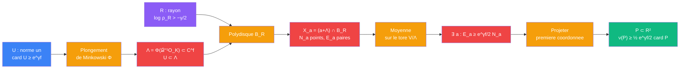

# Distance unite — etage fenetre (reseau de Minkowski, moyenne, projection)

> [Retour a Distance unite](../README.md) | Source : Section 2.1, Lemme 2.4, Lemme 2.5

## Le probleme

Transformer `U` — des translations de module 1 dans chaque coordonnee — en un ensemble **fini** du plan avec beaucoup de distances unite. Il faut une fenetre finie ou beaucoup de paires different d'un element de `U`. Puis une projection sur une coordonnee qui reste injective et garde les distances unite.

## La demarche

```
Donnees : U ⊂ 𝒟⁻¹ O_K (etage 4),  𝒟 := Q²,  |U| ≥ e^{γ f}

Plongement de Minkowski :
  pour chaque plongement reel de L, choisir une extension σ_r : K → C,  r = 1..f
  Φ : K → V = C^f,   Φ(x) = (σ_1(x), ..., σ_f(x))
  Λ := Φ(𝒟⁻¹ O_K) reseau de V ;   U ⊂ Λ
  chaque coordonnee de chaque u ∈ U a module 1          [etage 4]

Fenetre :
  ‖z‖_∞ := max_r |z_r|,   B_R := {‖z‖_∞ ≤ R} = produit de f disques de rayon R
  pour un translate a + Λ :
    X_a := (a + Λ) ∩ B_R,   N_a := |X_a|
    E_a := #{(x, x') ∈ X_a² : x' − x ∈ U}               [paires ordonnees]

Aires :
  b(R) := π R²                                          [un disque]
  a(R) := aire de l'intersection de deux disques de rayon R a distance 1
  ρ_R := a(R) / b(R) → 1 quand R → ∞
  choisir R > 1/2 avec log ρ_R > −γ/2

Moyenne sur le tore V/Λ (mesure de Haar de probabilite) :
  E[N_a] = vol(B_R) / covol(Λ) = b(R)^f / covol(Λ)      [depliement]
  pour u fixe : paires avec x' − x = u  <->  points de (a + Λ) ∩ B_R ∩ (B_R − u)
  vol(B_R ∩ (B_R − u)) = a(R)^f                         [chaque coordonnee de u a module 1]
  E[E_a] = |U| a(R)^f / covol(Λ) = |U| ρ_R^f E[N_a]

Existence :
  si tout translate non vide avait E_a < |U| ρ_R^f N_a, l'integrale contredirait l'egalite
  (les translates vides valent 0 des deux cotes)
  => ∃ a, X_a ≠ ∅ :  E_a ≥ |U| ρ_R^f N_a ≥ e^{γ f} · e^{−γ f/2} N_a = e^{γ f/2} N_a

Projection :
  X := X_a,   π_1 : V → C premiere coordonnee,   P := π_1(X) ⊂ C ≅ R²
  injectivite : π_1(x) = π_1(x') => x − x' = Φ(𝒟⁻¹β), σ_1(β) = 0
                σ_1 plongement de corps => β = 0 => x = x'
  distances :   |π_1(x + u) − π_1(x)| = |σ_1(u)| = 1
  paires distinctes de X² => paires planes distinctes [injectivite]
  une paire non ordonnee a deux orientations
  => 2 ν(P) ≥ E_a ≥ e^{γ f/2} |P|
```

## Circuit



## Role de chaque bloc

| Etape | Bloc | Contrat | Sens dans ce contexte |
|-------|------|---------|----------------------|
| 1 | Plongement de Minkowski | `K -> C^f` | un plongement par paire conjuguee ; `𝒟⁻¹O_K` devient un reseau `Λ` |
| 2 | Polydisque | `R_+ -> partie de C^f` | `B_R`, produit de `f` disques : fenetre finie |
| 3 | Moyenne sur le tore | `(V/Λ -> N) -> R` | esperance de `N_a` et de `E_a` sur tous les translates |
| 4 | Existence | `esperance -> translate` | un translate non vide atteint le rapport des moyennes `E[E_a] / E[N_a] = \|U\| ρ_R^f` |
| 5 | Projection | `C^f -> C` | `π_1` injective sur `X`, garde `\|σ_1(u)\| = 1` |

## Axiomes mobilises

| Code | Role | Type |
|------|------|------|
| FE1 | plongement de Minkowski : `𝒟⁻¹O_K` est un reseau de `C^f` | structurel |
| FE2 | depliement sur le tore : `E[card((a+Λ) ∩ S)] = vol(S) / covol(Λ)` | structurel |
| FE3 | `\|σ_r(u)\| = 1` pour tout `r` : `vol(B_R ∩ (B_R − u)) = a(R)^f` | numerique |
| FE4 | `ρ_R → 1` : il existe `R` avec `log ρ_R > −γ/2` | numerique |
| FE5 | moyenne => existence : une variable ne peut pas rester partout sous sa moyenne | numerique |
| FE6 | un plongement de corps est injectif : `π_1` injective sur un translate de `Λ` | structurel |

## Triple distinction

| Dimension | Fenetre |
|-----------|---------|
| **Sens** | en moyenne sur les translates, le nombre de paires vaut `\|U\| ρ_R^f` fois le nombre de points ; un translate non vide atteint ce rapport, puis une seule coordonnee suffit pour voir les distances unite |
| **Contrat** | `(U, \|U\| ≥ e^{γf}) -> P ⊂ R², ν(P) ≥ ½ e^{γ f/2} \|P\|` |
| **Cablage** | plongement de Minkowski + polydisque + moyenne sur le tore + existence + projection |

## Blocs reutilises

| Bloc | Occurrences | Role |
|------|-------------|------|
| [Plonger](../sens/plonger/) | x1 (repris dans [taille](taille.md)) | passer de `K` a un reseau geometrique `Λ` |
| [Moyenner](../sens/moyenner/) | x1 | version continue (Haar) : un translate atteint la moyenne |
| [Unitariser](../sens/unitariser/) | x1 | chaque coordonnee de `u` a module 1 : `vol(B_R ∩ (B_R − u)) = a(R)^f` |
| [Mesurer](../../../sens/mesurer/) | x1 | projection `π_1`, forme « premiere coordonnee » fixee |
| Depliement | x2 | `E[N_a]` et `E[E_a]` |
| [Ecart arithmetique](../vocabulaire/patterns.md#ecart-arithmetique) | forme degeneree | `σ_1(β) = 0 => β = 0` : injectivite de `π_1` |
| [Competition d'exposants](../vocabulaire/patterns.md#competition-dexposants) | x1 | `e^{γf}` contre `ρ_R^f` fixe `R` |
