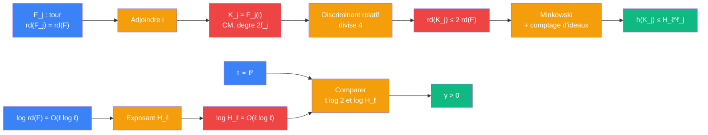

# Distance unite — etage nombre de classes (Minkowski)

> [Retour a Distance unite](../README.md) | Source : Proposition 3.7, Proposition 3.8 etape 4, Annexe A.13

## Le probleme

Apres adjonction de `i`, borner `h(K_j)` par `H^{f_j}` avec `H` independant de `j`. Puis verifier `γ = t log 2 − log H_ℓ > 0` : la perte due au groupe de classes doit rester plus petite que le gain des `2^{t f}` ideaux du niveau geometrique.

## La demarche

```
Donnees : tour F_j (etage 2),  rd(F_j) = rd(F),  q_b decomposes,  t = ⌊(ℓ−1)²/100⌋

Adjoindre i :
  K_j := F_j(i),  [K_j : Q] = 2 f_j,  corps CM
  d_{K_j/F_j} divise 4 O_{F_j}                       [discriminant de x² + 1]
  |D_{K_j}| = |D_{F_j}|² · N_{F_j/Q}(d_{K_j/F_j})    [formule de tour]
            ≤ |D_{F_j}|² · 4^{f_j}
  rd(K_j) = |D_{K_j}|^{1/(2 f_j)} ≤ 2 rd(F_j) = 2 rd(F)

Decomposition dans K_j :
  q_b ≡ 1 (mod 4) => x² + 1 scinde sur F_{q_b}
  => chaque premier v | q_b de F_j se decompose dans K_j

Nombre de classes :
  chaque classe contient un ideal entier de norme ≤ (C · √rd(K))^{[K:Q]}    [Minkowski]
  nombre d'ideaux de norme m ≤ d_n(m),  Σ_{m ≤ X} d_n(m) ≤ C^n X (1 + log X)^{n−1} / (n−1)!
  exponentiel en n = [K:Q] quand log X = O(n)
  => h(K) ≤ max{2, rd(K)}^{C_class · [K:Q]}           [Prop. 3.7, C_class absolue]

Application :
  h(K_j) ≤ (2 rd(F))^{C_class · 2 f_j} = H_ℓ^{f_j}
  H_ℓ := (2 rd(F))^{2 C_class}                        [independant de j]
  log H_ℓ = 2 C_class (log 2 + log rd(F)) = O(ℓ log ℓ)   [etage 1]

Bilan :
  t = ⌊(ℓ − 1)²/100⌋ ≥ (ℓ − 1)²/200                  [ℓ grand]
  t log 2 ≥ c · ℓ²   domine   log H_ℓ = O(ℓ log ℓ)
  => γ := t log 2 − log H_ℓ > 0                       [ℓ grand]
```

## Circuit



## Role de chaque bloc

| Etape | Bloc | Contrat | Sens dans ce contexte |
|-------|------|---------|----------------------|
| 1 | Adjoindre i | `corps totalement reel -> corps CM` | `K_j = F_j(i)`, `c` = automorphisme non trivial de `K_j/F_j` |
| 2 | Discriminant relatif | `K/F -> ideal de O_F` | `d_{K_j/F_j}` divise 4, donc `rd(K_j) ≤ 2 rd(F)` |
| 3 | Minkowski + comptage | `rd(K) -> borne sur h(K)` | `h(K) ≤ max{2, rd(K)}^{C_class [K:Q]}` |
| 4 | Exposant `H_ℓ` | `rd(F) -> R` | `H_ℓ = (2 rd(F))^{2 C_class}`, ne depend pas de `j` |
| 5 | Comparaison | `R x R -> bool` | `t log 2 > log H_ℓ` des que ℓ est grand |

## Axiomes mobilises

| Code | Role | Type |
|------|------|------|
| NC1 | `x² + 1` : le discriminant relatif de `F(i)/F` divise `4 O_F` | structurel |
| NC2 | formule de tour pour `K_j/F_j` | structurel |
| NC3 | borne de Minkowski : chaque classe contient un ideal entier de norme `≤ (C√rd(K))^{[K:Q]}` | structurel |
| NC4 | nombre d'ideaux de norme `m` au plus `d_n(m)`, somme exponentielle en `n` | numerique |
| NC5 | `q ≡ 1 (mod 4)` => `x² + 1` scinde modulo `q` | numerique |
| NC6 | croissance : `(ℓ−1)² log 2 / 200 > O(ℓ log ℓ)` pour ℓ grand | numerique |

## Triple distinction

| Dimension | Nombre de classes |
|-----------|-------------------|
| **Sens** | un discriminant racine borne force un nombre de classes au plus exponentiel en le degre ; la perte du pigeonhole devient negligeable devant `2^{t f}` |
| **Contrat** | `(F_j, rd(F_j) = rd(F)) -> (K_j, h(K_j) ≤ H_ℓ^{f_j}, γ > 0)` |
| **Cablage** | adjoindre `i` + borner `rd(K_j)` + Minkowski + comparer `t log 2` a `log H_ℓ` |

## Sortie : la donnee admissible

Cet etage ferme le niveau arithmetique. Sa sortie est l'interface lue par le niveau geometrique :

```
(L_j = F_j,  K_j = F_j(i),  q_1..q_t)
  f_j → ∞,  q_b ≡ 1 (mod 4),  q_b totalement decompose dans F_j
  h(K_j) ≤ H_ℓ^{f_j},  γ = t log 2 − log H_ℓ > 0
```

## Blocs reutilises

| Bloc | Occurrences | Role |
|------|-------------|------|
| [Jauger](../sens/jauger/) | x1 | `rd(K_j) ≤ 2 rd(F)` ([formule de tour](../sens/jauger/formule-de-tour.md)) |
| [Descendre](../sens/descendre/) | x1 | normes d'ideaux : compter les ideaux de norme `≤ X` |
| [Plonger](../sens/plonger/) | arriere-plan | la borne de Minkowski est de la geometrie des nombres sur `Φ(𝔞)` |
| [Borne de Minkowski](../sens/jauger/borne-minkowski.md) | x1 | convertir un discriminant racine borne en `h ≤ H^f` |
| [Signer](../sens/signer/) | x1 | `q_b ≡ 1 (mod 4)` : Frobenius trivial dans `Q(i)`, chaque `v \| q_b` se decompose dans `K_j` |
| [Competition d'exposants](../vocabulaire/patterns.md#competition-dexposants) | x1 | `t log 2 ≍ ℓ²` contre `log H_ℓ = O(ℓ log ℓ)` |
