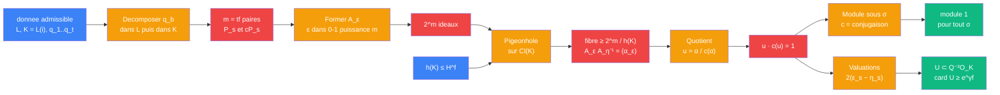

# Distance unite — etage norme un (pigeonhole sur les ideaux)

> [Retour a Distance unite](../README.md) | Source : Definition 2.1, Proposition 2.2, Annexe A.4

## Le probleme

A partir d'une donnee admissible, produire beaucoup d'elements `u ∈ K` avec `u · c(u) = 1`. Sous chaque plongement complexe, ils ont module 1 : ce sont des translations unite **simultanement dans toutes les coordonnees**. Il en faut au moins `e^{γ f}`, avec un denominateur fixe.

## La demarche

```
Donnees : donnee admissible (L, K = L(i), q_1..q_t),  h(K) ≤ H^f,  γ = t log 2 − log H

Paires de premiers :
  q_b totalement decompose dans L => f premiers 𝔮 de L au-dessus de q_b,  O_L/𝔮 ≅ F_{q_b}
  q_b ≡ 1 (mod 4) => x² + 1 scinde sur F_{q_b} => 𝔮 se decompose dans K
  => m = t f paires conjuguees {𝔓_s, c𝔓_s},  s = 1..m

Ideaux :
  pour ε ∈ {0,1}^m :  A_ε := ∏_{ε_s = 1} 𝔓_s · ∏_{ε_s = 0} c𝔓_s
  2^m ideaux, au plus h(K) classes

Pigeonhole :
  une fibre de ε ↦ [A_ε] ∈ Cl(K) a taille ≥ 2^m / h(K)
  fixer η dans cette fibre
  pour ε dans la fibre : A_ε A_η⁻¹ est principal, = (α_ε)

Norme un :
  u_ε := α_ε / c(α_ε)
  u_ε · c(u_ε) = 1,  donc N_{K/L}(u_ε) = 1
  L totalement reel => σ(c(α)) = conj(σ(α)) pour tout σ : K → C    [A.4]
  => |σ(u_ε)| = |σ(α_ε)| / |conj(σ(α_ε))| = 1

Denominateur :
  (u_ε) = A_ε A_η⁻¹ / c(A_ε A_η⁻¹)
  v_{𝔓_s}(u_ε) = 2(ε_s − η_s),   v_{c𝔓_s}(u_ε) = −2(ε_s − η_s)     ∈ {−2, 0, 2}
  poles d'ordre ≤ 2, tous au-dessus des q_b ;  Q·O_K a valuation 1 en ces premiers
  => Q² u_ε ∈ O_K,  donc U ⊂ Q⁻² O_K

Distinction :
  ε ≠ ε' => vecteurs de valuations distincts => u_ε ≠ u_ε'
  |U| ≥ 2^{t f} / h(K) ≥ 2^{t f} / H^f = e^{γ f}
```

## Circuit



## Role de chaque bloc

| Etape | Bloc | Contrat | Sens dans ce contexte |
|-------|------|---------|----------------------|
| 1 | Decomposition | `premier rationnel -> paires d'ideaux de K` | chaque `q_b` donne `f` paires conjuguees `{𝔓_s, c𝔓_s}` |
| 2 | Former les ideaux | `{0,1}^m -> ideaux de K` | choisir un premier par paire : `A_ε` |
| 3 | Pigeonhole | `ideaux -> Cl(K)` | une classe contient `≥ 2^m/h(K)` des `A_ε` |
| 4 | Quotient | `ideal principal -> K^×` | `u_ε = α_ε / c(α_ε)` |
| 5 | Module | `K -> R` sous chaque `σ` | `\|σ(u_ε)\| = 1` car `c` agit comme la conjugaison |
| 6 | Valuations | `K^× -> Z^{2m}` | `v_{𝔓_s}(u_ε) = 2(ε_s − η_s)` : denominateur `Q²`, injectivite |

## Axiomes mobilises

| Code | Role | Type |
|------|------|------|
| NU1 | `q_b` totalement decompose dans `L` : `f` premiers de degre 1 | structurel |
| NU2 | `q_b ≡ 1 (mod 4)` : chaque premier de `L` au-dessus de `q_b` se decompose dans `K` | structurel |
| NU3 | `Cl(K)` est fini, d'ordre `h(K)` | structurel |
| NU4 | corps CM : `σ ∘ c = conj ∘ σ` pour tout plongement complexe `σ` | structurel |
| NU5 | pigeonhole : `2^m` objets dans `h(K)` boites => une boite en contient `≥ 2^m/h(K)` | numerique |
| NU6 | valuations `v_{𝔓_s}(u_ε) = 2(ε_s − η_s)` : `ε ↦ u_ε` injective, poles d'ordre `≤ 2` | numerique |
| NU7 | `h(K) ≤ H^f` : `\|U\| ≥ e^{γ f}` | numerique |

## Triple distinction

| Dimension | Norme un |
|-----------|----------|
| **Sens** | des factorisations d'ideaux, rendues principales par pigeonhole, donnent des elements de module 1 sous **tous** les plongements a la fois |
| **Contrat** | `(donnee admissible) -> U ⊂ Q⁻²O_K, \|σ(u)\| = 1 pour tout σ, \|U\| ≥ e^{γ f}` |
| **Cablage** | decomposer les `q_b` + former `2^m` ideaux + pigeonhole sur `Cl(K)` + quotient `α / c(α)` + lire les valuations |

## Blocs reutilises

| Bloc | Occurrences | Role |
|------|-------------|------|
| [Unitariser](../sens/unitariser/) | x1 | `u_ε = α_ε / c(α_ε)`, module 1 partout |
| [Moyenner](../sens/moyenner/) | x1 | version discrete (tiroirs) : fibre `≥ 2^m / h(K)` |
| [Descendre](../sens/descendre/) | x1 | norme relative `N_{K/L}(u) = u · c(u) = 1` |
| [Signer](../sens/signer/) | x1 | `q_b ≡ 1 (mod 4)` et `q_b` decompose dans `L` : `m = tf` paires `{𝔓_s, c𝔓_s}` |
| [Pythagore complexe](../../pythagore/cablages/complexe.md) | x1 | `u · c(u) = 1` est la version relative de `\|z\|² = z · z̄` : module 1 = norme relative 1 |
| [Normer](../../../sens/normer/) | x1 | `\|σ(u)\|`, module dans chaque coordonnee complexe |
