# Distance unite — etage tour pro-3 (Golod–Shafarevich)

> [Retour a Distance unite](../README.md) | Source : Propositions 3.3 a 3.6, Proposition 3.8 etapes 2 et 3, Remarque 3.1, Annexe A.7 a A.10, A.12

## Le probleme

Transformer `F` en une tour infinie `F = F_0 ⊂ F_1 ⊂ F_2 ⊂ ⋯` de 3-extensions partout non ramifiees, ou `t` premiers rationnels **fixes** se decomposent totalement a chaque couche. Difficulte : imposer une decomposition ajoute une relation au groupe de Galois. Il faut rester sous le seuil de Golod–Shafarevich pour que la tour reste infinie.

C'est la methode de Hajir–Maire (tours `T`-decomposees, `S`-ramifiees) avec `S` vide : tour non ramifiee, `T` = premiers de `F` au-dessus des `q_b`.

## La demarche

```
Donnees : F (etage 1),  G = Gal(F^{ur,3}/F),  d := d(G) ≥ ℓ − 1

Rang des relations :
  r(G) ≤ d + C_0                                  [Shafarevich ; F totalement reel cubique, ζ_3 ∉ F]

Choix des premiers :
  E/F := extension de Frattini, Gal(E/F) = G/Φ(G)
  t := ⌊(ℓ − 1)²/100⌋
  q_1, ..., q_t distincts, hors de 3D,
    totalement decomposes dans la cloture normale sur Q de E(i)   [Chebotarev]
  => q_b totalement decompose dans Q(i), donc q_b ≡ 1 (mod 4)
  => q_b totalement decompose dans F               [F ⊂ E(i)]
  => pour v | q_b : Frobenius trivial dans G/Φ(G), donc σ_v ∈ Φ(G)

Quotient :
  k := nombre de premiers v de F au-dessus des q_b = 3t    [q_b totalement decompose dans F cubique]
  N := cloture normale fermee de {σ_v : v | q_b}
  Ḡ := G/N
  d(Ḡ) = d                                        [σ_v ∈ Φ(G) : non-generateurs]
  r(Ḡ) ≤ r(G) + 3t ≤ d + C_0 + 3d²/100            [t ≤ (ℓ−1)²/100 ≤ d²/100]
       < d²/4                                     [d grand, car 3/100 < 1/4]
  => Ḡ infini                                     [Golod–Shafarevich ; Ḡ non trivial car d ≥ 1]

Tour :
  Ḡ = H_0 ⊃ H_1 ⊃ H_2 ⊃ ⋯   sous-groupes ouverts distingues, indices → ∞
  F_j := corps fixe de H_j
  F_j/F finie, galoisienne, partout non ramifiee, de groupe un 3-groupe
  f_j = [F_j : Q] → ∞

Decomposition :
  σ_v trivial dans Ḡ => trivial dans chaque quotient Gal(F_j/F)
  => chaque v | q_b se decompose totalement dans F_j   [Frobenius trivial <=> decomposition totale, A.7]
  => chaque q_b se decompose totalement dans F_j

Totalement reel :
  une place reelle devenue complexe aurait un groupe de decomposition d'ordre 2
  impossible dans un 3-groupe => F_j totalement reel

Discriminant racine :
  F_j/F non ramifiee => d_{F_j/F} = O_F
  => |D_{F_j}| = |D_F|^{[F_j:F]} => rd(F_j) = rd(F)   [formule de tour]
```

## Circuit

```mermaid
graph LR
    F["F : corps cubique<br/>d(G) ≥ ℓ − 1"]:::blue --> SHA["Shafarevich"]:::curry
    SHA --> rG["r(G) ≤ d + C_0"]:::red

    F --> FRAT["Quotient de Frattini<br/>G/Φ(G)"]:::curry
    FRAT --> E["E/F elementaire<br/>abelienne"]:::red
    E --> CHEB["Chebotarev<br/>sur E(i)"]:::curry
    CHEB --> qb["q_1..q_t<br/>q_b ≡ 1 mod 4"]:::red
    qb --> FROB["Frobenius<br/>σ_v ∈ Φ(G)"]:::curry

    FROB --> KILL["Quotienter<br/>Ḡ = G/N"]:::curry
    rG --> KILL
    KILL --> rank["d(Ḡ) = d<br/>r(Ḡ) ≤ d + C_0 + 3d²/100"]:::red
    rank --> GS["Golod–Shafarevich<br/>r < d²/4"]:::curry
    GS --> inf["Ḡ infini"]:::red

    inf --> CHAIN["Chaine H_j<br/>corps fixes"]:::curry
    CHAIN --> tower["F_j, f_j → ∞<br/>rd(F_j) = rd(F)<br/>totalement reels"]:::green

    inf --> SPLIT["Frobenius trivial<br/>= decomposition totale"]:::curry
    SPLIT --> split["q_b decompose<br/>dans tout F_j"]:::green

    classDef blue fill:#3B82F6,color:#fff
    classDef green fill:#10B981,color:#fff
    classDef red fill:#EF4444,color:#fff
    classDef curry fill:#F59E0B,color:#fff
```



## Role de chaque bloc

| Etape | Bloc | Contrat | Sens dans ce contexte |
|-------|------|---------|----------------------|
| 1 | Shafarevich | `groupe pro-3 -> N` | borne les relations : `r(G) ≤ d(G) + C_0` |
| 2 | Quotient de Frattini | `G -> G/Φ(G)` | extension `E/F` qui « voit » tous les generateurs |
| 3 | Chebotarev | `extension finie de Q -> premiers` | `q_b` decomposes dans `E(i)` : `≡ 1 (mod 4)`, decomposes dans `F`, Frobenius dans `Φ(G)` |
| 4 | Frobenius | `premier de F -> element de G` | un representant `σ_v` par premier `v` au-dessus des `q_b` |
| 5 | Quotient | `(G, {σ_v}) -> Ḡ` | tuer les Frobenius : `d` inchange, `r` augmente de `3t` au plus |
| 6 | Golod–Shafarevich | `(d, r) -> {infini, indetermine}` | `r < d²/4` force `Ḡ` infini |
| 7 | Chaine de sous-groupes | `Ḡ -> (F_j)_j` | couches finies de la tour |
| 8 | Decomposition | `Frobenius trivial -> q_b decompose` | chaque `q_b` totalement decompose a chaque couche |

## Axiomes mobilises

| Code | Role | Type |
|------|------|------|
| TP1 | Shafarevich : `F` totalement reel cubique, `ζ_3 ∉ F` => `r(G) ≤ d(G) + C_0` | structurel |
| TP2 | Burnside : `d(G) = dim_{F_p} G/Φ(G)` | structurel |
| TP3 | quotient par `g_1..g_k ∈ Φ(G)` : `d(G/N) = d(G)`, `r(G/N) ≤ r(G) + k` | numerique |
| TP4 | Golod–Shafarevich : pro-p fini non trivial => `r > d²/4` | numerique |
| TP5 | Chebotarev : une infinite de premiers totalement decomposes dans toute extension galoisienne finie de `Q` | numerique |
| TP6 | Frobenius trivial <=> decomposition totale | structurel |
| TP7 | un 3-groupe n'a pas d'element d'ordre 2 => pas de ramification infinie | structurel |
| TP8 | extension finie non ramifiee => discriminant racine conserve | structurel |

## Triple distinction

| Dimension | Tour pro-3 |
|-----------|------------|
| **Sens** | imposer des decompositions coute des relations ; tant que les relations restent sous `d²/4`, la tour reste infinie — on achete la decomposition des `q_b` sans perdre l'infinitude |
| **Contrat** | `(F, d(G) ≥ ℓ − 1) -> ((F_j)_j tour infinie totalement reelle, rd(F_j) = rd(F), q_1..q_t decomposes dans tout F_j)` |
| **Cablage** | Shafarevich + quotient de Frattini + Chebotarev + tuer les Frobenius + Golod–Shafarevich + chaine de sous-groupes |

## Blocs reutilises

| Bloc | Occurrences | Role |
|------|-------------|------|
| [Galois](../meta-objets/galois.md) | x3 | `Φ(G) ↔ E`, `N ↔` sous-extension decomposee, `H_j ↔ F_j` |
| [Jauger](../sens/jauger/) | x1 | non ramifie => `rd(F_j) = rd(F)` ([formule de tour](../sens/jauger/formule-de-tour.md)) |
| [Seuil](../meta-sens/seuil.md) | x1 | Golod–Shafarevich : `r(Ḡ) < d²/4` => `Ḡ` infini |
| [Quotient de Frattini](../meta-sens/seuil/quotient-frattini.md) | x2 | choisir les premiers (`E/F`), garder `d` lors du quotient |
| [Signer](../sens/signer/) | x3 | Chebotarev produit les `q_b` ; `σ_v ∈ Φ(G)` ; Frobenius trivial => decomposition dans `F_j` |
| [Competition d'exposants](../vocabulaire/patterns.md#competition-dexposants) | x1 | `3t ≤ 3d²/100 < d²/4` fixe `t` |
