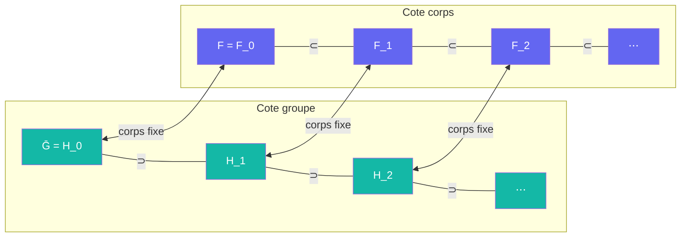

# Galois

> [Retour aux meta-objets](README.md) | [Distance unite](../README.md)

## Triple distinction

| Dimension | Galois |
|-----------|--------|
| **Sens** | traduire un sous-groupe en corps et un corps en sous-groupe : plus le groupe est petit, plus le corps est grand |
| **Contrat** | `Sous-groupes fermes(Gal(Ω/F)) <-> Corps intermediaires(F ⊂ · ⊂ Ω)` |
| **Cablage** | `H ↦ Ω^H` (corps fixe) ; `F' ↦ Gal(Ω/F')` (groupe qui fixe `F'`) |

## Comment ca marche

Galois est un meta-objet : son entree est une **structure** (un sous-groupe), pas une valeur. Il renverse les inclusions : `H ⊂ H'  <=>  Ω^H ⊃ Ω^{H'}`.

| Cote groupe | Cote corps |
|-------------|------------|
| `H` sous-groupe ferme | `Ω^H` corps intermediaire |
| `H` ouvert, d'indice `k` | `Ω^H` extension finie de degre `k` sur `F` |
| `H` distingue | `Ω^H / F` galoisienne, de groupe `G/H` |
| groupe de decomposition trivial en `v` ([Signer](../sens/signer/) : Frobenius trivial) | `v` totalement decompose |

Les sous-groupes **descendent**, les corps **montent** : une chaine decroissante de sous-groupes est une tour croissante de corps.

Version abelienne sur `Q` : un groupe `X` de caracteres de Dirichlet correspond au corps fixe de `∩_{χ ∈ X} ker χ`. « Le corps coupe par `χ` » (Annexe A.5) est Galois applique au noyau de `χ`.

## Usages dans la preuve

| Etage | Cote groupe | Cote corps |
|---------|-------------|------------|
| [Corps de base](../etages/corps-de-base.md) | `⟨χ_1⋯χ_ℓ⟩` | `F`, cubique cyclique |
| [Corps de base](../etages/corps-de-base.md) | `Gal(F^{ur,3}/M)`, de quotient `G/Gal(F^{ur,3}/M) ≅ (Z/3Z)^{ℓ−1}` | `M`, extension non ramifiee de `F` |
| [Tour pro-3](../etages/tour-pro-3.md) | `Φ(G)` | `E`, extension de Frattini |
| [Tour pro-3](../etages/tour-pro-3.md) | `N`, cloture normale des Frobenius `σ_v` | `(F^{ur,3})^N`, plus grande sous-extension ou tous les `v \| q_b` se decomposent |
| [Tour pro-3](../etages/tour-pro-3.md) | `H_j` ouverts distingues, indices `→ ∞` | `F_j` finis galoisiens, degres `→ ∞` |

La tour infinie est **construite cote groupe** (Golod–Shafarevich dit que `Ḡ` est infini) puis **lue cote corps** par Galois.

## Liens avec les meta-objets globaux

| Meta-objet | Lien |
|------------|------|
| [Invariance](../../../meta-objets/invariance.md) | `Ω^H` est exactement ce qui reste invariant sous `H` ; `Gal(Ω/F')` est le stabilisateur de `F'` |
| Dual (liste dans [meta-objets](../../../meta-objets/README.md), sans fiche) | Galois renverse le sens des inclusions, comme Dual renverse les fleches |
