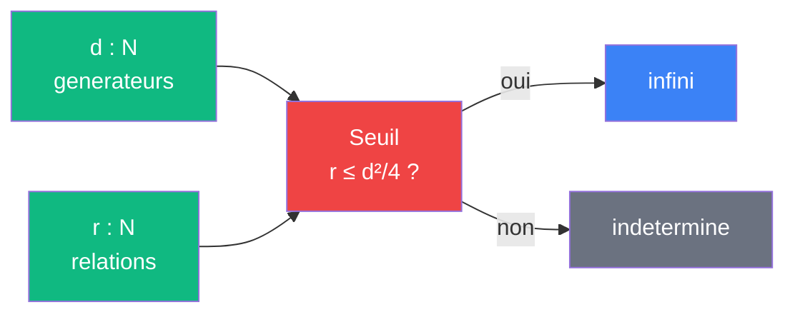

# Seuil

> [Retour aux meta-sens](README.md) | [Distance unite](../README.md)

`r(G) ≤ d(G)²/4  =>  G infini`

- **Sens** -- decider qu'un groupe pro-p est infini en comptant seulement ses generateurs et ses relations
- **Contrat** -- `(d, r) -> {infini, indetermine}` (pour `G` pro-p finiment engendre, non trivial)
- **Ports** -- `d = d(G)`, `r = r(G)` en entree ; verdict en sortie
- **Cablage** -- Shafarevich + quotient de Frattini -> compter `(d, r)` -> comparer a `d²/4` ([detail](seuil/quotient-frattini.md))

## Comment ca marche

Golod–Shafarevich : un pro-p groupe **fini** non trivial verifie toujours `r > d²/4`. Par contraposee, `r ≤ d²/4` force l'infinitude. La forme `d²/4` est due a Gaschütz–Vinberg (1965) ; Golod–Shafarevich (1964) donnaient `(d−1)²/4`. Le verdict est a sens unique : `r > d²/4` ne permet pas de conclure.

Seuil est un meta-sens : il ne calcule pas une valeur de la tour, il decide une **condition de possibilite**. La tour infinie existe-t-elle ?

## Budget de relations

Le seuil se lit comme un budget. `G` part avec `r ≤ d + C_0` relations. Le seuil autorise jusqu'a `d²/4`. Chaque decomposition imposee coute une relation.

| Poste | Relations | Ordre |
|-------|-----------|-------|
| depart (Shafarevich) | `≤ d + C_0` | lineaire en `d` |
| decompositions imposees | `3t ≤ 3d²/100` | quadratique, coefficient `3/100` |
| seuil | `d²/4` | quadratique, coefficient `1/4 = 25/100` |

`3/100 < 25/100` : il reste de la marge pour `d` grand. C'est une [competition d'exposants](../vocabulaire/patterns.md#competition-dexposants) sur les coefficients quadratiques.

## Analogie avec Frontiere

| | [Frontiere](../../../meta-sens/frontiere.md) | Seuil |
|---|---|---|
| **Entree** | encodage de Godel `G ∈ N` | presentation `(d, r)` |
| **Seuil** | `σ_c`, abscisse de convergence | `r = d²/4` |
| **Verdict** | le produit d'Euler converge ou diverge | la tour est infinie, ou on ne sait pas |

Hypothese de lecture : une presentation pro-p ressemble a un circuit. Les generateurs sont des entrees libres, les relations sont des contraintes entre elles. Seuil dit que peu de contraintes face a beaucoup d'entrees laissent l'objet infini.

## Etages

### Tour pro-3
[etages/tour-pro-3.md](../etages/tour-pro-3.md)

- `Ḡ = G/N` : `d(Ḡ) = d`, `r(Ḡ) ≤ d + C_0 + 3d²/100 < d²/4` → infini → tour `F_j` infinie, lue par [Galois](../meta-objets/galois.md)
