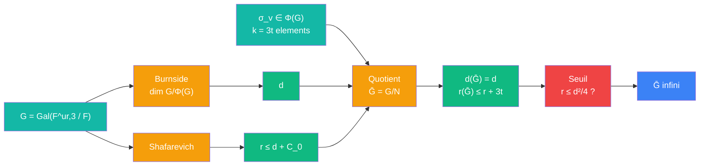

# Seuil -- cablage quotient de Frattini

> [Retour au meta-sens Seuil](../seuil.md) | Source : Propositions 3.3 a 3.5, Proposition 3.8 etape 2

## Comment ca marche

Le cablage prepare les deux entrees de Seuil apres avoir impose les decompositions. Il ajoute des relations sans perdre de generateurs, en n'ajoutant que des elements du sous-groupe de Frattini `Φ(G)`.

```
Generateurs :
  Φ(G) = ∩ sous-groupes maximaux ouverts = closure(G^p [G, G])
  d(G) = dim_{F_p} G/Φ(G)                         [Burnside]

Relations de depart :
  r(G) ≤ d(G) + C_0                               [Shafarevich ; F totalement reel cubique, ζ_3 ∉ F]

Quotient par des non-generateurs :
  g_1, ..., g_k ∈ Φ(G),  N := cloture normale fermee de {g_i}
  N ⊂ Φ(G) => (G/N) / Φ(G/N) ≅ G/Φ(G)  =>  d(G/N) = d(G)
  presentation de G/N = presentation de G + k relations  =>  r(G/N) ≤ r(G) + k

Dans la preuve :
  g_i = σ_v, Frobenius des k = 3t premiers v | q_b de F
  σ_v ∈ Φ(G) parce que q_b se decompose dans E (extension de Frattini)
  => d(Ḡ) = d,  r(Ḡ) ≤ d + C_0 + 3t
```



## Blocs reutilises

| Bloc | Contrat | Role |
|------|---------|------|
| [Signer](../../sens/signer/) | `premier -> classe de G` | fournit les `σ_v` ; Chebotarev garantit `σ_v ∈ Φ(G)` |
| [Seuil](../seuil.md) | `(d, r) -> {infini, indetermine}` | verdict final |
| [Galois](../../meta-objets/galois.md) | `sous-groupes <-> corps` | `Φ(G) ↔ E` ; lire `Ḡ` comme une tour de corps |

## Triple distinction

| Dimension | Quotient de Frattini |
|-----------|----------------------|
| **Sens** | tuer des non-generateurs coute des relations, jamais des generateurs |
| **Contrat** | `(G, g_1..g_k ∈ Φ(G)) -> (d(G/N), r(G/N)) = (d(G), ≤ r(G) + k)` |
| **Cablage** | Burnside + Shafarevich + quotient par la cloture normale -> Seuil |
