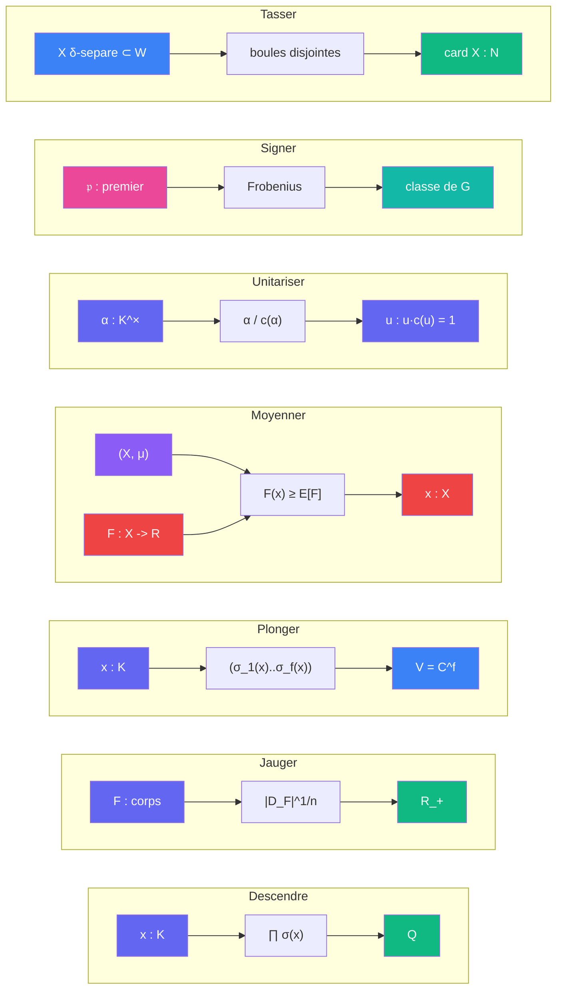

# Sens — distance unite

> [Retour a Distance unite](../README.md) | [Espaces locaux](../vocabulaire/espaces.md) | [Sens globaux](../../../sens/README.md)

Blocs extraits de la preuve. Chacun a un seul contrat et sert dans au moins deux [etages](../etages/) ou fait le pont avec un autre theoreme.

## Blocs atomiques

| Sens | Contrat | Role dans la preuve |
|------|---------|---------------------|
| [Plonger](plonger/) | `K -> V = C^f` | adaptateur d'espace : l'arithmetique de `K` devient la geometrie d'un reseau |
| [Moyenner](moyenner/) | `(X, μ, F : X -> R) -> X` | une quantite atteint sa moyenne quelque part : tiroirs, moyenne sur le tore |
| [Signer](signer/) | `premier -> classe de Gal(N/F)` | Frobenius ; reciproque Chebotarev : choisir les premiers fixes `q_b` |
| [Tasser](tasser/) | `(X δ-separe ⊂ W) -> card X` | packing : la fenetre ne contient que `e^{Bf}` points |

## Sens derives

| Sens | Contrat | Derivation |
|------|---------|------------|
| [Descendre](descendre/) | `K -> Q`, restreint `O_K \ {0} -> Z \ {0}` | [Ponderer](../../../sens/ponderer/) itere sur tous les plongements ([produit des conjugues](descendre/produit-conjugues.md)) |
| [Jauger](jauger/) | `corps de nombres -> R_+` | discriminant normalise par le degre ([formule de tour](jauger/formule-de-tour.md)) ; converti en `h(K)` par la [borne de Minkowski](jauger/borne-minkowski.md) |
| [Unitariser](unitariser/) | `K^× -> {u : u·c(u) = 1}` | quotient d'un element par son conjugue ([quotient conjugue](unitariser/quotient-conjugue.md)) |

## Sens globaux reutilises

| Sens | Ou | Role |
|------|----|------|
| [Mesurer](../../../sens/mesurer/) | [fenetre](../etages/fenetre.md) | projection `π_1 : V -> C` = forme lineaire « premiere coordonnee » fixee |
| [Normer](../../../sens/normer/) | [norme un](../etages/norme-un.md) | module `\|σ(u)\|` dans chaque coordonnee |
| [Ponderer](../../../sens/ponderer/) | cablages internes de Descendre, Jauger, Unitariser | produits et quotients |

## Usage par etage

| Etage | Descendre | Jauger | Plonger | Moyenner | Unitariser | Signer | Tasser |
|---------|:---------:|:------:|:-------:|:--------:|:----------:|:------:|:------:|
| [Corps de base](../etages/corps-de-base.md) | x | x | | | | | |
| [Tour pro-3](../etages/tour-pro-3.md) | | x | | | | x | |
| [Nombre de classes](../etages/nombre-classes.md) | x | x | x | | | x | |
| [Norme un](../etages/norme-un.md) | x | | | x | x | x | |
| [Fenetre](../etages/fenetre.md) | | | x | x | x | | |
| [Taille](../etages/taille.md) | x | | x | | | | x |

Le meta-sens [Seuil](../meta-sens/seuil.md) agit dans [tour pro-3](../etages/tour-pro-3.md), le meta-objet [Galois](../meta-objets/galois.md) dans [corps de base](../etages/corps-de-base.md) et [tour pro-3](../etages/tour-pro-3.md).

Le niveau arithmetique tourne autour de **Jauger**, le niveau geometrique autour de **Plonger**. **Descendre** traverse les deux.

---

[<- Distance unite](../README.md) | [Meta-objets ->](../meta-objets/)
