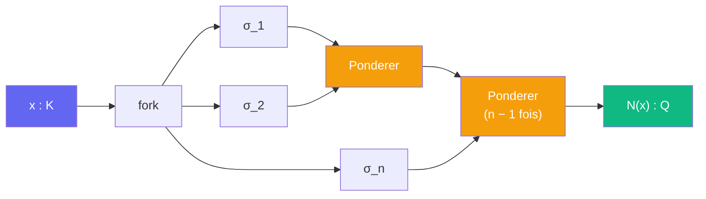

# Descendre -- cablage

> [Retour au sens Descendre](README.md)

## Comment ca marche

On branche `x` sur les `n` plongements `σ_1, ..., σ_n : K -> C`, puis on multiplie les `n` sorties par [Ponderer](../../../../sens/ponderer/) en chaine. Le produit est fixe par tout automorphisme de Galois : il appartient a `Q`.



## Cas CM : la forme utilisee dans la preuve

Pour `K = L(i)` CM de degre `2f`, les plongements vont par paires conjuguees `{σ_r, conj ∘ σ_r}`. On en garde un par paire, comme [Plonger](../plonger/) :

```
N_{K/Q}(x) = ∏_{r=1}^{f} σ_r(x) · conj(σ_r(x)) = ∏_{r=1}^{f} |σ_r(x)|²

=>  ∏_{r=1}^{f} |σ_r(x)| = |N_{K/Q}(x)|^{1/2}
```

Le produit des modules des `f` coordonnees de `Φ(x)` est donc la racine de la norme. C'est l'egalite que [taille](../../etages/taille.md) combine avec l'ecart entier `|N(β)| ≥ 1`.

## Blocs reutilises

| Bloc | Contrat | Role |
|------|---------|------|
| fork | `K -> K^n` | dupliquer `x` sur chaque plongement |
| [Plonger](../plonger/) (composantes) | `K -> C` | les `σ_r` |
| [Ponderer](../../../../sens/ponderer/) | `R x R -> R`, ici etendu a `C x C -> C` | `n − 1` multiplications |

## Triple distinction

| Dimension | Descendre |
|-----------|-----------|
| **Sens** | ecraser toutes les copies complexes d'un nombre algebrique en un seul nombre rationnel |
| **Contrat** | `K -> Q` (`O_K \ {0} -> Z \ {0}`) |
| **Cablage** | fork -> plongements -> Ponderer en chaine |
