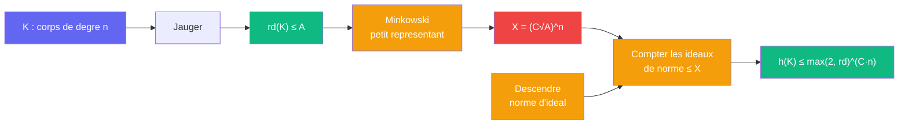

# Jauger -- cablage borne de Minkowski

> [Retour au sens Jauger](README.md) | Source : Proposition 3.7, Annexe A.13, reponse brute du modele (inegalite (5))

## Comment ca marche

Ce cablage convertit la sortie de Jauger en une borne sur le nombre de classes. Si `rd(K)` est borne, `h(K)` est au plus exponentiel en le degre.

```
Donnees : K de degre n,  rd(K) ≤ A

Petit representant :
  chaque classe d'ideaux contient un ideal entier 𝔞 avec
  N(𝔞) ≤ M_K = (4/π)^{r_2} · (n!/n^n) · √|D_K|        [Minkowski]
       ≤ √|D_K| = rd(K)^{n/2}                          [le facteur devant est ≤ 1 pour n ≥ 2]
  => X := (C √A)^n suffit,  log X = O_A(n)

Comptage :
  h(K) ≤ card{ideaux entiers de norme ≤ X}
  card{ideaux entiers de norme m} ≤ d_n(m)             [d_n = fonction diviseur a n facteurs]
  Σ_{m ≤ X} d_n(m) ≤ C^n · X · (1 + log X)^{n−1} / (n−1)!
  exponentiel en n quand log X = O_A(n)

Resultat :
  h(K) ≤ max{2, rd(K)}^{C_class · [K:Q]},   C_class absolue
```



## Application dans la preuve

[Nombre de classes](../../etages/nombre-classes.md) : `K_j = F_j(i)`, `rd(K_j) ≤ 2 rd(F)`, `[K_j:Q] = 2 f_j`, d'ou

```
h(K_j) ≤ (2 rd(F))^{2 C_class f_j} = H_ℓ^{f_j},   log H_ℓ = O(ℓ log ℓ)
```

`H_ℓ` ne depend pas de `j` : c'est le point. Le degre monte le long de la tour, mais `rd` reste fixe, donc la base de l'exponentielle aussi.

## Blocs reutilises

| Bloc | Contrat | Role |
|------|---------|------|
| [Jauger](README.md) | `corps -> R_+` | entree `rd(K)` |
| [Descendre](../descendre/) | `I(K) -> Z_{≥1}` | norme des ideaux comptes |
| [Plonger](../plonger/) | `K -> C^f` | arriere-plan : la borne de Minkowski est un argument de volume sur le reseau `Φ(𝔞)` |

## Triple distinction

| Dimension | Borne de Minkowski |
|-----------|--------------------|
| **Sens** | un corps de petite taille par degre a peu de classes par degre |
| **Contrat** | `rd(K) ≤ A -> h(K) ≤ C(A)^{[K:Q]}` |
| **Cablage** | Jauger -> petit representant de Minkowski -> compter les ideaux de petite norme |
