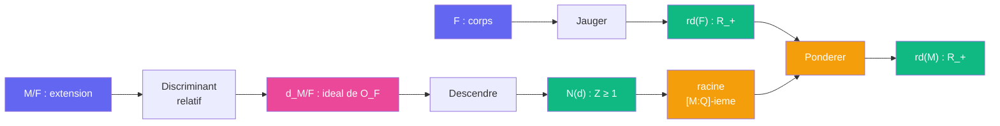

# Jauger -- cablage

> [Retour au sens Jauger](README.md)

## Comment ca marche

La formule de tour (Annexe A.6) relie les discriminants de `M` et de `F` par le discriminant relatif `d_{M/F}`, un ideal de `O_F` :

```
|D_M| = |D_F|^{[M:F]} · N_{F/Q}(d_{M/F})
```

On prend la racine `[M:Q]`-ieme des deux cotes. Comme `[M:Q] = [M:F]·[F:Q]` :

```
rd(M) = rd(F) · N_{F/Q}(d_{M/F})^{1/[M:Q]}
```

`rd` augmente exactement de la part ramifiee. [Descendre](../descendre/) transforme l'ideal `d_{M/F}` en un entier `≥ 1`, qui vaut 1 si et seulement si `M/F` est non ramifiee aux places finies.



## Les trois cas de la preuve

| Cas | `d_{M/F}` | Facteur `N(d)^{1/[M:Q]}` | Resultat |
|-----|-----------|--------------------------|----------|
| `M/F` compositum cyclotomique | `O_F` (force par le calcul des conducteurs) | 1 | `rd(M) = rd(F)` : non ramifiee aux places finies |
| `F_j/F` couche de la tour | `O_F` (tour non ramifiee) | 1 | `rd(F_j) = rd(F)` |
| `K_j = F_j(i)` | divise `4 O_{F_j}` | `≤ (4^{f_j})^{1/(2 f_j)} = 2` | `rd(K_j) ≤ 2 rd(F)` |

Pour un corps abelien sur `Q`, le discriminant lui-meme se calcule par conducteur-discriminant : `|D_L| = ∏_{ψ ∈ X} f(ψ)`. C'est ainsi que [corps de base](../../etages/corps-de-base.md) obtient `|D_F| = D²` et `|D_M| = D^{2·3^{ℓ−1}}`.

## Blocs reutilises

| Bloc | Contrat | Role |
|------|---------|------|
| [Descendre](../descendre/) | `I(F) -> Z_{≥1}` | norme du discriminant relatif |
| racine | `R_+ -> R_+` | normaliser par le degre |
| [Ponderer](../../../../sens/ponderer/) | `R x R -> R` | `rd(F) × facteur de ramification` |

## Triple distinction

| Dimension | Jauger |
|-----------|--------|
| **Sens** | le discriminant racine ne bouge que si l'extension ramifie en une place finie |
| **Contrat** | `corps de nombres -> R_+` |
| **Cablage** | discriminant relatif -> Descendre -> racine -> Ponderer par `rd(F)` |
