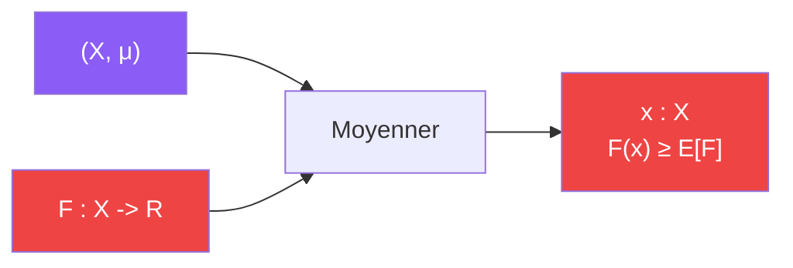

# Moyenner

> [Retour aux sens](../README.md) | [Distance unite](../../README.md)

`∃ x : F(x) ≥ E_μ[F]`

- **Sens** -- une quantite ne peut pas rester partout sous sa moyenne : un point au moins fait aussi bien que la moyenne
- **Contrat** -- `(X, μ, F : X -> R) -> X` (sortie : un temoin `x`)
- **Ports** -- `X` espace, `μ` mesure de probabilite, `F` fonction (entrees) ; `x in X` (sortie)
- **Origine** -- atomique

## Comment ca marche

Si `F(x) < E[F]` pour tout `x`, alors en integrant `E[F] < E[F]` : contradiction. Le bloc ne dit pas **ou** est le temoin, seulement qu'il existe. C'est une preuve d'existence non constructive.

Deux versions, un seul contrat :

| Version | `X` | `μ` | `F` | Moyenne | Temoin |
|---------|-----|-----|-----|---------|--------|
| **discrete** (tiroirs) | `Cl(K)` | uniforme | `c ↦ card{ε : [A_ε] = c}` | `2^m / h(K)` | une classe riche, representee par `η` |
| **continue** (Haar) | tore `V/Λ` | Haar | `a ↦ E_a − \|U\| ρ_R^f N_a` | 0 | un translate `a` non vide |

Dans la version continue, les translates vides donnent `F = 0`. Si tout translate non vide donnait `F < 0`, la moyenne serait `< 0`, car l'ensemble des translates non vides a une mesure positive (`E[N_a] > 0`).

## Difference avec Concentrer

| | [Concentrer](../../../../sens/concentrer/) | Moyenner |
|---|---|---|
| **Contrat** | `R_+ x X x (X -> R) -> R` | `(X, μ, F) -> X` |
| **Sortie** | une valeur locale `f(x_0)` | un point temoin |
| **Geste** | du global vers une valeur locale | du global vers une existence locale |

## Etages

### Norme un
[etages/norme-un.md](../../etages/norme-un.md)

- version discrete : `2^m` ideaux dans `h(K)` classes → une fibre `≥ 2^m / h(K)` → `|U| ≥ e^{γf}`

### Fenetre
[etages/fenetre.md](../../etages/fenetre.md)

- version continue : `E[E_a] = |U| ρ_R^f E[N_a]` → un translate avec `E_a ≥ e^{γf/2} N_a`

---

[<- Plonger](../plonger/) | [Unitariser ->](../unitariser/)
