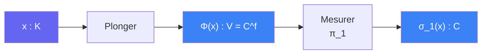

# Plonger

> [Retour aux sens](../README.md) | [Distance unite](../../README.md)

`Φ(x) = (σ_1(x), ..., σ_f(x))`

- **Sens** -- voir un nombre algebrique comme un point d'un espace geometrique : une coordonnee complexe par plongement
- **Contrat** -- `K -> V = C^f` (pour `K` CM de degre `2f` : un plongement par paire conjuguee)
- **Ports** -- `x in K` (entree), `V` (sortie)
- **Origine** -- atomique ; adaptateur d'espace : `K` et `V` sont incompatibles sans lui ([espaces](../../vocabulaire/espaces.md))

## Comment ca marche

Chaque plongement `σ_r : K -> C` est un morphisme de corps. Les mettre cote a cote donne une application additive et multiplicative coordonnee par coordonnee. L'image d'un ideal fractionnaire comme `𝒟⁻¹O_K` est un **reseau** `Λ` de `V` (rang `2f = dim_R V`).

Trois proprietes servent :

| Propriete | Enonce | Usage |
|-----------|--------|-------|
| **Additivite** | `Φ(x) − Φ(x') = Φ(x − x')` | une difference de points du reseau est l'image d'un element de `K` : l'arithmetique controle la geometrie |
| **Injectivite par coordonnee** | `σ_1(x) = 0 => x = 0` | une seule coordonnee (`π_1` = [Mesurer](../../../../sens/mesurer/)) ne perd rien sur un translate de `Λ` |
| **Produit des coordonnees** | `∏_r \|σ_r(x)\|² = \|N_{K/Q}(x)\|` | lien avec [Descendre](../descendre/) : ecart entier => separation |

Un element de module 1 dans chaque coordonnee (sortie de [Unitariser](../unitariser/)) devient une translation de `V` qui deplace chaque disque de exactement 1.

## Etages

### Fenetre
[etages/fenetre.md](../../etages/fenetre.md)

- `x ∈ 𝒟⁻¹O_K` → reseau `Λ = Φ(𝒟⁻¹O_K)`, avec `U ⊂ Λ` ; moyenne sur le tore `V/Λ`
- projection `π_1 ∘ Φ = σ_1` → injective sur un translate de `Λ`, garde `|σ_1(u)| = 1`

### Taille
[etages/taille.md](../../etages/taille.md)

- `x − x' = Φ(𝒟⁻¹β)` → produit des coordonnees via Descendre → separation `𝒟⁻¹` en norme sup

### Nombre de classes (arriere-plan)
[etages/nombre-classes.md](../../etages/nombre-classes.md)

- la borne de Minkowski sur `h(K)` est un argument de geometrie des nombres sur le reseau `Φ(𝔞)`. Le PDF la cite (Prop. 3.7) sans la deplier.

---

[<- Jauger](../jauger/) | [Moyenner ->](../moyenner/)
