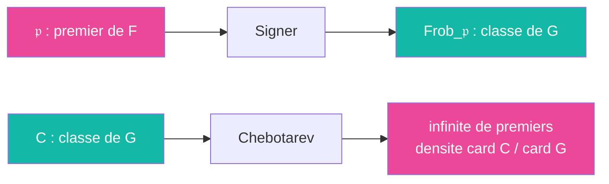

# Signer

> [Retour aux sens](../README.md) | [Distance unite](../../README.md)

`Frob_𝔓 : x ↦ x^{N(𝔭)} (mod 𝔓)`

- **Sens** -- attribuer a chaque premier non ramifie un element du groupe de Galois qui resume comment il se decompose
- **Contrat** -- `premier 𝔭 de F, non ramifie dans N -> classe de conjugaison de Gal(N/F)`
- **Ports** -- `𝔭 in I(F)` (entree), classe dans `G` (sortie)
- **Origine** -- atomique ; reciproque : Chebotarev, `classe -> infinite de premiers`

## Comment ca marche

Au-dessus de `𝔭`, un premier `𝔓` de `N` a un corps residuel `O_N/𝔓`, extension finie de `O_F/𝔭 = F_q`. Le groupe de Galois d'une extension de corps finis est cyclique, engendre par `x ↦ x^q`. Si `𝔭` est non ramifie, ce generateur se releve en un unique element de `Gal(N/F)` : le Frobenius. Changer de `𝔓` au-dessus de `𝔭` le conjugue : seule sa **classe** depend de `𝔭`.

Ce que la signature dit de la decomposition :

| `Frob_𝔭` | Decomposition de `𝔭` dans `N` |
|----------|-------------------------------|
| identite | totalement decompose : `[N:F]` premiers, chacun de degre residuel 1 |
| d'ordre `k` | `[N:F]/k` premiers, chacun de degre residuel `k` |

Deux proprietes servent :

| Propriete | Enonce | Usage |
|-----------|--------|-------|
| **Compatibilite aux quotients** | pour `N' ⊂ N` galoisienne, `Frob_𝔭` dans `Gal(N'/F)` est l'image de `Frob_𝔭` dans `Gal(N/F)` | un Frobenius trivial en haut est trivial dans tout quotient |
| **Trivial <=> decompose** | `Frob_𝔭 = 1  <=>  𝔭` totalement decompose dans `N` | lire une decomposition comme une egalite dans un groupe |

## Reciproque : Chebotarev

Chaque classe `C` de `Gal(N/F)` est le Frobenius d'une infinite de premiers, de densite `card C / card G`. Avec `C = {1}` : une infinite de premiers se decomposent totalement dans `N`, et on peut en eviter tout ensemble fini.

## Etages

### Tour pro-3
[etages/tour-pro-3.md](../../etages/tour-pro-3.md)

- Chebotarev, `C = {1}` dans la cloture normale de `E(i)` sur `Q` → `q_1..q_t` hors de `3D`
- compatibilite : `q_b` decompose dans `E` → `Frob_v` trivial dans `Gal(E/F) = G/Φ(G)` → `σ_v ∈ Φ(G)`
- `σ_v` tue dans `Ḡ` → trivial dans chaque `Gal(F_j/F)` → `q_b` totalement decompose dans chaque `F_j`

### Norme un, Nombre de classes
[etages/norme-un.md](../../etages/norme-un.md) | [etages/nombre-classes.md](../../etages/nombre-classes.md)

- `N = Q(i)`, `Gal = Z/2Z` : `Frob_q` trivial `<=> q ≡ 1 (mod 4)` `<=>` `x² + 1` scinde mod `q` → chaque premier au-dessus de `q_b` se decompose dans `K = L(i)` en une paire `{𝔓, c𝔓}`

Le cote groupe / cote corps de cette lecture est le meta-objet [Galois](../../meta-objets/galois.md) : groupe de decomposition trivial `<=>` decomposition totale.

---

[<- Unitariser](../unitariser/) | [Tasser ->](../tasser/)
