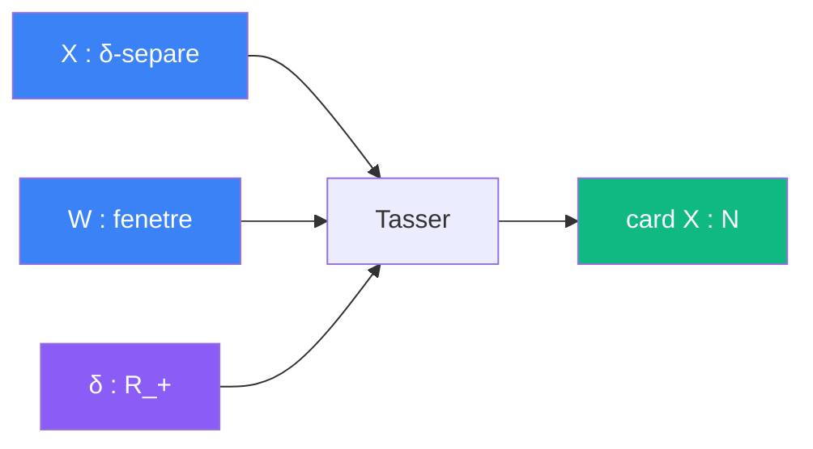

# Tasser

> [Retour aux sens](../README.md) | [Distance unite](../../README.md)

`card X · vol(B_{δ/2}) ≤ vol(W + B_{δ/2})`

- **Sens** -- compter des points par la place qu'ils occupent : des points espaces ne peuvent pas etre plus nombreux que ce que la fenetre peut contenir
- **Contrat** -- `(X ⊂ W, X δ-separe) -> card X ≤ vol(W + B_{δ/2}) / vol(B_{δ/2})`
- **Ports** -- `X` ensemble, `W` fenetre, `δ in R_+` separation (entrees) ; `N` (sortie)
- **Origine** -- atomique

## Comment ca marche

Autour de chaque point de `X`, on pose une boule ouverte de rayon `δ/2` pour la norme choisie. Ces boules sont deux a deux disjointes : sinon deux centres seraient a distance `< δ`. Toutes tiennent dans la fenetre elargie `W + B_{δ/2}`. La somme de leurs volumes est donc au plus le volume de la fenetre elargie.



En norme sup sur `V = C^f`, une boule est un polydisque : `vol(B_ρ) = (π ρ²)^f`. Le rapport des volumes devient une puissance `2f`-ieme :

```
card X ≤ ( (R + δ/2) / (δ/2) )^{2f} = (1 + 2R/δ)^{2f}     pour W = B_R
```

## Tasser et Moyenner

Les deux blocs comptent des points de reseau par des volumes, dans des sens opposes :

| | [Moyenner](../moyenner/) | Tasser |
|---|---|---|
| **Borne** | basse, sur un translate bien choisi | haute, sur tout ensemble separe |
| **Outil** | esperance `vol / covol` | boules disjointes |
| **Sortie dans la preuve** | `E_a ≥ e^{γf/2} N_a` | `n ≤ e^{Bf}` |

La preuve a besoin des deux : Moyenner fournit beaucoup de paires, Tasser empeche les points d'etre trop nombreux.

## Etages

### Taille
[etages/taille.md](../../etages/taille.md)

- `X` est `𝒟⁻¹`-separe ([ecart arithmetique](../../vocabulaire/patterns.md#ecart-arithmetique)), `W = B_R`, `δ = 𝒟⁻¹` → `n ≤ (1 + 2R𝒟)^{2f} ≤ (4R𝒟)^{2f} = e^{Bf}`

---

[<- Signer](../signer/) | [Sens ->](../README.md)
