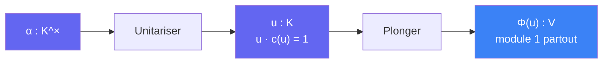

# Unitariser

> [Retour aux sens](../README.md) | [Distance unite](../../README.md)

`u = α / c(α)`

- **Sens** -- fabriquer, a partir de n'importe quel `α ≠ 0`, un element de module 1 dans **tous** les plongements a la fois
- **Contrat** -- `K^× -> S = {u ∈ K : u · c(u) = 1}` (`K` CM, `c` = conjugaison)
- **Ports** -- `α in K^×` (entree), `u in S` (sortie)
- **Origine** -- derive : quotient d'un element par son conjugue ([detail](quotient-conjugue.md)) ; version relative de [Normer](../../../../sens/normer/)

## Comment ca marche

Dans `C` : `z / z̄` a module 1. Pour `z = r e^{iθ}`, `z / z̄ = e^{2iθ}` : le module disparait, seul l'angle (double) reste. Dans un corps CM, `c` agit comme la conjugaison complexe sous **chaque** plongement. Donc `σ(α / c(α)) = σ(α) / conj(σ(α))` a module 1 pour tout `σ` en meme temps.

## Pont avec Pythagore

| | [Pythagore complexe](../../../pythagore/cablages/complexe.md) | Unitariser |
|---|---|---|
| **Geste** | multiplier par le conjugue | diviser par le conjugue |
| **Formule** | `z · z̄ = \|z\|²` | `α / c(α)`, module 1 |
| **Corps** | `C = R(i)` | `K = L(i)`, `L` totalement reel de degre `f` |
| **Coordonnees** | 1 | `f`, toutes a module 1 en meme temps |

`u · c(u) = 1` est [Descendre](../descendre/) en version relative : `N_{K/L}(u) = 1`.

## Lecture par ideaux

L'ideal de `u` est `(u) = 𝔄 / c(𝔄)` quand `(α) = 𝔄`. Les valuations en `𝔓` et `c𝔓` sont opposees. C'est ce qui rend `ε ↦ u_ε` injective et borne le denominateur dans [norme un](../../etages/norme-un.md).

Hors PDF : pour `K/L` cyclique, le theoreme 90 de Hilbert dit que **tout** `u` de norme relative 1 s'ecrit `α / c(α)`. Unitariser atteint donc tous les elements de `S`.

## Etages

### Norme un
[etages/norme-un.md](../../etages/norme-un.md)

- `α = α_ε` generateur de `A_ε A_η⁻¹` → `u_ε`, `|σ(u_ε)| = 1`, valuations `2(ε_s − η_s)`

### Fenetre
[etages/fenetre.md](../../etages/fenetre.md)

- `u ∈ U` comme translation → `vol(B_R ∩ (B_R − u)) = a(R)^f`, car chaque coordonnee a module 1

---

[<- Moyenner](../moyenner/) | [Signer ->](../signer/)
