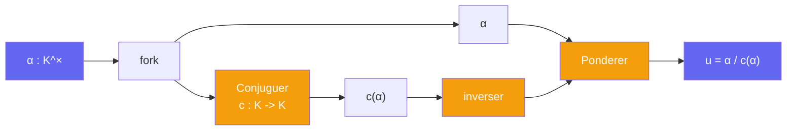

# Unitariser -- cablage

> [Retour au sens Unitariser](README.md)

## Comment ca marche

On duplique `α`. Une copie passe par la conjugaison `c`. On divise l'original par la copie conjuguee avec [Ponderer](../../../../sens/ponderer/) (`a = α`, `b = 1/c(α)`).



## Verification

```
u · c(u) = (α / c(α)) · (c(α) / c²(α))
         = (α / c(α)) · (c(α) / α)          [c² = id]
         = 1

Pour tout σ : K -> C :
  σ(c(α)) = conj(σ(α))                     [L totalement reel, K = L(i) CM]
  |σ(u)| = |σ(α)| / |conj(σ(α))| = 1
```

## Blocs reutilises

| Bloc | Contrat | Role |
|------|---------|------|
| fork | `K -> K x K` | dupliquer `α` |
| Conjuguer | `K -> K` | automorphisme `c` de `K/L`, involution |
| inverser | `K^× -> K^×` | `c(α) ↦ 1/c(α)` |
| [Ponderer](../../../../sens/ponderer/) | `R x R -> R`, ici dans `K` | `α · 1/c(α)` |

## Triple distinction

| Dimension | Unitariser |
|-----------|------------|
| **Sens** | garder l'angle, jeter le module, dans toutes les coordonnees a la fois |
| **Contrat** | `K^× -> {u : u · c(u) = 1}` |
| **Cablage** | fork -> conjuguer -> inverser -> Ponderer |
