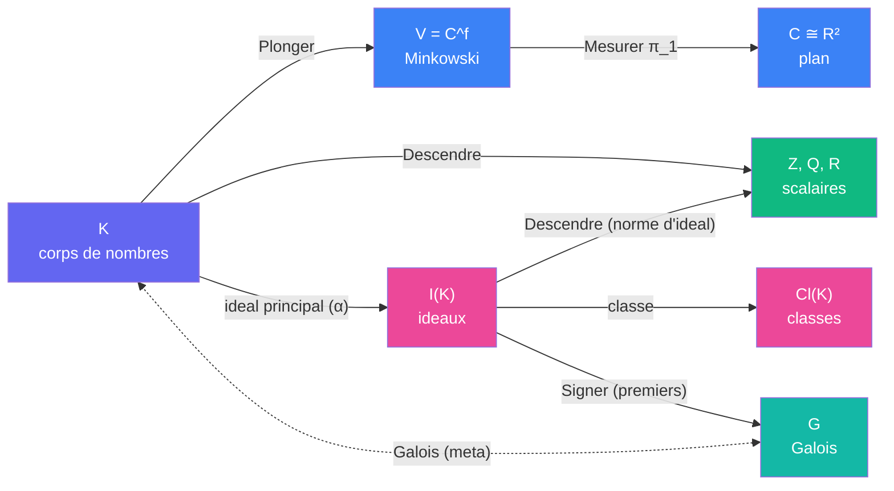

# Espaces — distance unite

> [Retour au vocabulaire](README.md) | [Espaces globaux](../../../vocabulaire/espaces.md)

Les espaces globaux (`E`, `E*`, `R`, `Omega`) ne suffisent pas : la preuve manipule des nombres algebriques, des ideaux et des groupes de Galois. Ces espaces s'ajoutent, avec les memes regles : deux ports se connectent seulement si leurs espaces sont identiques.

## Espaces

| Espace | Couleur | Role |
|--------|---------|------|
| `K` | indigo `#6366F1` | corps de nombres et ses parties : `O_K` (entiers), `K^×` (inversibles), `S = {u : u·c(u) = 1}` |
| `I(K)` | rose `#EC4899` | ideaux fractionnaires de `K` |
| `Cl(K)` | rose `#EC4899` | groupe de classes `I(K) / {ideaux principaux}`, fini d'ordre `h(K)` |
| `G` | teal `#14B8A6` | groupes de Galois : `Gal(F^{ur,3}/F)`, ses quotients `Ḡ`, `Gal(F_j/F)` |
| `V = C^f` | bleu `#3B82F6` | espace de Minkowski : un `E` de dimension reelle `2f` |
| `C ≅ R²` | bleu `#3B82F6` | le plan final : un `E` de dimension 2 |
| `Z`, `Q`, `R` | vert `#10B981` | scalaires |

Couleurs de role, comme dans les sens globaux : violet `#8B5CF6` pour un parametre (la mesure `μ` de [Moyenner](../sens/moyenner/)), rouge `#EF4444` pour une fonction ou une valeur intermediaire.

## Adaptateurs

Un adaptateur est le seul bloc qui relie deux espaces incompatibles.

| De | Vers | Bloc | Perte |
|----|------|------|-------|
| `K` | `V` | [Plonger](../sens/plonger/) | aucune : injectif |
| `K` | `Q` | [Descendre](../sens/descendre/) | forte : seul le produit des conjugues reste |
| `K^×` | `I(K)` | ideal principal `α ↦ (α)` | les unites de `O_K` |
| `I(K)` | `Cl(K)` | classe | tout sauf la classe |
| `I(K)` | `Q` | [Descendre](../sens/descendre/) (norme d'ideal) | forte |
| `V` | `C` | [Mesurer](../../../sens/mesurer/) `π_1` | aucune sur un translate du reseau (injectivite de `σ_1`) |
| `I(F)` (premiers non ramifies) | `G` (classes) | [Signer](../sens/signer/) | tout sauf la classe de conjugaison du Frobenius ; son ordre donne le type de decomposition |
| `G` | corps | [Galois](../meta-objets/galois.md) | aucune : bijection (niveau meta) |

[Norme un](../etages/norme-un.md) parcourt un adaptateur **a l'envers** : une classe triviale dans `Cl(K)` donne un ideal principal, dont on **choisit** un generateur `α ∈ K^×`. Ce choix n'est pas une fonction : `α` est defini a une unite pres.

## Incompatibilites

| Paire | Pourquoi |
|-------|----------|
| `K` x `V` | un nombre algebrique n'est pas un point avant d'avoir choisi ses plongements |
| `I(K)` x `K` | un ideal n'a pas de valeur numerique ; seul un ideal principal a un generateur, a une unite pres |
| `G` x `K` | un groupe n'agit pas comme une valeur : le passage est meta (Galois) |
