# Pythagore — cablage nombre complexe

> [Retour a Pythagore](../README.md)

## Le probleme

Montrer que `a² + b² = c²` en utilisant le module d'un nombre complexe. Pour z = a + ib, on definit |z|² = z · z̄ (conjugaison), et le calcul direct revele l'identite pythagoricienne comme consequence pure de l'algebre des complexes.

## La demarche

```
Axiomes : structure du corps C, conjugaison complexe

Pour z = a + ib :
  |z|² = z · z̄                                 [definition du module]
       = (a + ib)(a - ib)                      [z̄ = a - ib, conjugue]
       = a² - (ib)²                             [identite remarquable]
       = a² + b²                                [car i² = -1]

Pour un triangle rectangle d'hypotenuse de longueur |z| et cotes a, b :
  les sommets sont 0, a et a+ib dans le plan complexe
  les cotes ont pour longueurs : a, b et |a+ib|
  donc : |a+ib|² = a² + b², ce qui est Pythagore
```

## Circuit

```mermaid
graph LR
    a["a : R"]:::green --> COMPLEX["Construire<br/>z = a + ib"]:::curry
    b["b : R"]:::green --> COMPLEX

    COMPLEX --> z["z : C"]:::red

    z --> CONJ["Conjugaison<br/>z̄ = a - ib"]:::curry
    CONJ --> zbar["z̄ : C"]:::red

    z --> MULT["Multiplication<br/>z · z̄"]:::curry
    zbar --> MULT
    MULT --> zprod["z · z̄ : R"]:::red

    zprod --> EXPAND["Developper<br/>(a+ib)(a-ib)"]:::curry
    EXPAND --> dev["a² - (ib)² : R"]:::red

    dev --> SIMPL["Simplifier<br/>i² = -1"]:::curry
    SIMPL --> simp["a² + b² : R"]:::green

    z --> MOD["Module<br/>|z| = √(z·z̄)"]:::curry
    zprod --> MOD
    MOD --> mz["|z| : R"]:::red

    mz --> SQUARE["Carre du module<br/>|z|²"]:::curry
    SQUARE --> mz2["c² = |z|² : R"]:::red

    simp --> EGAL["Egaliser"]:::curry
    mz2 --> EGAL
    EGAL --> result["a² + b² = c² : bool"]:::green

    classDef green fill:#10B981,color:#fff
    classDef red fill:#EF4444,color:#fff
    classDef curry fill:#F59E0B,color:#fff
```



## Role de chaque bloc

| Etape | Bloc | Contrat | Sens dans ce contexte |
|-------|------|---------|----------------------|
| 1 | Construire complexe | `R x R -> C` | z = a + ib |
| 2 | Conjugaison | `C -> C` | z̄ = a - ib |
| 3 | Multiplication | `C x C -> R` | z · z̄ |
| 4 | Developper | `R -> R` | (a+ib)(a-ib) = a² - (ib)² |
| 5 | Simplifier i² | `R -> R` | a² - (ib)² = a² + b² |
| 6 | Module | `C x R -> R` | |z|² = z · z̄ |
| 7 | Carre du module | `R -> R` | c² = |z|² |
| 8 | Egalisation | `R x R -> bool` | a² + b² = c² |

## Axiomes mobilises

Statuts etablis par Lean : un axiome **essentiel** a un contre-modele, un axiome **superflu** a une preuve qui s'en passe ; les autres codes ne sont pas des axiomes du modele (motif entre parentheses). Details : [lean/README.md](../../../../lean/README.md), visualiseur [V10](../../../../app/10_statuts/).

| Code | Role | Statut (Lean) | Type |
|------|------|---------------|------|
| C1 | structure du corps C : addition et multiplication | inverses superflus (un anneau commutatif suffit) ; commutativite : hypothese cachee, non testee | structurel |
| C2 | conjugaison : z̄ = Re(z) - i·Im(z) | essentiel | structurel |
| C3 | propriete i² = -1 | essentiel | structurel |
| N1 | definition du module : |z|² = z · z̄ | definition, integree a l'enonce | structurel |
| N2 | identite remarquable : (a+ib)(a-ib) = a² - (ib)² | etape de calcul | numerique |
| N3 | simplification : -(ib)² = -i²b² = b² | etape de calcul | numerique |
| N4 | conservation du module par interpretation geometrique | hors preuve | numerique |

## Triple distinction

| Dimension | Pythagore complexe |
|-----------|---------------------|
| **Sens** | l'hypotenuse se deduit des deux cotes par multiplication d'un nombre complexe par son conjugue |
| **Contrat** | `R x R -> R` (entrees : a, b ; sortie : c = |a+ib|) |
| **Cablage** | construire z = a+ib + conjuguer + multiplier z·z̄ + developper + simplifier i² |

## Blocs reutilises

| Bloc | Occurrences | Role |
|------|-------------|------|
| Conjugaison | x1 | construire z̄ a partir de z |
| Multiplication | x1 | calculer z · z̄ |
| Simplification algebrique | x2 | developper et simplifier i² |
| Module | x1 | |z|² = a² + b² |

## Lien geometrique

Le caractere « geometrique » du module vient du fait que la multiplication par e^(iθ) (rotation) preserve le module : |e^(iθ) · z| = |z|. Cette propriete, deduite algebriquement de la definition du module, justifie l'interpretation des nombres complexes comme points du plan euclidien.
