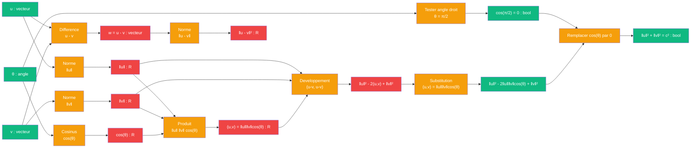

# Pythagore — cablage loi des cosinus

> [Retour a Pythagore](../README.md)

## Le probleme

Montrer que `a² + b² = c²` comme cas particulier de la loi des cosinus pour un triangle rectangle. La loi des cosinus, ‖u - v‖² = ‖u‖² + ‖v‖² - 2‖u‖‖v‖cos(θ), devient Pythagore lorsque l'angle θ est droit (cos(π/2) = 0).

## La demarche

```
Axiomes : produit scalaire, definition de l'angle entre vecteurs

Pour deux vecteurs u et v formant un angle θ :
  (u, v) = ‖u‖ ‖v‖ cos(θ)                      [definition analytique de l'angle]

Considerons w = u - v :
  ‖u - v‖² = (u - v, u - v)                    [definition de la norme]
           = ‖u‖² - 2(u, v) + ‖v‖²             [bilinearite]
           = ‖u‖² - 2‖u‖‖v‖cos(θ) + ‖v‖²       [remplacer (u,v)]

Lorsque θ = π/2 (angle droit), cos(θ) = 0 :
  ‖u - v‖² = ‖u‖² + ‖v‖²

C'est Pythagore, comme cas particulier d'une identite valable pour tous les angles.
```

## Circuit



## Role de chaque bloc

| Etape | Bloc | Contrat | Sens dans ce contexte |
|-------|------|---------|----------------------|
| 1 | Norme vecteurs | `vecteur -> R` | ‖u‖, ‖v‖ |
| 2 | Cosinus angle | `angle -> R` | cos(θ) |
| 3 | Produit scalaire | `R x R x R -> R` | ‖u‖‖v‖cos(θ) |
| 4 | Difference vecteurs | `vecteur x vecteur -> vecteur` | w = u - v |
| 5 | Norme difference | `vecteur -> R` | ‖u - v‖² |
| 6 | Developpement | `R x R x R -> R` | bilinearite + simplification |
| 7 | Substitution | `R -> R` | remplacer (u,v) par ‖u‖‖v‖cos(θ) |
| 8 | Test angle droit | `angle -> bool` | θ = π/2 ? |
| 9 | Application | `bool -> bool` | cos(π/2) = 0 => Pythagore |

## Axiomes mobilises

| Code | Role | Type |
|------|------|------|
| S1 | definition de l'angle entre vecteurs : (u,v) = ‖u‖‖v‖cos(θ) | structurel |
| S2 | bilinearite du produit scalaire | structurel |
| S3 | symetrie du produit scalaire | structurel |
| N1 | loi des cosinus derivee du produit scalaire | numerique |
| N2 | angle droit : θ = π/2 | numerique |
| N3 | cos(π/2) = 0 | numerique |
| N4 | identite remarquable : (a-b)² = a² - 2ab + b² | numerique |

## Triple distinction

| Dimension | Pythagore via loi des cosinus |
|-----------|---------------------|
| **Sens** | l'hypotenuse se deduit des deux cotes comme cas particulier (θ=π/2) de la loi des cosinus, laquelle formalise la notion d'angle dans un espace euclidien |
| **Contrat** | `vecteur x vecteur x angle -> bool` (entrees : u, v, θ ; sortie : verif c² = ‖u‖²+‖v‖²) |
| **Cablage** | normer u,v + fixer θ=π/2 + calculer cos(θ)=0 + appliquer loi des cosinus + verifier |

## Blocs reutilises

| Bloc | Occurrences | Role |
|------|-------------|------|
| Norme | x3 | ‖u‖, ‖v‖, ‖u-v‖ |
| Produit scalaire | x1 | (u,v) = ‖u‖‖v‖cos(θ) |
| Cosinus | x1 | cos(π/2) = 0 |
| Developpement bilineaire | x1 | (u-v, u-v) |

## Universalite de la formule

Pythagore n'est que le cas particulier θ=π/2 d'une formule bien plus generale. Cette vision montre que :
- Pour θ < π/2 (angle aigu) : ‖u-v‖² < ‖u‖² + ‖v‖² (le terme cos(θ) > 0 joue un role actif)
- Pour θ = π/2 (angle droit) : ‖u-v‖² = ‖u‖² + ‖v‖² (le terme cos(θ) s'annule)
- Pour θ > π/2 (angle obtus) : ‖u-v‖² > ‖u‖² + ‖v‖² (le terme cos(θ) < 0 augmente la distance)

L'invariant Pythagoricien n'est qu'une instance d'une symetrie angulaire beaucoup plus vaste.
