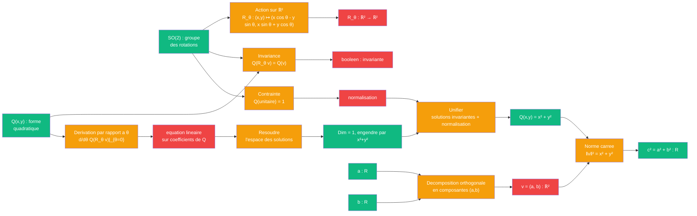

# Pythagore — cablage theorie des groupes

> [Retour a Pythagore](../README.md)

## Le probleme

Montrer que `a² + b² = c²` par invariance sous le groupe des rotations SO(2). L'espace des formes quadratiques sur ℝ² invariantes sous les rotations est de dimension 1 et engendre par Q(x,y) = x² + y². La longueur euclidienne au carre est cette unique forme quadratique invariante.

## La demarche

```
Axiomes : action lineaire de SO(2) sur ℝ², theorie des formes quadratiques invariantes

Theoreme : Dim(Inv_{SO(2)}(Q²(ℝ²))) = 1, engendre par Q(x,y) = x² + y²

Preuve : Si Q est invariante par toutes les rotations R_θ, alors :
  Q(R_θ v) = Q(v)  pour tout θ et tout v

En derivant par rapport a θ en θ = 0 :
  dQ/dθ|_{θ=0}(R_θ v) = 0

Cette derivation impose une equation lineaire sur les coefficients de Q.
L'espace des solutions (a scalaire multiplicatif pres) est exactement
celui engendre par x² + y².

La longueur euclidienne au carre est l'unique forme quadratique
invariante par SO(2) valant 1 sur les vecteurs unitaires.

Pour un vecteur dont les deux composantes orthogonales valent a et b :
  longueur² = x² + y² = a² + b²

C'est Pythagore, deduit de pures considerations de symetrie.
```

## Circuit



## Role de chaque bloc

| Etape | Bloc | Contrat | Sens dans ce contexte |
|-------|------|---------|----------------------|
| 1 | Groupe SO(2) | `∅ -> groupe` | groupe des rotations 2D |
| 2 | Action de groupe | `SO(2) x ℝ² -> ℝ²` | R_θ : v ↦ Rv |
| 3 | Forme quadratique | `ℝ² -> R` | Q(x,y) |
| 4 | Invariance | `Q x SO(2) -> bool` | Q(R_θ v) = Q(v) |
| 5 | Derivation | `Q -> equation` | d/dθ Q(R_θ v) = 0 |
| 6 | Resolution | `equation -> espace` | solutions de dim 1 |
| 7 | Normalisation | `forme -> R` | Q(unitaire) = 1 |
| 8 | Unicite | `solutions x norm -> forme` | Q unique = x² + y² |
| 9 | Application | `ℝ² -> R` | ‖(a,b)‖² = a² + b² |

## Axiomes mobilises

| Code | Role | Type |
|------|------|------|
| G1 | SO(2) est un groupe : composition, identite, inverse | structurel |
| G2 | action lineaire preservant la structure euclidienne | structurel |
| G3 | derivation d'une fonction invariante par un groupe en l'identite | structurel |
| A1 | forme quadratique : Q(λv) = λ² Q(v) | structurel |
| N1 | derivation et resolution d'equations differentielles | numerique |
| N2 | espace des solutions d'une equation lineaire homogene | numerique |
| N3 | normalisation : Q(v₀) = 1 pour v₀ unitaire | numerique |
| N4 | unicite a scalaire pres | numerique |

## Triple distinction

| Dimension | Pythagore par symetrie de groupe |
|-----------|---------------------|
| **Sens** | l'hypotenuse se deduit des deux cotes par l'unicite de la forme quadratique invariante sous rotations |
| **Contrat** | `groupe x forme -> forme_unique` (entrees : SO(2), Q quelconque ; sortie : Q(x,y)=x²+y²) |
| **Cablage** | definir action SO(2) + exprimer invariance + deriver condition + resoudre EDP + normaliser + etablir unicite |

## Blocs reutilises

| Bloc | Occurrences | Role |
|------|-------------|------|
| Action groupe | x1 | R_θ appliquee a vecteur |
| Derivation | x1 | d/dθ Q(R_θ v) en θ=0 |
| Resolution EDP | x1 | espace des formes invariantes |
| Normalisation | x1 | Q(unitaire) = 1 |
| Forme quadratique | x1 | evaluation x² + y² |

## Philosophie

Cette approche est la plus abstraite : elle ne construit pas de figure, ne decompose pas, ne calcule pas directement. Elle demande : "Quelle est l'UNIQUE forme quadratique qui respecte la symetrie rotationnelle ?" La reponse est x² + y², et pour un vecteur de composantes orthogonales (a,b), cela donne a² + b².

Pythagore emerge ici comme une **necessite logique**, consequence d'une symetrie fondamentale plutot que d'une construction ou d'un calcul. C'est peut-etre la vision la plus profonde du theoreme.
