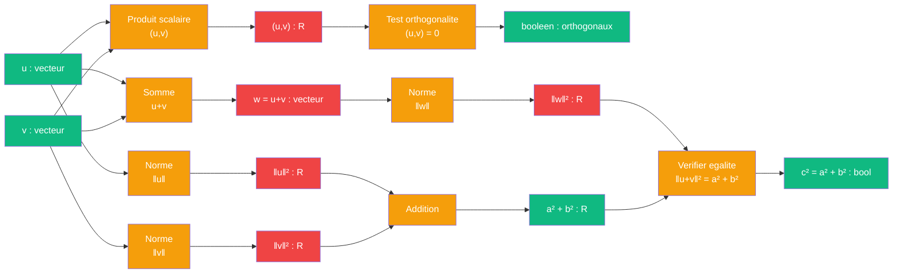

# Pythagore — cablage produit scalaire

> [Retour a Pythagore](../README.md)

## Le probleme

Montrer que `a² + b² = c²` en exploitant les proprietes du produit scalaire dans un espace prehilbertien. Pour deux vecteurs orthogonaux u et v, la norme de leur somme satisfait `‖u+v‖² = ‖u‖² + ‖v‖²`.

## La demarche

```
Axiomes : bilinearite, symetrie et positivite du produit scalaire
Norme definie par : ‖x‖² = (x, x)

Pour tous vecteurs u et v :
  ‖u+v‖² = (u+v, u+v)                          [definition de la norme]
         = (u,u) + 2(u,v) + (v,v)              [bilinearite du produit scalaire]
         = ‖u‖² + 2(u,v) + ‖v‖²                [definition de la norme]

Lorsque u et v sont orthogonaux, (u,v) = 0 par definition :
  ‖u+v‖² = ‖u‖² + ‖v‖²

Pour un triangle rectangle avec cotes a et b (orthogonaux) et hypotenuse c :
  c = u + v  =>  c² = ‖u+v‖² = ‖u‖² + ‖v‖² = a² + b²
```

## Circuit



## Role de chaque bloc

| Etape | Bloc | Contrat | Sens dans ce contexte |
|-------|------|---------|----------------------|
| 1 | Norme vecteur u | `vecteur -> R` | ‖u‖² = (u,u) |
| 2 | Norme vecteur v | `vecteur -> R` | ‖v‖² = (v,v) |
| 3 | Produit scalaire | `vecteur x vecteur -> R` | (u,v) = bilinearite |
| 4 | Test orthogonalite | `R -> bool` | verifier (u,v) = 0 |
| 5 | Somme vecteurs | `vecteur x vecteur -> vecteur` | w = u+v |
| 6 | Norme somme | `vecteur -> R` | ‖u+v‖² = (u+v,u+v) |
| 7 | Addition normes | `R x R -> R` | a² + b² |
| 8 | Verification | `R x R -> bool` | ‖u+v‖² = a² + b² |

## Axiomes mobilises

Statuts etablis par Lean : un axiome **essentiel** a un contre-modele, un axiome **superflu** a une preuve qui s'en passe ; les autres codes ne sont pas des axiomes du modele (motif entre parentheses). Details : [lean/README.md](../../../../lean/README.md), visualiseur [V10](../../../../app/10_statuts/).

| Code | Role | Statut (Lean) | Type |
|------|------|---------------|------|
| S1 | bilinearite du produit scalaire : `(au+bv, w) = a(u,w) + b(v,w)` | superflue en partie : addL, addR, homog superflus un a un, essentiels tous les trois ensemble | structurel |
| S2 | symetrie : `(u,v) = (v,u)` | essentiel | structurel |
| S3 | positivite : `(u,u) ≥ 0` et `(u,u) = 0 ⟺ u = 0` | superflu pour `carre`, essentiel pour `norme` (le statut depend du contrat) | structurel |
| N1 | definition de la norme : `‖x‖² = (x,x)` | definition, integree a l'enonce `norme` | structurel |
| N2 | orthogonalite : `u ⊥ v ⟺ (u,v) = 0` | essentiel | numerique |
| N3 | developpement bilineaire : `(u+v,u+v) = ‖u‖² + 2(u,v) + ‖v‖²` | etape de calcul | numerique |

## Triple distinction

| Dimension | Pythagore scalaire |
|-----------|---------------------|
| **Sens** | l'hypotenuse se deduit des deux cotes par bilinearite du produit scalaire dans un espace prehilbertien |
| **Contrat** | `vecteur x vecteur -> R` (entrees : u, v orthogonaux ; sortie : c = ‖u+v‖) |
| **Cablage** | normer u et v + tester orthogonalite + sommer vecteurs + normer somme + verifier egalite |

## Blocs reutilises

| Bloc | Occurrences | Role |
|------|-------------|------|
| Norme | x3 | calculer ‖u‖², ‖v‖², ‖u+v‖² |
| Produit scalaire | x1 | verifier orthogonalite |
| Addition | x1 | u + v et a² + b² |
