# Pythagore — cablage trigonometrique

> [Retour a Pythagore](../README.md)

## Le probleme

Montrer que `a² + b² = c²` en exploitant l'identite trigonometrique fondamentale `cos²θ + sin²θ = 1`, derivee par analyse serielle plutot que par geometrie. Les cosinus et sinus sont definis par leurs series entieres, et leur identite s'en deduit par derivation et integrales.

## La demarche

```
Axiomes : analyse reelle, derivation terme a terme des series entieres

Definition par series :
  cos(θ) = Σ((-1)ⁿ θ²ⁿ / (2n)!)   pour n=0 a ∞
  sin(θ) = Σ((-1)ⁿ θ²ⁿ⁺¹ / (2n+1)!)  pour n=0 a ∞

Derivation terme a terme :
  cos'(θ) = -sin(θ)
  sin'(θ) = cos(θ)

Considerons f(θ) = cos²θ + sin²θ :
  f'(θ) = -2cos(θ)sin(θ) + 2sin(θ)cos(θ) = 0

Donc f(θ) = constante = f(0) = 1

D'ou cos²θ + sin²θ = 1

Pour un triangle rectangle d'hypotenuse c et angle aigu θ :
  cotes = c·cos(θ) et c·sin(θ)
  c²(cos²θ + sin²θ) = c² => a² + b² = c²
```

## Circuit

```mermaid
graph LR
    THETA["θ : angle"]:::green --> DEF_COS["Developper<br/>cos(θ) par serie"]:::curry
    DEF_COS --> cos_serie["cos(θ) = Σ(-1)ⁿθ²ⁿ/(2n)! : R"]:::red

    THETA --> DEF_SIN["Developper<br/>sin(θ) par serie"]:::curry
    DEF_SIN --> sin_serie["sin(θ) = Σ(-1)ⁿθ²ⁿ⁺¹/(2n+1)! : R"]:::red

    cos_serie --> DERIV_COS["Derivation terme-a-terme<br/>d/dθ cos(θ)"]:::curry
    DERIV_COS --> cos_prime["cos'(θ) = -sin(θ)"]:::red

    sin_serie --> DERIV_SIN["Derivation terme-a-terme<br/>d/dθ sin(θ)"]:::curry
    DERIV_SIN --> sin_prime["sin'(θ) = cos(θ)"]:::red

    cos_serie --> SQ_COS["Carre<br/>cos²(θ)"]:::curry
    SQ_COS --> cos2["cos²(θ) : R"]:::red

    sin_serie --> SQ_SIN["Carre<br/>sin²(θ)"]:::curry
    SQ_SIN --> sin2["sin²(θ) : R"]:::red

    cos2 --> ADD_SQ["Addition"]:::curry
    sin2 --> ADD_SQ
    ADD_SQ --> f["f(θ) = cos²θ + sin²θ"]:::red

    cos2 --> DERIV_F["Derivation de f<br/>d/dθ (cos²θ + sin²θ)"]:::curry
    sin2 --> DERIV_F
    cos_prime --> DERIV_F
    sin_prime --> DERIV_F
    DERIV_F --> f_prime["f'(θ) = 0"]:::green

    f_prime --> CONST["f est constante"]:::curry
    CONST --> f_val["f(0) = 1"]:::green

    f_val --> IDENT["Identite etablie"]:::curry
    IDENT --> trig_ident["cos²θ + sin²θ = 1 : bool"]:::green

    c["c : hypotenuse"]:::green --> APPLY["Appliquer a triangle<br/>cotes = c·cos(θ), c·sin(θ)"]:::curry
    trig_ident --> APPLY
    APPLY --> result["c²(cos²θ+sin²θ) = c² => a²+b²=c² : bool"]:::green

    classDef green fill:#10B981,color:#fff
    classDef red fill:#EF4444,color:#fff
    classDef curry fill:#F59E0B,color:#fff
```



## Role de chaque bloc

| Etape | Bloc | Contrat | Sens dans ce contexte |
|-------|------|---------|----------------------|
| 1 | Developper cos(θ) | `angle -> R` | serie entiere |
| 2 | Developper sin(θ) | `angle -> R` | serie entiere |
| 3 | Derivation cos | `R -> R` | cos'(θ) = -sin(θ) |
| 4 | Derivation sin | `R -> R` | sin'(θ) = cos(θ) |
| 5 | Carre des trig | `R -> R` | cos²(θ), sin²(θ) |
| 6 | Addition | `R x R -> R` | cos²(θ) + sin²(θ) |
| 7 | Derivation de f | `R -> R` | f'(θ) = 0 |
| 8 | Constance | `R -> R` | f(0) = 1 |
| 9 | Application triangle | `R x angle -> bool` | a²+b²=c² |

## Axiomes mobilises

Statuts etablis par Lean : un axiome **essentiel** a un contre-modele, un axiome **superflu** a une preuve qui s'en passe ; les autres codes ne sont pas des axiomes du modele (motif entre parentheses). Details : [lean/README.md](../../../../lean/README.md), visualiseur [V10](../../../../app/10_statuts/).

| Code | Role | Statut (Lean) | Type |
|------|------|---------------|------|
| A1 | definition de cos par serie entiere | en amont (sert a etablir A4, A5, N3) | structurel |
| A2 | definition de sin par serie entiere | en amont (sert a etablir A4, A5, N3) | structurel |
| A3 | derivation terme-a-terme valide pour cos, sin | en amont (sert a etablir A4, A5) | structurel |
| A4 | cos'(θ) = -sin(θ) | essentiel | structurel |
| A5 | sin'(θ) = cos(θ) | essentiel | structurel |
| N1 | derivation du produit et simplification | etape de calcul | numerique |
| N2 | fonction derivee nulle => fonction constante | hypothese cachee : repose sur la completude de R | numerique |
| N3 | evaluation a θ = 0 : cos(0) = 1, sin(0) = 0 | essentiel (cos 0 = 1 et sin 0 = 0, chacun) | numerique |
| N4 | rapports trigonometriques dans triangle rectangle | hors preuve | numerique |

## Triple distinction

| Dimension | Pythagore trigonometrique |
|-----------|---------------------|
| **Sens** | l'hypotenuse se deduit des deux cotes par l'identite cos²θ+sin²θ=1, elle-meme deduite de l'analyse des series entieres |
| **Contrat** | `angle -> bool` (entree : θ ; sortie : verif de a²+b²=c²) |
| **Cablage** | developper cos,sin par series + deriver + carre + addition + deriver f + montrer constance |

## Blocs reutilises

| Bloc | Occurrences | Role |
|------|-------------|------|
| Derivation | x3 | cos, sin, f |
| Carre | x2 | cos², sin² |
| Addition | x1 | cos²+sin² |
| Evaluation | x1 | f(0) = 1 |

## Fondement analytique

Cette approche montre que l'identite trigonometrique est **independante de la geometrie** et repose entierement sur l'analyse : derivation, integrales et proprietes des series. La « geometrie » du triangle rectangle n'est qu'une interpretation posterieure de l'identite analytique.
